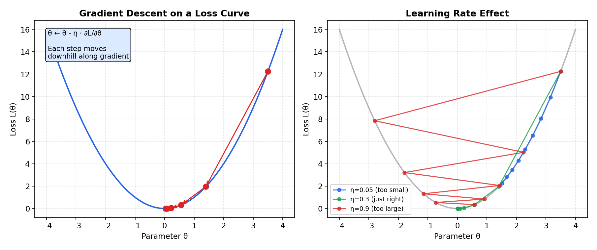
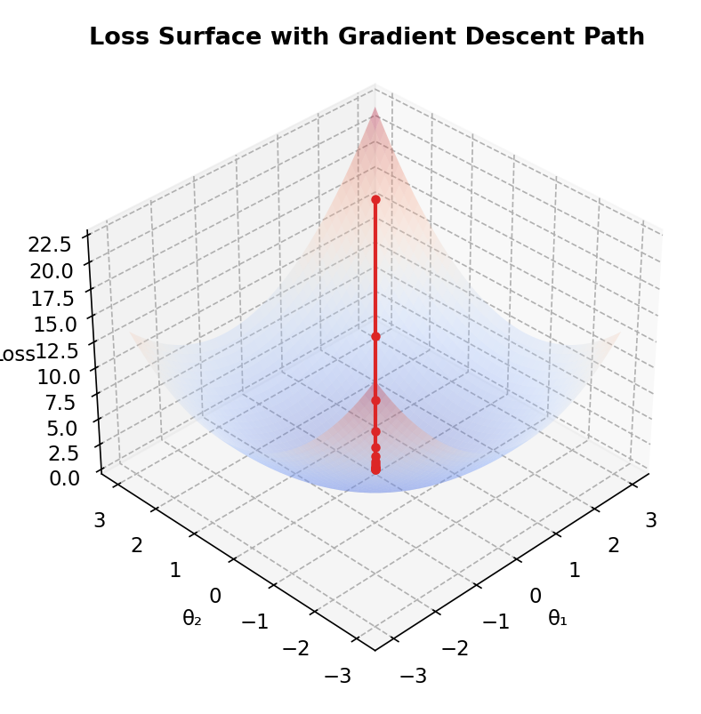
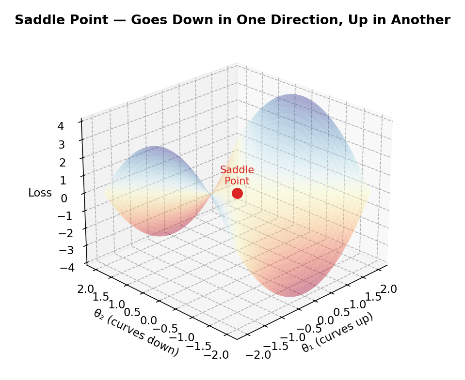

# Calculus & Optimization

> **🎯 Goal**: Understand how models learn — gradient descent is just a search algorithm
> **⏱ Time**: 2–3h study + 1h exercises
> **📦 Deliverable**: Intuition for how gradient descent "tunes" model parameters

---

## Table of Contents

1. [Derivatives as Rate of Change](#1-derivatives-as-rate-of-change)
2. [Partial Derivatives](#2-partial-derivatives)
3. [The Gradient](#3-the-gradient)
4. [Gradient Descent](#4-gradient-descent)
5. [Learning Rate](#5-learning-rate)
6. [Backpropagation](#6-backpropagation)
7. [Loss Functions](#7-loss-functions)

---

## 1. Derivatives as Rate of Change

### The Intuition (Backend Analogy)

You monitor your API's p99 latency over time. The derivative is the **rate of change** —
is latency going up or down, and how fast? If the derivative is positive, things are
getting worse. If it's negative, things are improving. The magnitude tells you how
urgently you need to act.

### How It Works

For a function f(x), the derivative f'(x) is the slope of the tangent line at point x.

```
  f(x)
   |
   |        .
   |      .  *  .              * = point of interest
   |    .  /      .            / = tangent line (slope = f'(x))
   |  .  /          .
   | . /              .
   |./                  .
   +----------------------------> x
```

- **f'(x) > 0**: function is increasing (going uphill)
- **f'(x) < 0**: function is decreasing (going downhill)
- **f'(x) = 0**: you're at a peak, valley, or flat spot

### The Math

**Formal definition (limit definition):**

```
  f'(x) = lim     f(x + h) - f(x)
           h→0    ─────────────────
                         h
```

**Key differentiation rules:**

```
  Power Rule:   d/dx(xⁿ) = n · x^(n-1)

  Sum Rule:     d/dx[f(x) + g(x)] = f'(x) + g'(x)

  Chain Rule:   d/dx f(g(x)) = f'(g(x)) · g'(x)
                "derivative of the outside × derivative of the inside"
```

**Worked example — differentiate f(x) = 3x² + 2x:**

```
  f(x)  = 3x² + 2x

  Apply power rule to each term:
    d/dx(3x²) = 3 · 2 · x^(2-1) = 6x
    d/dx(2x)  = 2 · 1 · x^(1-1) = 2

  f'(x) = 6x + 2

  At x = 1:  f'(1) = 6(1) + 2 = 8   → slope is 8 (steeply increasing)
  At x = 0:  f'(0) = 6(0) + 2 = 2   → slope is 2 (gently increasing)
  At x = -1/3: f'(-1/3) = 0          → flat (local minimum)
```

**Chain rule worked example — differentiate f(x) = (2x + 1)³:**

```
  Let g(x) = 2x + 1   (inner function)
  Let f(u) = u³        (outer function)

  f'(g(x)) = 3(2x + 1)²     (derivative of outer, evaluated at inner)
  g'(x)    = 2               (derivative of inner)

  d/dx (2x + 1)³ = 3(2x + 1)² · 2 = 6(2x + 1)²
```

**Connection to ML:** Every time a framework computes a gradient, it's applying these
rules automatically. The chain rule is especially critical — it's the engine behind
backpropagation (Section 6).

### Recipe

```python
import numpy as np

def numerical_derivative(f, x, h=1e-7):
    """Approximate f'(x) using finite differences."""
    return (f(x + h) - f(x - h)) / (2 * h)

f = lambda x: x**2 - 4*x + 4   # (x-2)^2
x = 5.0
print(f"f'({x}) = {numerical_derivative(f, x):.4f}")  # ~6.0
print(f"f'(2.0) = {numerical_derivative(f, 2.0):.4f}")  # ~0.0 (minimum)
```

### When to Use

Whenever you need to know **how sensitive** an output is to a single input.
In ML, this is the foundation — everything builds on this idea.

---

## 2. Partial Derivatives

### The Intuition (Backend Analogy)

Your service has multiple knobs: thread pool size, cache TTL, connection pool limit.
A partial derivative answers: "If I turn **just this one knob**, how much does latency
change?" — exactly like A/B testing one variable at a time while holding others fixed.

### How It Works

For f(x, y), the partial derivative ∂f/∂x means: treat y as a constant, differentiate
with respect to x only.

```
  Example: f(x, y) = x² + 2xy + y²

  ∂f/∂x = 2x + 2y     (how f changes when only x moves)
  ∂f/∂y = 2x + 2y     (how f changes when only y moves)
```

```
  y
  ^
  |  hold y fixed at y₀
  |  - - - - - - * - - - - ->  vary x, measure slope
  |              |
  |              | hold x fixed at x₀
  |              |
  |              v  vary y, measure slope
  +-----------------------------> x
```

### The Math

**Formal definition:**

```
  ∂f          f(x₁, ..., xᵢ + h, ..., xₙ) - f(x₁, ..., xᵢ, ..., xₙ)
  ──── = lim  ──────────────────────────────────────────────────────────
  ∂xᵢ   h→0                            h

  Key idea: treat ALL other variables as constants, differentiate w.r.t. xᵢ only.
```

The gradient ∇f — all partial derivatives collected into one vector — is
detailed in Section 3.

**Worked example — f(x, y) = x² + 3xy:**

```
  Step 1: ∂f/∂x  (treat y as constant)
    ∂/∂x (x²) = 2x
    ∂/∂x (3xy) = 3y        (y is just a constant coefficient)
    ∂f/∂x = 2x + 3y

  Step 2: ∂f/∂y  (treat x as constant)
    ∂/∂y (x²) = 0          (x² is a constant w.r.t. y)
    ∂/∂y (3xy) = 3x        (x is just a constant coefficient)
    ∂f/∂y = 3x

  Gradient: ∇f = [2x + 3y,  3x]

  At (x, y) = (1, 2):
    ∇f = [2(1) + 3(2),  3(1)] = [8, 3]
    → f increases fastest in the direction [8, 3]
    → to MINIMIZE f, move in direction [-8, -3]
```

**Connection to ML:** A neural network with millions of parameters has a loss function
L(w₁, w₂, ..., wₙ). The gradient ∇L tells each weight which direction and how much to
adjust. This is computed efficiently by backpropagation.

### Recipe

```python
import numpy as np

def partial_derivative(f, params, idx, h=1e-7):
    """Partial derivative of f with respect to params[idx]."""
    params_plus = params.copy()
    params_minus = params.copy()
    params_plus[idx] += h
    params_minus[idx] -= h
    return (f(params_plus) - f(params_minus)) / (2 * h)

f = lambda p: p[0]**2 + p[1]**2  # bowl-shaped
params = np.array([3.0, 4.0])
print(f"∂f/∂x = {partial_derivative(f, params, 0):.2f}")  # ~6.0
print(f"∂f/∂y = {partial_derivative(f, params, 1):.2f}")  # ~8.0
```

### When to Use

When your model has multiple parameters (they all do). Each weight gets its own
partial derivative telling it which direction to adjust.

---

## 3. The Gradient

### The Intuition (Backend Analogy)

Imagine a topographic map of your system's error rate across two config params. The
gradient is a **compass arrow** pointing directly uphill — toward the steepest increase.
In ML, we go the **opposite** direction (downhill = less error). It's the vector that
says "move this way to improve the fastest."

### How It Works

The gradient ∇f is the vector of all partial derivatives:

```
  ∇f = [ ∂f/∂x₁, ∂f/∂x₂, ..., ∂f/∂xₙ ]
```

```
  Loss surface (contour plot, top-down view):

    .  .  .  . ←─┐ .  .  .  .      Arrows show -∇f
    .  .  .  .  . ↙  .  .  .       (direction we move
    .  .  .  .  [*]  .  .  .       toward minimum [*])
    .  .  .  .  ↗ .  .  .  .
    .  .  .  ┌─→ .  .  .  .
```

### The Math

**Formal definition:**

```
  For f: ℝⁿ → ℝ, the gradient is the vector of all partial derivatives:

  ∇f(x) = [ ∂f/∂x₁, ∂f/∂x₂, ..., ∂f/∂xₙ ]ᵀ ∈ ℝⁿ
```

**Key properties:**

```
  1. ∇f points in the direction of steepest ASCENT
  2. -∇f points in the direction of steepest DESCENT (this is what GD uses)
  3. ‖∇f‖ = magnitude = how steep the slope is
  4. At a minimum: ∇f = 0 (zero vector — no direction to go)
```

**Worked example — f(x, y) = (x - 1)² + (y + 2)²:**

```
  This is a bowl-shaped surface with minimum at (1, -2).

  ∂f/∂x = 2(x - 1)
  ∂f/∂y = 2(y + 2)

  ∇f = [2(x - 1), 2(y + 2)]

  At (5, 3):
    ∇f = [2(5-1), 2(3+2)] = [8, 10]
    ‖∇f‖ = √(8² + 10²) = √164 ≈ 12.8  (steep!)
    Direction to minimize: -[8, 10] → move toward (1, -2)

  At (1.1, -1.9):
    ∇f = [0.2, 0.2]
    ‖∇f‖ = √(0.04 + 0.04) ≈ 0.28  (nearly flat — close to minimum)
```

**Connection to ML:** The gradient magnitude tells you how far you are from a minimum.
Large gradients mean big updates; near convergence, gradients shrink and steps get
smaller — a natural "braking" effect.

### Recipe

```python
import numpy as np

def compute_gradient(f, params, h=1e-7):
    """Compute gradient vector (all partial derivatives)."""
    grad = np.zeros_like(params)
    for i in range(len(params)):
        params_plus = params.copy(); params_plus[i] += h
        params_minus = params.copy(); params_minus[i] -= h
        grad[i] = (f(params_plus) - f(params_minus)) / (2 * h)
    return grad

f = lambda p: (p[0] - 1)**2 + (p[1] + 2)**2  # minimum at (1, -2)
params = np.array([5.0, 3.0])
print(f"Gradient: {compute_gradient(f, params)}")  # [8.0, 10.0]
print("Move OPPOSITE to gradient to reduce loss")
```

### When to Use

Every training step in ML computes a gradient. It's the signal that tells each
parameter how to update. No gradient = no learning.

---

## 4. Gradient Descent

### The Intuition (Backend Analogy)

Binary search finds the answer in a sorted array by repeatedly halving the search space.
Gradient descent finds the minimum of a function by repeatedly stepping downhill. Each
step, you ask "which way is down?" (the gradient) and take a step in that direction.

### How It Works

```
  The optimization loop:
  ┌──────────────────────────────────┐
  │  repeat until converged:         │
  │    1. Compute loss L(params)     │
  │    2. Compute gradient ∇L        │
  │    3. params = params - lr * ∇L  │
  └──────────────────────────────────┘
```

```
  Descent path on a loss curve:

  Loss
   | *                          * = start (x=10)
   |   \ *                      Each step moves downhill
   |      \ *                   by learning_rate × gradient
   |         *  *  *
   |                 *--*       Converges near minimum
   +──────────────────────→ x (minimum)
```

**Three flavors — like database query strategies:**

```
  ┌─────────────────────────────────────────────────────────┐
  │  Full Batch         │  Use ALL data each step           │
  │  (full table scan)  │  Accurate but slow & memory-heavy │
  ├─────────────────────┼───────────────────────────────────┤
  │  Stochastic (SGD)   │  Use ONE random sample each step  │
  │  (random sampling)  │  Noisy but fast & memory-light    │
  ├─────────────────────┼───────────────────────────────────┤
  │  Mini-batch          │  Use a BATCH (32-512 samples)    │
  │  (pagination)        │  Best of both — the default      │
  └──────────────────────┴──────────────────────────────────┘
```

### The Math

**The update rule:**

```
  θ_{t+1} = θ_t - η · ∇L(θ_t)

  Where:
    θ_t   = parameters at step t
    η     = learning rate (scalar, e.g., 0.001)
    ∇L    = gradient of loss w.r.t. parameters
    θ_{t+1} = updated parameters
```

**For MSE loss with linear model ŷ = Xθ:**

```
  Loss:     L(θ) = (1/2n) Σᵢ (yᵢ - ŷᵢ)²

  Gradient: ∇L(θ) = (1/n) Xᵀ(Xθ - y)

  Update:   θ_{t+1} = θ_t - (η/n) Xᵀ(Xθ_t - y)
```

**Worked example — minimize f(x) = (x - 3)² + 1, starting at x = 10:**

```
  f'(x) = 2(x - 3),   η = 0.1

  Step 0: x = 10.0    f'(10) = 14.0    x ← 10.0 - 0.1 × 14.0 = 8.6
  Step 1: x = 8.6     f'(8.6) = 11.2   x ← 8.6  - 0.1 × 11.2 = 7.48
  Step 2: x = 7.48    f'(7.48) = 8.96  x ← 7.48 - 0.1 × 8.96 = 6.584
  ...
  Step 10: x ≈ 3.79   f'(3.79) ≈ 1.58  x ← 3.79 - 0.1 × 1.58 ≈ 3.63
  ...
  Step 30: x ≈ 3.001  f(x) ≈ 1.000    (converged!)

  Each step, x gets closer to 3 (the minimum) and the gradient shrinks.
```

**Convergence condition:**

```
  Gradient descent converges when: 0 < η < 2 / L_max

  Where L_max is the Lipschitz constant of the gradient (largest eigenvalue
  of the Hessian). For f(x) = (x-3)², the Hessian is f''(x) = 2, so:
    η < 2/2 = 1.0  → any lr < 1.0 will converge
```

**SGD vs. Mini-batch vs. Full Batch:**

```
  Gradient estimates:
    Full Batch:  ∇L = (1/n) Σᵢ₌₁ⁿ ∇Lᵢ     (all n samples)
    SGD:         ∇L ≈ ∇Lᵢ                   (1 random sample)
    Mini-batch:  ∇L ≈ (1/B) Σⱼ₌₁ᴮ ∇Lⱼ     (B samples)

  Variance decreases with batch size: Var(∇L_batch) = Var(∇Lᵢ) / B
```



*Steps on a parabola showing how gradient descent converges to the minimum,
plus the effect of different learning rates.*



*A 3D loss surface showing the gradient descent path navigating toward the
global minimum through a valley.*

### Recipe

```python
import numpy as np

def gradient_descent(f, df, x_init, lr=0.1, steps=50):
    """Minimize f starting from x_init."""
    x = x_init
    for i in range(steps):
        grad = df(x)
        x = x - lr * grad
        if i % 10 == 0:
            print(f"  step {i:3d}: x={x:.4f}, f(x)={f(x):.4f}")
    return x

f  = lambda x: (x - 3)**2 + 1       # minimum at x=3, f(3)=1
df = lambda x: 2 * (x - 3)           # derivative
result = gradient_descent(f, df, x_init=10.0, lr=0.1)
print(f"Found minimum at x={result:.4f}")  # ~3.0
```

### When to Use

**Always.** Gradient descent (or a variant like Adam) is how virtually every neural
network is trained. Understanding this loop is the single most important concept in ML.

---

## 5. Learning Rate

### The Intuition (Backend Analogy)

Learning rate is like the step size in auto-scaling:
- **Too high** → You scale from 2 to 200 instances, then back to 2, then 200…
  The system oscillates and never stabilizes. (Overshooting the minimum.)
- **Too low** → You scale by 1 instance at a time. Eventually you get there,
  but your users are already gone. (Converges too slowly.)

### How It Works

```
  TOO HIGH (lr = 1.0):           JUST RIGHT (lr = 0.1):     TOO LOW (lr = 0.001):

  Loss                           Loss                        Loss
   |                              |                           |
   |  *     *     *               | *                         | *
   |   \   / \   / \              |  \                        |  *
   |    \ /   \ /   \             |   *                       |   *
   |     *     *     *            |    *                      |    *
   |    DIVERGES!                 |     *  *  *               |     *
   |                              |          minimum          |      *
   +-----------> steps            +-----------> steps         |       *  *  *
                                                              |  (still going...)
                                                              +-----------> steps
```

Common learning rates: 0.001 to 0.01 (a safe starting point is **0.001**).

### The Math

**Formal effect on the update step:**

```
  θ_{t+1} = θ_t - η · ∇L(θ_t)

  Too small η:  |θ_{t+1} - θ_t| is tiny → slow convergence
  Too large η:  θ oscillates across minimum → divergence
  Just right η: steady decrease in L → convergence
```

**Learning rate schedules:**

```
  Step Decay:
    η_t = η₀ · γ^(⌊t / step_size⌋)

    Example: η₀=0.01, γ=0.5, step_size=10 → η halves every 10 epochs

  Cosine Annealing:
    η_t = η_min + (η_max - η_min) / 2 · (1 + cos(π · t / T))

    Smoothly decreases from η_max to η_min over T steps.

  Warm-up + Decay (common in transformers):
    Phase 1 (t < T_warm): η_t = η_max · (t / T_warm)     (linear increase)
    Phase 2 (t ≥ T_warm): η_t = η_max · decay(t)          (cosine/step decay)
```

**Worked example — step decay effect on convergence:**

```
  Minimize f(x) = (x - 3)², starting at x = 10, γ = 0.5, step_size = 5

  Steps 0–4 (η = 0.1):   x: 10.0 → 8.6 → 7.48 → 6.58 → 5.87 → 5.30
  Steps 5–9 (η = 0.05):  x: 5.30 → 5.07 → 4.86 → 4.67 → 4.51 → 4.36
  Steps 10–14 (η = 0.025): x: 4.36 → 4.29 → 4.22 → 4.16 → 4.10 → 4.05

  Large steps early (fast progress), smaller steps later (precise convergence).
```

**Connection to ML:** Most modern training uses warm-up + cosine annealing.
Warm-up prevents early instability (gradients are unreliable when weights are random),
and annealing fine-tunes the final solution.

### Recipe

```python
import numpy as np

def show_lr_effect(lr, x_init=10.0, steps=20):
    """Demonstrate learning rate effect on f(x) = (x-3)^2 + 1."""
    x = x_init
    for i in range(steps):
        grad = 2 * (x - 3)
        x = x - lr * grad
    return x

for lr in [0.001, 0.1, 1.0]:
    result = show_lr_effect(lr)
    print(f"lr={lr:<6} -> x={result:>12.4f}  ({'diverged' if abs(result) > 1e6 else 'ok'})")
```

### When to Use

Tuning the learning rate is **the first thing** you do when a model isn't training well.
Before touching architecture, data, or anything else — check the learning rate.

---

## 6. Backpropagation

### The Intuition (Backend Analogy)

When your API returns a 500 error, you look at the **stack trace** — it tells you
exactly which function in which layer caused the problem. Backpropagation works the
same way: it traces the error backwards through the network, telling each layer
"here's how much you contributed to the mistake."

Each layer **passes blame** to the layer before it, proportional to how much it
amplified or dampened the signal. This is the **chain rule** from calculus.

### How It Works

```
  Forward pass (compute prediction):

  Input → [Layer 1] → [Layer 2] → [Layer 3] → Prediction
                                                    |
                                                    v
                                               Loss = 4.2

  Backward pass (assign blame via chain rule):

  Input ← [Layer 1] ← [Layer 2] ← [Layer 3] ← ∂Loss/∂pred
           "my fault    "my fault    "my fault
            was 0.1"     was 0.8"     was 2.3"
```

**The chain rule** makes this work:

```
  If  y = f(g(x)):   dy/dx = dy/dg · dg/dx

  Pipeline:  x → [g] → [f] → y
  Each layer multiplies the error signal — like compound interest.
```

### The Math

**Chain rule through network layers:**

```
  For a network: input x → z = Wx + b → a = f(z) → L(a, y)

  The key derivatives (working backwards from loss):

  ∂L/∂a  = direct from loss function
  ∂L/∂z  = ∂L/∂a · ∂a/∂z = ∂L/∂a · f'(z)           (activation gradient)
  ∂L/∂W  = ∂L/∂z · ∂z/∂W = ∂L/∂z · xᵀ               (weight gradient)
  ∂L/∂b  = ∂L/∂z · ∂z/∂b = ∂L/∂z · 1                 (bias gradient)
  ∂L/∂x  = ∂L/∂z · ∂z/∂x = Wᵀ · ∂L/∂z               (input gradient — passed to prev layer)
```

**General backprop formula for layer l:**

```
  Error signal:    δ^(l) = (W^(l+1))ᵀ · δ^(l+1) ⊙ f'(z^(l))

  Weight gradient:  ∂L/∂W^(l) = δ^(l) · (a^(l-1))ᵀ

  Bias gradient:    ∂L/∂b^(l) = δ^(l)

  Where:
    ⊙ = element-wise (Hadamard) product
    δ^(l) = error signal at layer l
    a^(l-1) = activations from previous layer
    f'(z^(l)) = derivative of activation function at layer l
```

**Worked example — 2-layer network, one training sample:**

```
  Network:  x → [W₁, b₁] → ReLU → [W₂, b₂] → ŷ → MSE Loss

  Given: x = 2, y = 1 (true label)
         W₁ = 0.5, b₁ = 0.1, W₂ = -0.3, b₂ = 0.2

  ── Forward Pass ──
  z₁ = W₁·x + b₁ = 0.5(2) + 0.1 = 1.1
  a₁ = ReLU(z₁) = max(0, 1.1) = 1.1
  z₂ = W₂·a₁ + b₂ = -0.3(1.1) + 0.2 = -0.13
  ŷ  = z₂ = -0.13  (linear output for regression)
  L  = (ŷ - y)² = (-0.13 - 1)² = (-1.13)² = 1.2769

  ── Backward Pass ──
  ∂L/∂ŷ  = 2(ŷ - y) = 2(-1.13) = -2.26

  Layer 2:
    δ₂     = ∂L/∂z₂ = ∂L/∂ŷ · 1 = -2.26
    ∂L/∂W₂ = δ₂ · a₁ = -2.26 × 1.1 = -2.486
    ∂L/∂b₂ = δ₂ = -2.26

  Layer 1:
    δ₁     = W₂ᵀ · δ₂ ⊙ ReLU'(z₁) = (-0.3)(-2.26) × 1 = 0.678
             (ReLU'(1.1) = 1 since z₁ > 0)
    ∂L/∂W₁ = δ₁ · x = 0.678 × 2 = 1.356
    ∂L/∂b₁ = δ₁ = 0.678

  ── Update (η = 0.1) ──
    W₂ ← -0.3  - 0.1(-2.486)  = -0.3 + 0.2486  = -0.0514
    b₂ ← 0.2   - 0.1(-2.26)   = 0.2 + 0.226    = 0.426
    W₁ ← 0.5   - 0.1(1.356)   = 0.5 - 0.1356   = 0.3644
    b₁ ← 0.1   - 0.1(0.678)   = 0.1 - 0.0678   = 0.0322
```

**Connection to ML:** This is exactly what PyTorch's `loss.backward()` computes, but
for millions of parameters simultaneously. Understanding this example helps you debug
vanishing gradients (δ shrinks through many layers) and exploding gradients (δ grows).

### Recipe

```python
import numpy as np

# Manual backprop for y = (wx + b)^2 (a tiny "network")
w, b, x = 2.0, 1.0, 3.0
lr = 0.01

# Forward pass
z = w * x + b          # linear: z = 7
y = z ** 2             # square: y = 49

# Backward pass (chain rule)
dy_dz = 2 * z          # = 14
dz_dw = x              # = 3
dz_db = 1              # = 1
dy_dw = dy_dz * dz_dw  # = 42 (gradient for w)
dy_db = dy_dz * dz_db  # = 14 (gradient for b)

w -= lr * dy_dw         # update w
b -= lr * dy_db         # update b
print(f"Updated: w={w:.2f}, b={b:.2f}")
```

### When to Use

You rarely implement backprop yourself — frameworks (PyTorch, TensorFlow) do it
automatically. But understanding it tells you **why** certain architectures train
poorly (vanishing/exploding gradients) and how to fix them.

---

## 7. Loss Functions

### The Intuition (Backend Analogy)

A loss function is your **error metric** — like p99 latency or error rate for your
service. It's a single number that answers: "How wrong is the model right now?"
Training is just minimizing this number.

Different problems need different metrics:
- **Regression** (predicting a number): "How far off am I?" → **MSE**
- **Classification** (predicting a category): "How surprised am I?" → **Cross-Entropy**

### How It Works

**MSE (Mean Squared Error)** — for regression:

```
  MSE = (1/n) * Σ(predicted - actual)²

  Why squared? Penalizes big errors MORE than small ones.

  Error:   -3   -1    0   +1   +3
  Squared:  9    1    0    1    9    ← big misses hurt A LOT
```

**Cross-Entropy** — for classification:

```
  CE = -Σ actual * log(predicted)

  Intuition: How SURPRISED are you by the prediction?

  True label: cat (1.0)
    Model says 90% cat → CE = -log(0.9) = 0.10  (not surprised)
    Model says 10% cat → CE = -log(0.1) = 2.30  (very surprised!)
```

```
  Surprise curve (-log(p)):

  Loss  5|*
        3|  *            Near 0: WRONG + confident → huge loss
        1|     *  *  *   Near 1: RIGHT + confident → tiny loss
        0+────────────→ p(correct class)
         0  0.2  0.5  1.0
```

### The Math

**MSE (Mean Squared Error) — formal definition and gradient:**

```
  L_MSE = (1/n) Σᵢ₌₁ⁿ (yᵢ - ŷᵢ)²

  Gradient w.r.t. ŷ:  ∂L/∂ŷᵢ = -2(yᵢ - ŷᵢ) / n = 2(ŷᵢ - yᵢ) / n
```

**Worked MSE example:**

```
  Predictions: ŷ = [2.5, 5.5]
  True values: y  = [3.0, 5.0]

  L = (1/2) [(3.0 - 2.5)² + (5.0 - 5.5)²]
    = (1/2) [0.25 + 0.25]
    = 0.25

  Gradients: ∂L/∂ŷ₁ = 2(2.5 - 3.0)/2 = -0.5  (predicted too low → push up)
             ∂L/∂ŷ₂ = 2(5.5 - 5.0)/2 =  0.5  (predicted too high → push down)
```

**Binary Cross-Entropy — formal definition and gradient:**

```
  L_BCE = -(1/n) Σᵢ₌₁ⁿ [ yᵢ · log(pᵢ) + (1 - yᵢ) · log(1 - pᵢ) ]

  Where pᵢ = σ(zᵢ) = predicted probability, yᵢ ∈ {0, 1}

  Gradient w.r.t. pᵢ:  ∂L/∂pᵢ = -(yᵢ/pᵢ) + (1-yᵢ)/(1-pᵢ)
                                 = (pᵢ - yᵢ) / (pᵢ(1 - pᵢ))
```

**Deriving Cross-Entropy from Maximum Likelihood Estimation (MLE):**

```
  For binary classification, each sample has likelihood:
    P(yᵢ | pᵢ) = pᵢ^yᵢ · (1 - pᵢ)^(1-yᵢ)

  Joint likelihood over n samples:
    L = Πᵢ₌₁ⁿ pᵢ^yᵢ · (1 - pᵢ)^(1-yᵢ)

  Log-likelihood:
    log L = Σᵢ [ yᵢ · log(pᵢ) + (1 - yᵢ) · log(1 - pᵢ) ]

  Maximizing log-likelihood = Minimizing NEGATIVE log-likelihood:
    NLL = -Σᵢ [ yᵢ · log(pᵢ) + (1 - yᵢ) · log(1 - pᵢ) ]

  This IS cross-entropy!  CE = NLL / n
```

**Worked Cross-Entropy example:**

```
  True label:  y = 1 (positive class)
  Prediction:  p = 0.9

  L = -[1 · log(0.9) + 0 · log(0.1)]
    = -log(0.9)
    = -(-0.105)
    = 0.105  (low loss — model is correct and confident)

  If prediction were p = 0.1:
  L = -log(0.1) = 2.303  (high loss — model is wrong and confident!)
```

**Saddle points** — where ∇L = 0 but it's neither minimum nor maximum.
Momentum-based optimizers (Adam, SGD+momentum) help escape these.



**Connection to ML:** MSE works for regression but has weak gradients far from the target.
Cross-entropy produces strong gradients for confident wrong predictions — the standard for classification.

### Recipe

```python
import numpy as np

def mse(y_true, y_pred):
    """Mean Squared Error — for regression."""
    return np.mean((y_true - y_pred) ** 2)

def cross_entropy(y_true, y_pred):
    """Binary Cross-Entropy — for classification."""
    y_pred = np.clip(y_pred, 1e-15, 1 - 1e-15)  # avoid log(0)
    return -np.mean(y_true * np.log(y_pred) + (1 - y_true) * np.log(1 - y_pred))

# Regression example
print(f"MSE: {mse(np.array([3.0, 5.0]), np.array([2.5, 5.5])):.4f}")

# Classification example
print(f"CE (good): {cross_entropy(np.array([1.0]), np.array([0.9])):.4f}")
print(f"CE (bad):  {cross_entropy(np.array([1.0]), np.array([0.1])):.4f}")
```

### When to Use

| Problem Type | Loss Function | Example |
|---|---|---|
| Predict a number | MSE | House prices, temperature |
| Yes/No decision | Binary Cross-Entropy | Spam detection, fraud |
| Pick one of N classes | Categorical Cross-Entropy | Image classification |

---

## Exercises

### Exercise 1: Conceptual

> Your model's loss is decreasing but very slowly. You double the learning rate and
> now the loss oscillates wildly. Explain what's happening using the gradient descent
> analogy.

### Exercise 2: Implementation

> Implement gradient descent for `y = (x-3)² + 1` from scratch in NumPy.
> Find the minimum starting from `x = 10`.

### Exercise 3: Real-World Scenario

> Your team trains a model overnight but the loss hasn't decreased at all after
> 1000 epochs. List 3 things you'd check, in order.

---

## Solutions

### Solution 1

With the original (small) learning rate, each step moved slightly downhill — progress
was real but slow. Doubling the rate made each step **overshoot** the minimum. Imagine
standing on one side of a valley and taking such a big step that you end up even higher
on the opposite wall. Next step you overshoot back. The steps keep bouncing across the
minimum, never settling in — that's the oscillation.

**Fix:** Increase the learning rate **gradually** (e.g., 1.5× instead of 2×), or use
an adaptive optimizer like Adam that adjusts the rate automatically.

### Solution 2

```python
import numpy as np

f  = lambda x: (x - 3)**2 + 1
df = lambda x: 2 * (x - 3)

x = 10.0
lr = 0.1

for i in range(100):
    grad = df(x)
    x = x - lr * grad
    if i % 20 == 0:
        print(f"step {i:3d}: x={x:.6f}, loss={f(x):.6f}")

print(f"\nMinimum at x={x:.4f}, f(x)={f(x):.4f}")
# Expected: x ≈ 3.0, f(x) ≈ 1.0
```

### Solution 3

Check in this order (most common causes first):

1. **Learning rate too low (or too high).** Plot the loss curve. If flat from the
   start, the rate may be too low. If it spiked early then flatlined, it may have
   diverged. Try `lr = 0.001` and `lr = 0.0001` and compare.

2. **Data pipeline bug.** Verify that training data is actually reaching the model
   correctly. Check for: labels mismatched with features, all-zero inputs after
   normalization, or a shuffle bug that feeds the same batch repeatedly.

3. **Model architecture issue.** If using deep networks, check for vanishing gradients
   (print gradient norms per layer). Ensure activation functions are appropriate (ReLU
   for hidden layers, not sigmoid, which saturates). Verify the output layer matches
   your loss function (sigmoid + BCE, softmax + CE).

---

## Key Takeaways

```
  ┌───────────────────────────────────────────────────────────┐
  │  Concept              │  Backend Analogy                  │
  ├───────────────────────┼───────────────────────────────────┤
  │  Derivative           │  Rate of change (monitoring)      │
  │  Partial derivative   │  A/B test one variable            │
  │  Gradient             │  Compass pointing uphill          │
  │  Gradient descent     │  Binary search for minimum        │
  │  Learning rate        │  Auto-scaling step size           │
  │  Backpropagation      │  Stack trace for blame            │
  │  Loss function        │  Error metric (p99, error rate)   │
  └───────────────────────┴───────────────────────────────────┘
```

**Next chapter:** [03 - Linear Algebra for ML →](03-linear-algebra.md)
