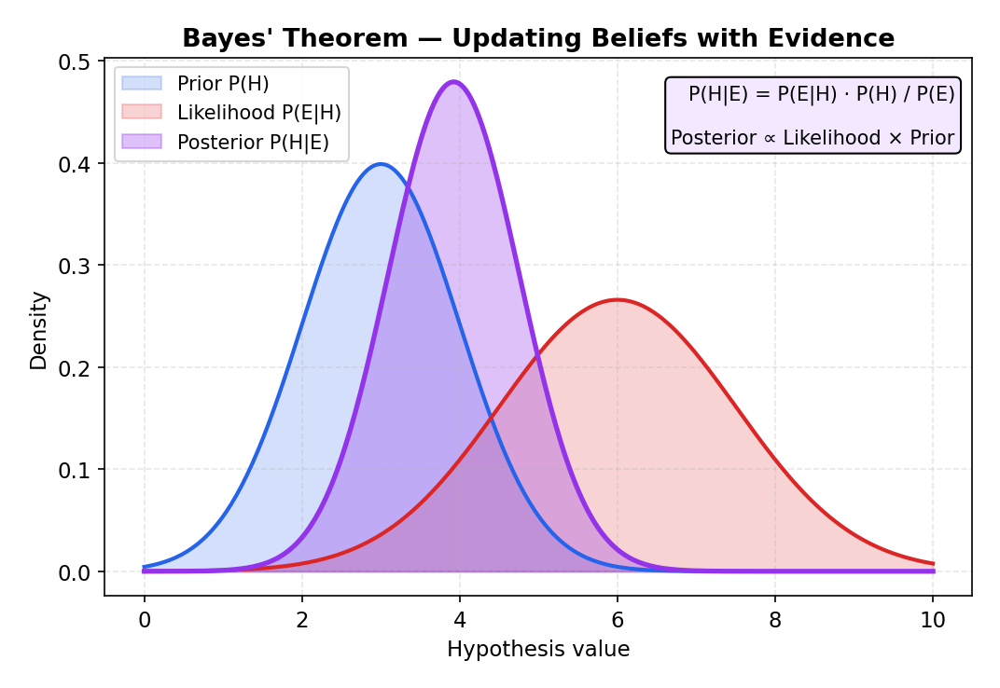
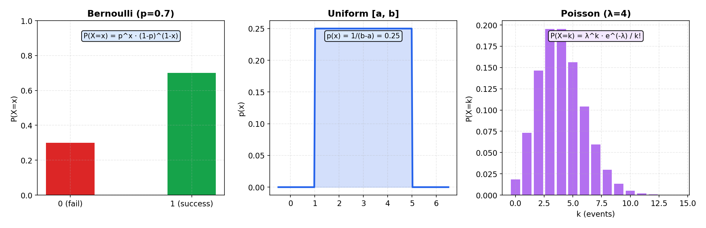
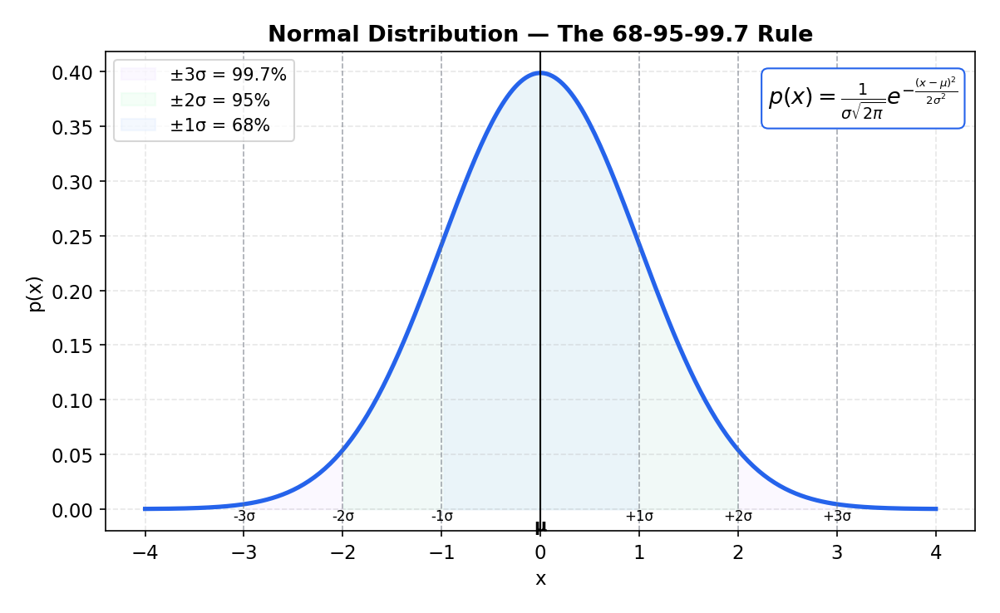

# Probability & Statistics for ML

> **🎯 Goal**: Understand the statistical foundations that ML models rely on
> **⏱ Time**: 2–3h study + 1h exercises
> **📦 Deliverable**: Intuition for distributions, Bayes' theorem, and loss functions

---

## Table of Contents

1. [Probability Basics](#1-probability-basics)
2. [Bayes' Theorem](#2-bayes-theorem)
3. [Distributions](#3-distributions)
4. [Expected Value & Variance](#4-expected-value--variance)
5. [Loss Functions in Depth](#5-loss-functions-in-depth)
6. [Maximum Likelihood Estimation (MLE)](#6-maximum-likelihood-estimation-mle)
7. [Sampling & Central Limit Theorem](#7-sampling--central-limit-theorem)

---

## 1. Probability Basics

### Intuition (Backend Analogy)

You already think in probabilities. An SLA of 99.9% uptime means P(server_up) = 0.999.
Conditional probability is the same idea scoped to a context: "What's the probability of
a slow response *given* high traffic?" — that's P(slow | high_traffic).

**Key rules:**

| Rule | Formula | System Example |
|------|---------|----------------|
| Complement | P(down) = 1 − P(up) | If uptime is 0.999, downtime is 0.001 |
| Joint (independent) | P(A ∩ B) = P(A) × P(B) | P(both replicas down) = 0.001 × 0.001 |
| Conditional | P(A \| B) = P(A ∩ B) / P(B) | P(slow \| peak_hour) |
| Union | P(A ∪ B) = P(A) + P(B) − P(A ∩ B) | P(server1 OR server2 fails) |

**Independent events** — two events don't affect each other. Replica A crashing doesn't
change the probability of Replica B crashing (assuming no shared dependencies). This is
why we multiply: P(both down) = P(A down) × P(B down).

```
Three 9s reliability across 2 independent replicas:

  P(replica down)  = 0.001
  P(both down)     = 0.001 × 0.001 = 0.000001  (six 9s!)
  P(at least 1 up) = 1 − 0.000001 = 0.999999
```

**The Math:**

```
  Addition Rule (union of events):
    P(A ∪ B) = P(A) + P(B) − P(A ∩ B)

  Conditional Probability:
    P(A|B) = P(A ∩ B) / P(B),  where P(B) > 0

  Independence (two events don’t affect each other):
    A ⊥ B  ⇔  P(A ∩ B) = P(A) · P(B)

  Chain Rule (generalised conditional):
    P(A ∩ B) = P(A|B) · P(B) = P(B|A) · P(A)
```

### Recipe

```python
# Conditional probability from logs
total_requests = 100_000
peak_requests  = 30_000
slow_total     = 5_000
slow_and_peak  = 4_000

p_slow_given_peak = slow_and_peak / peak_requests  # 0.133
p_slow_overall    = slow_total / total_requests     # 0.05
print(f"Slow|Peak: {p_slow_given_peak:.3f} vs overall: {p_slow_overall:.3f}")
```

### When to Use

- **Feature engineering**: P(click | user_segment) helps you decide which features matter.
- **Model evaluation**: Precision = P(actually_positive | predicted_positive).
- **System design**: Redundancy calculations, A/B test sizing.

---

## 2. Bayes' Theorem

### Intuition (Backend Analogy)

Bayes' theorem is how you **update beliefs with new evidence** — like updating a cache.

You start with a **prior** (your initial belief), observe **evidence**, and compute a
**posterior** (updated belief). Every on-call engineer does this intuitively: "The
database is usually fine (prior), but I see timeouts in the logs (evidence), so now I
think the DB is probably the root cause (posterior)."

```
                    Bayes' Theorem
  ┌─────────────────────────────────────────────┐
  │                                             │
  │             P(A|B) × P(B)                   │
  │  P(B|A) = ─────────────────                 │
  │                 P(A)                         │
  │                                             │
  │  posterior = likelihood × prior / evidence  │
  │                                             │
  └─────────────────────────────────────────────┘
```

### How It Works — Spam Filter Example

An email contains the word "free". Is it spam?

```
  Known:
    P(spam)             = 0.3       ← prior: 30% of all email is spam
    P("free" | spam)    = 0.8       ← likelihood: 80% of spam has "free"
    P("free" | not_spam)= 0.1       ← 10% of legit email has "free"

  Step 1 — Total probability of seeing "free":
    P("free") = P("free"|spam)×P(spam) + P("free"|not_spam)×P(not_spam)
              = 0.8 × 0.3  +  0.1 × 0.7
              = 0.24 + 0.07
              = 0.31

  Step 2 — Apply Bayes:
    P(spam | "free") = P("free"|spam) × P(spam) / P("free")
                     = 0.8 × 0.3 / 0.31
                     = 0.774

  Result: 77.4% chance it's spam!
```

The flow of information:

```
  ┌──────────┐     ┌──────────────┐     ┌─────────────┐
  │  PRIOR   │     │   EVIDENCE   │     │ POSTERIOR    │
  │          │────▶│              │────▶│              │
  │ P(spam)  │     │ word="free"  │     │ P(spam|free) │
  │ = 0.30   │     │ P(free)=0.31 │     │ = 0.774      │
  └──────────┘     └──────────────┘     └─────────────┘
       ▲                  ▲
       │                  │
   Historical         Observation
     data              (new email)
```

**The Math:**

```
  Bayes’ Theorem:
    P(H|E) = P(E|H) · P(H) / P(E)

  where:
    H = hypothesis,  E = observed evidence

  Law of Total Probability (denominator):
    P(E) = Σₕ P(E|H=h) · P(H=h)
         = P(E|H) · P(H) + P(E|¬H) · P(¬H)

  Worked example (spam detection):
    P(spam)           = 0.30   ← prior
    P("free"|spam)    = 0.80   ← likelihood
    P("free"|¬spam)   = 0.10

    P("free") = 0.80 × 0.30 + 0.10 × 0.70 = 0.31   (total probability)
    P(spam|"free") = 0.80 × 0.30 / 0.31 = 0.774       (posterior)
```



### Recipe

```python
def bayes(p_b_given_a, p_a, p_b):
    """P(A|B) = P(B|A) * P(A) / P(B)"""
    return (p_b_given_a * p_a) / p_b

p_spam = 0.3
p_free_given_spam = 0.8
p_free_given_ham  = 0.1
p_free = p_free_given_spam * p_spam + p_free_given_ham * (1 - p_spam)

print(f"P(spam|free) = {bayes(p_free_given_spam, p_spam, p_free):.3f}")
```

### When to Use

- **Naive Bayes classifiers**: Text classification, spam detection.
- **A/B testing**: Bayesian approach updates beliefs as data arrives (no fixed sample size).
- **Anomaly detection**: P(attack | unusual_pattern) — start with a low prior, update.

---

## 3. Distributions

### Intuition (Backend Analogy)

A distribution tells you **how likely each outcome is**. Think of it as the histogram of
your monitoring dashboard.

### 3a. Normal (Gaussian) Distribution

The "bell curve." It shows up everywhere because of the Central Limit Theorem (Section 7).

**Analogy**: Response times of a healthy API — most requests cluster around the median,
with symmetric tails for unusually fast or slow requests.

```
  Normal Distribution (μ=50ms, σ=10ms)
  API Response Time Histogram

  Frequency
     │
  ▐▌ │              ████
  ▐▌ │           ████████
  ▐▌ │         ████████████
  ▐▌ │       ████████████████
  ▐▌ │     ████████████████████
  ▐▌ │   ████████████████████████
  ▐▌ │ ████████████████████████████
     └──┬───┬───┬───┬───┬───┬───┬──
       20  30  40  50  60  70  80  ms
                    μ
        ◄──── σ ────►
          68% of data

  68%  within ±1σ  (40–60ms)
  95%  within ±2σ  (30–70ms)
  99.7% within ±3σ (20–80ms)   ← the "three sigma" rule
```

**Parameters**: μ (mean — the center), σ (standard deviation — the spread).

### 3b. Bernoulli Distribution

Binary outcome: 1 (success) or 0 (failure). One coin flip.

**Analogy**: Did the user click? Did the transaction succeed? Buy or no-buy.

```
  Bernoulli (p=0.7)          Bernoulli (p=0.5)
  (e.g. 70% click rate)      (fair coin)

  P │  ███                    P │  ███  ███
    │  ███  ███                 │  ███  ███
    │  ███  ███                 │  ███  ███
  ──┴──┬────┬──              ──┴──┬────┬──
       0    1                     0    1
     0.3  0.7                   0.5  0.5
```

### 3c. Uniform Distribution

Every outcome is equally likely. Flat line.

**Analogy**: Round-robin load balancing — each server gets traffic with equal probability.

```
  Uniform(a=0, b=1)
  (e.g. random server selection from pool)

  P │  ████████████████████
    │  ████████████████████
    │  ████████████████████
  ──┴──┬────────────────┬──
       0                1
       a                b
     P(x) = 1/(b−a) = 1.0 everywhere
```

**The Math:**

```
  Normal (Gaussian) PDF:
    p(x) = (1 / (σ√(2π))) · exp(−(x − μ)² / (2σ²))
    Notation: X ~ N(μ, σ²)

  Bernoulli PMF:
    P(X = x) = pˣ · (1 − p)⁽¹⁻ˣ⁾,   x ∈ {0, 1}
    E[X] = p,  Var(X) = p(1 − p)

  Binomial PMF (n independent Bernoulli trials):
    P(X = k) = C(n,k) · pᵏ · (1 − p)⁽ⁿ⁻ᵏ⁾
    where C(n,k) = n! / (k!(n−k)!)
    E[X] = np,  Var(X) = np(1 − p)

  Poisson PMF:
    P(X = k) = λᵏ · e⁻λ / k!
    E[X] = λ,  Var(X) = λ

  Uniform PDF (continuous):
    p(x) = 1 / (b − a)   for a ≤ x ≤ b
    E[X] = (a + b) / 2,  Var(X) = (b − a)² / 12
```





### Recipe

```python
import numpy as np

normal_samples   = np.random.normal(loc=50, scale=10, size=1000)
bernoulli_sample = np.random.binomial(n=1, p=0.7, size=1000)
uniform_samples  = np.random.uniform(low=0, high=1, size=1000)

print(f"Normal:    mean={normal_samples.mean():.1f}, std={normal_samples.std():.1f}")
print(f"Bernoulli: mean={bernoulli_sample.mean():.2f} (expect ~0.70)")
print(f"Uniform:   mean={uniform_samples.mean():.2f} (expect ~0.50)")
```

### When to Use

| Distribution | ML Use Case |
|-------------|-------------|
| Normal | Weight initialization, noise injection, feature normalization |
| Bernoulli | Binary classification targets, dropout (each neuron kept with P=p) |
| Uniform | Random hyperparameter search, random initialization bounds |

---

## 4. Expected Value & Variance

### Intuition (Backend Analogy)

**Expected value (E[X])** is the weighted average outcome — like your **average response
time** (p50). It tells you "on a typical request, what should I expect?"

**Variance (Var[X])** measures the **spread** — the gap between your p50 and p99. A
service with low variance is predictable. High variance means unpredictable spikes.

```
  Low Variance Service          High Variance Service
  (predictable)                 (spiky)

  │    ██                       │          █
  │   ████                      │ █      █ █  █
  │  ██████                     │ ██ █  ██ █ ██
  │ ████████                    │ ████ ████████
  │██████████                   │██████████████
  └──────────── time            └──────────── time
  p50≈p99 (good)                p50 << p99 (bad)
```

**Formulas**:

```
  E[X]   = Σ xᵢ × P(xᵢ)           ← weighted average
  Var[X] = E[(X − μ)²]             ← average squared deviation
  σ      = √Var[X]                 ← standard deviation (same units as X)
```

**The Math:**

```
  Expected Value:
    Discrete:    E[X] = Σₓ x · P(X = x)
    Continuous:  E[X] = ∫ x · f(x) dx

  Variance (spread around the mean):
    Var(X) = E[X²] − (E[X])²
           = E[(X − μ)²]
    σ = √Var(X)              ← standard deviation

  Sample Statistics:
    Sample mean:      x̄ = (1/n) Σᵢ xᵢ
    Sample variance:  s² = (1/(n−1)) Σᵢ (xᵢ − x̄)²

  Why n−1?  Bessel’s correction.
    A sample underestimates the true spread because it is centred
    on x̄, not the population μ.  Dividing by (n−1) instead of n
    corrects this bias, giving an unbiased estimator of σ².

  Useful identities:
    Var(aX + b) = a² · Var(X)
    Var(X + Y)  = Var(X) + Var(Y)        (if X ⊥ Y)
```

### Recipe

```python
import numpy as np

latencies = np.array([45, 47, 50, 52, 48, 51, 200, 49, 46, 50])  # ms

mean = latencies.mean()          # E[X] = 63.8
var  = latencies.var()           # Var[X] — high because of the 200ms spike
std  = latencies.std()           # σ
p50  = np.percentile(latencies, 50)
p99  = np.percentile(latencies, 99)
print(f"mean={mean:.1f}ms, std={std:.1f}ms, p50={p50:.0f}ms, p99={p99:.0f}ms")
```

### When to Use

- **Feature scaling**: Subtract mean (center), divide by std (normalize). This is StandardScaler.
- **Batch normalization**: Normalizes layer activations using batch mean and variance.
- **Model comparison**: Two models with similar mean loss — pick the one with lower variance (more stable).

---

## 5. Loss Functions in Depth

### Intuition (Backend Analogy)

A loss function measures **how wrong your predictions are**. It's the signal your model
uses to improve — like an error budget for your ML system.

### 5a. MSE — Mean Squared Error

**Squaring** the error means large mistakes hurt disproportionately. Like SLA penalties
that escalate: 1s late = $1, 2s late = $4, 3s late = $9.

```
  MSE = (1/n) × Σ(yᵢ − ŷᵢ)²

  Error:     1    2    3    4    5
  Penalty:   1    4    9   16   25   ← quadratic growth
```

Good for: Regression where large errors are truly bad.
Problem: Sensitive to outliers (one huge error dominates the loss).

### 5b. MAE — Mean Absolute Error

Linear penalty. An error of 5 is exactly 5× worse than an error of 1.

```
  MAE = (1/n) × Σ|yᵢ − ŷᵢ|

  Error:     1    2    3    4    5
  Penalty:   1    2    3    4    5   ← linear growth
```

Good for: Datasets with outliers (robust). Predicting medians.
Problem: Not differentiable at zero (gradient is undefined there — needs special handling).

### MSE vs MAE Comparison

```
  Penalty
  25 │                              /  MSE
     │                            /
  20 │                          /
     │                        /
  15 │                      /
     │                    /
  10 │                 /
     │              /
   5 │          . /    ...---""""  MAE
     │      . / ...--""
   0 │___./."""_________________________
     0    1    2    3    4    5   Error
              ↑
        MSE and MAE cross at error=1
        Below 1: MSE < MAE (MSE is gentler)
        Above 1: MSE > MAE (MSE penalizes harder)
```

### 5c. Cross-Entropy Loss

Measures the **"surprise"** of your predictions. If you predict P(cat)=0.9 and it IS a
cat, low surprise (low loss). If you predict P(cat)=0.01 and it IS a cat, massive
surprise (huge loss).

**Analogy**: Compression. Cross-entropy measures how many extra bits you need when your
predicted distribution doesn't match reality.

```
  Cross-Entropy = −Σ yᵢ × log(ŷᵢ)

  For multi-class (one-hot y):
    Only the true class contributes: −log(ŷ_true)

    ŷ_true = 0.9  →  loss = −log(0.9)  = 0.105  (confident & correct: low)
    ŷ_true = 0.5  →  loss = −log(0.5)  = 0.693  (uncertain: medium)
    ŷ_true = 0.01 →  loss = −log(0.01) = 4.605  (confident & wrong: huge!)
```

### 5d. Log Loss (Binary Cross-Entropy)

Cross-entropy for binary classification (spam/not-spam, click/no-click).

```
  Log Loss = −[ y×log(ŷ) + (1−y)×log(1−ŷ) ]

  Why log?
  1. Turns multiplication → addition  (numerically stable)
  2. Prevents underflow with tiny probabilities
  3. Provides smooth gradients for optimization
```

**Analogy**: Like using log-scale for latency dashboards — it compresses the range and
makes patterns visible.

**The Math:**

```
  Mean Squared Error (regression):
    MSE = (1/n) Σᵢ (yᵢ − ŷᵢ)²

  Mean Absolute Error (regression):
    MAE = (1/n) Σᵢ |yᵢ − ŷᵢ|

  Binary Cross-Entropy (classification):
    BCE = −(1/n) Σᵢ [ yᵢ log(pᵢ) + (1 − yᵢ) log(1 − pᵢ) ]

  Derivation — CE as negative log-likelihood of a Bernoulli model:
    Each label yᵢ ∈ {0,1} is modelled as Bernoulli(pᵢ).
    Likelihood:      L = ∏ᵢ pᵢ^yᵢ · (1−pᵢ)^(1−yᵢ)
    Log-likelihood:  ℓ = Σᵢ [ yᵢ log(pᵢ) + (1−yᵢ) log(1−pᵢ) ]
    Negative ℓ:      −ℓ = BCE × n
    ∴ Minimising BCE = Maximising log-likelihood (MLE)
```

### Recipe

```python
import numpy as np

y_true = np.array([3.0, 5.0, 2.5, 7.0])
y_pred = np.array([2.8, 5.2, 3.0, 6.5])

mse = np.mean((y_true - y_pred) ** 2)               # 0.1225
mae = np.mean(np.abs(y_true - y_pred))               # 0.325
print(f"MSE={mse:.4f}, MAE={mae:.4f}")

# Binary cross-entropy
y_bin  = np.array([1, 0, 1, 1])
y_prob = np.array([0.9, 0.1, 0.7, 0.99])
eps = 1e-15  # prevent log(0)
bce = -np.mean(y_bin*np.log(y_prob+eps) + (1-y_bin)*np.log(1-y_prob+eps))
print(f"Binary CE={bce:.4f}")
```

### When to Use

| Loss | Task | Pick When |
|------|------|-----------|
| MSE | Regression | Large errors are truly costly |
| MAE | Regression | Outliers exist, want robustness |
| Cross-Entropy | Multi-class classification | Standard choice |
| Log Loss | Binary classification | Standard choice |

---

## 6. Maximum Likelihood Estimation (MLE)

### Intuition (Backend Analogy)

MLE asks: **"What parameters make the observed data most probable?"**

Like debugging from logs. You see 10 timeout errors in 5 minutes. Was it a network blip
(θ₁) or a database failure (θ₂)? MLE picks the hypothesis that makes your logs most
likely.

```
  Observed data: [timeout, timeout, success, timeout, success]

  Hypothesis θ₁: P(timeout) = 0.3    →  L(θ₁) = 0.3 × 0.3 × 0.7 × 0.3 × 0.7
                                                 = 0.01323

  Hypothesis θ₂: P(timeout) = 0.6    →  L(θ₂) = 0.6 × 0.6 × 0.4 × 0.6 × 0.4
                                                 = 0.03456

  MLE picks θ₂ because L(θ₂) > L(θ₁)
  (3/5 = 0.6 is the MLE estimate — just the observed frequency!)
```

### How It Works

```
  ┌─────────────┐     ┌──────────────────┐     ┌────────────────┐
  │  Observe     │     │ Try different    │     │ Pick θ that    │
  │  data points │────▶│ parameter values │────▶│ maximizes      │
  │  x₁...xₙ    │     │ θ₁, θ₂, θ₃...   │     │ L(θ|data)      │
  └─────────────┘     └──────────────────┘     └────────────────┘

  In practice we maximize log-likelihood (same θ*, easier math):
    log L(θ) = Σ log P(xᵢ | θ)
```

**Why it matters for ML**: When you train a logistic regression or neural network by
minimizing cross-entropy, you are *doing MLE*. Minimizing cross-entropy = maximizing
log-likelihood. Same math, different framing.

**The Math:**

```
  Likelihood function:
    L(θ) = ∏ᵢ P(xᵢ | θ)

  Log-likelihood (easier to optimise):
    ℓ(θ) = Σᵢ log P(xᵢ | θ)

  Maximum Likelihood Estimator:
    θ* = argmax_θ ℓ(θ)

  Bernoulli MLE derivation (coin with unknown p):
    Data: k heads in n flips.
    L(p) = pᵏ · (1 − p)⁽ⁿ⁻ᵏ⁾
    ℓ(p) = k·log(p) + (n−k)·log(1−p)
    dℓ/dp = k/p − (n−k)/(1−p) = 0
    → p̂ = k / n              ← MLE is the observed frequency

  Worked example:
    Observe 7 heads in 10 flips.
    p̂ = 7/10 = 0.70
    ℓ(0.5) = 7·log(0.5) + 3·log(0.5) = −6.931
    ℓ(0.7) = 7·log(0.7) + 3·log(0.3) = −6.109  ← higher (better)
    ℓ(0.8) = 7·log(0.8) + 3·log(0.2) = −6.380
    Maximum is at p = 0.70 ✔
```

### Recipe

```python
import numpy as np

# MLE for coin flip: observe k heads in n flips
heads, n = 7, 10
mle_p = heads / n  # 0.7 — the MLE estimate is just the frequency

# Verify: log-likelihood is maximized at p=0.7
for p in [0.5, 0.6, 0.7, 0.8]:
    ll = heads*np.log(p) + (n-heads)*np.log(1-p)
    print(f"p={p:.1f}  log-likelihood={ll:.3f}")
```

### When to Use

- **Training ML models**: Most supervised learning optimizes a likelihood objective.
- **Understanding loss functions**: Cross-entropy IS negative log-likelihood.
- **Bayesian vs MLE**: MLE gives a point estimate. Bayesian methods give a full distribution (more robust but more complex).

---

## 7. Sampling & Central Limit Theorem

### Intuition (Backend Analogy)

**Central Limit Theorem (CLT)**: If you average enough random samples, the result is
approximately normal — *regardless of the original distribution*.

**Analogy**: Load testing. You don't hit every possible user scenario. You sample a
representative subset of requests, and the average behavior of your sample approximates
the true system behavior. The more samples, the tighter the approximation.

This is **why mini-batch gradient descent works**: each mini-batch is a sample. The
average gradient of the batch approximates the true gradient over the full dataset.

```
  Original Distribution             Sample Means (n=30 each)
  (can be anything — skewed, etc.)  (always approaches normal!)

  │ ██                              │       ████
  │ ████                            │     ████████
  │ ██████                          │   ████████████
  │ ████████                        │  ██████████████
  │ ████████████                    │ ████████████████
  └──────────────                   └──────────────────
  (skewed right)                    (approximately normal)

  Key insight: means of samples → Normal(μ, σ/√n)
  Larger n → tighter bell curve → more precise estimate
```

### How It Works

```
  Full dataset: N = 1,000,000 rows
  ┌────────────────────────────────────────────┐
  │ x₁  x₂  x₃  ...  ...  ...  ...  x₁₀₀₀₀₀₀│
  └────────────┬─────────────┬─────────────────┘
               │             │
        ┌──────┴──────┐ ┌───┴──────────┐
        │ Batch 1     │ │ Batch 2      │   ...
        │ n=64        │ │ n=64         │
        │ mean ≈ μ    │ │ mean ≈ μ     │
        │ grad ≈ ∇L   │ │ grad ≈ ∇L    │
        └─────────────┘ └──────────────┘

  Standard error = σ / √n
  Batch of 64:  SE = σ/8     (decent approximation)
  Batch of 256: SE = σ/16    (2× more precise, but 4× slower)
```

**Trade-off**: Larger batches = more precise gradient estimates but slower iterations.
Smaller batches = noisier but faster iterations + implicit regularization.

**The Math:**

```
  Central Limit Theorem:
    Let X₁, X₂, …, Xₙ be i.i.d. with mean μ and variance σ².

    Sample mean:  X̄ = (1/n) Σᵢ Xᵢ

    For large n:
      X̄  ~  N(μ, σ²/n)       (approximately)

    Standard Error:
      SE = σ / √n

    95% Confidence Interval for the true mean:
      x̄ ± 1.96 · SE
      = x̄ ± 1.96 · σ/√n
```

### Recipe

```python
import numpy as np

# CLT demo: means of samples from a skewed distribution approach normal
population = np.random.exponential(scale=2.0, size=100_000)  # skewed!
sample_means = [np.random.choice(population, size=30).mean() for _ in range(1000)]

print(f"Population: mean={population.mean():.2f}, std={population.std():.2f}")
print(f"Sample means: mean={np.mean(sample_means):.2f}, "
      f"std={np.std(sample_means):.2f}")
print(f"Predicted SE: {population.std()/30**0.5:.2f}")  # σ/√n
```

### When to Use

- **Mini-batch SGD**: The CLT is why batching works — batch gradients approximate true gradients.
- **Batch size tuning**: Larger batch = lower variance gradient, but diminishing returns (√n scaling).
- **A/B testing**: Sample size calculations rely on CLT — means of large enough samples are normal.
- **Confidence intervals**: "95% CI" assumes the sampling distribution is approximately normal.

---

## Exercises

### Exercise 1: Bayes' Theorem (Conceptual)

**Problem**: Your spam filter has the following statistics:
- P(spam) = 0.3
- P("free" | spam) = 0.8
- P("free" | not_spam) = 0.1

An email arrives containing the word "free". What's the probability it's spam?

<details>
<summary><strong>Solution</strong></summary>

```
Step 1: Compute P("free") using total probability
  P("free") = P("free"|spam) × P(spam) + P("free"|not_spam) × P(not_spam)
            = 0.8 × 0.3 + 0.1 × 0.7
            = 0.24 + 0.07
            = 0.31

Step 2: Apply Bayes' theorem
  P(spam|"free") = P("free"|spam) × P(spam) / P("free")
                 = 0.8 × 0.3 / 0.31
                 = 0.24 / 0.31
                 ≈ 0.774

Answer: ~77.4% probability it's spam.

Intuition: Even though only 30% of email is spam, the word "free"
is so strongly associated with spam (80% vs 10%) that seeing it
dramatically shifts our belief toward spam.
```

</details>

---

### Exercise 2: Distributions (Implementation)

**Problem**: Generate 1000 samples from a normal distribution (μ=0, σ=1), compute the
mean and standard deviation, and verify the 68-95-99.7 rule.

<details>
<summary><strong>Solution</strong></summary>

```python
import numpy as np

samples = np.random.normal(loc=0, scale=1, size=1000)
mu, sigma = samples.mean(), samples.std()

within_1s = np.mean(np.abs(samples - mu) < 1*sigma) * 100
within_2s = np.mean(np.abs(samples - mu) < 2*sigma) * 100
within_3s = np.mean(np.abs(samples - mu) < 3*sigma) * 100

print(f"Mean: {mu:.3f}, Std: {sigma:.3f}")
print(f"Within 1σ: {within_1s:.1f}% (expect ~68%)")
print(f"Within 2σ: {within_2s:.1f}% (expect ~95%)")
print(f"Within 3σ: {within_3s:.1f}% (expect ~99.7%)")
```

**Expected output** (approximate — random samples):
```
Mean: -0.012, Std: 1.003
Within 1σ: 68.4% (expect ~68%)
Within 2σ: 95.1% (expect ~95%)
Within 3σ: 99.8% (expect ~99.7%)
```

With 1000 samples you should see values close to the theoretical percentages. Running
with `size=100_000` will get even closer.

</details>

---

### Exercise 3: Loss Functions (Real-World Scenario)

**Problem**: Your regression model has very low MSE on training data but terrible
performance on test data. The test loss keeps increasing. Explain what's happening in
statistical terms.

<details>
<summary><strong>Solution</strong></summary>

**Diagnosis: Overfitting (high variance)**

```
  Loss
    │
    │  \                        ___---  test loss
    │   \                 __---"
    │    \           __--"
    │     \     __--"
    │      ---""
    │     ──────────────────── training loss
    │
    └─────────────────────────── epochs
              ↑
        Overfitting starts here
```

**In statistical terms:**

1. **Low bias, high variance**: The model has learned the training data's noise and
   idiosyncrasies, not the underlying pattern. It has enough capacity to memorize.

2. **The model's learned distribution doesn't generalize**: It has fit the specific
   *sample* distribution of the training set, not the *population* distribution.

3. **MLE overfitting**: From an MLE perspective, the model has found parameters that
   maximize likelihood on training data, but these parameters are overfit to the specific
   sample. This is why regularization (adding a prior/penalty) helps — it's moving from
   MLE toward MAP (Maximum A Posteriori).

**Fixes:**
- Regularization (L1/L2) — adds a penalty term to the loss
- Early stopping — stop training when validation loss starts increasing
- Dropout — randomly zeroes neurons, preventing co-adaptation
- More training data — harder to memorize a larger dataset
- Reduce model complexity — fewer parameters = less capacity to memorize

</details>

---

## Quick Reference Card

```
  ┌────────────────────────────────────────────────────────────────┐
  │                  PROBABILITY & STATS CHEAT SHEET               │
  ├────────────────────────────────────────────────────────────────┤
  │                                                                │
  │  BAYES:  P(A|B) = P(B|A) × P(A) / P(B)                       │
  │                                                                │
  │  DISTRIBUTIONS:                                                │
  │    Normal:    N(μ, σ²)  — bell curve, 68-95-99.7 rule         │
  │    Bernoulli: B(p)      — binary {0,1}, P(1)=p                │
  │    Uniform:   U(a,b)    — flat, P(x)=1/(b−a)                  │
  │                                                                │
  │  LOSS FUNCTIONS:                                               │
  │    MSE  = mean((y − ŷ)²)        — regression, hates outliers  │
  │    MAE  = mean(|y − ŷ|)         — regression, robust          │
  │    CE   = −Σ y·log(ŷ)           — multi-class classification  │
  │    BCE  = −[y·log(ŷ)+(1−y)·log(1−ŷ)]  — binary classification│
  │                                                                │
  │  KEY RELATIONSHIPS:                                            │
  │    Minimizing CE  =  Maximizing log-likelihood (MLE)           │
  │    CLT: sample means → Normal(μ, σ/√n) regardless of source   │
  │    Variance: E[(X−μ)²]  |  StdDev: σ = √Var                   │
  │                                                                │
  │  BATCH SIZE TRADE-OFF:                                         │
  │    Larger batch → lower gradient variance (by √n factor)       │
  │    Smaller batch → faster iterations + implicit regularization │
  │                                                                │
  └────────────────────────────────────────────────────────────────┘
```

---

**Next**: [Chapter 4 — Optimization & Gradient Descent](./04-optimization-and-gradient-descent.md)
