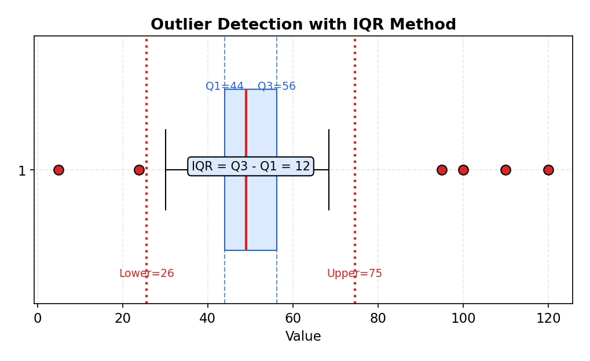
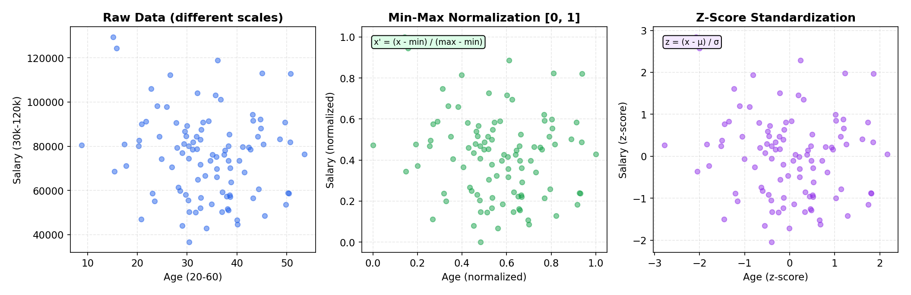

# Data Preprocessing

> **🎯 Goal**: Master the "boring" work that determines 80% of ML success
> **⏱ Time**: 2–3h study + 1h exercises
> **📦 Deliverable**: A mental checklist for preparing any dataset for ML

---

## Table of Contents

1. [The Data Pipeline Mindset](#1-the-data-pipeline-mindset)
2. [Handling Missing Values](#2-handling-missing-values)
3. [Outlier Detection & Treatment](#3-outlier-detection--treatment)
4. [Normalization & Scaling](#4-normalization--scaling)
5. [Encoding Categorical Variables](#5-encoding-categorical-variables)
6. [Train / Validation / Test Split](#6-train--validation--test-split)
7. [Data Leakage — Deep Dive](#7-data-leakage--deep-dive)

---

## 1. The Data Pipeline Mindset

### Intuition (Backend Analogy)

Think ETL. You already know this pattern: **Extract** raw data, **Transform** it
into something clean, **Load** it into the system that consumes it. ML
preprocessing is the same pipeline — except the consumer is a model, not a
database.

> **"Garbage in, garbage out."** Most ML failures aren't algorithm failures —
> they're data failures. A logistic regression on clean data beats a neural
> network on messy data every time.

### How It Works

```
  Raw Data            Transform                      Model-Ready
  ┌──────┐    ┌──────────────────────┐              ┌──────────┐
  │ CSV  │    │  ┌───────────────┐   │              │          │
  │ JSON │───▶│  │ Handle NULLs  │   │              │ Numeric  │
  │ DB   │    │  └──────┬────────┘   │              │ arrays   │
  │ API  │    │  ┌──────▼────────┐   │   Fit on     │ with no  │
  └──────┘    │  │ Remove/Clip   │   │───train──▶   │ NULLs,   │
   EXTRACT    │  │ Outliers      │   │   only!      │ no text, │
              │  └──────┬────────┘   │              │ uniform  │
              │  ┌──────▼────────┐   │              │ scale    │
              │  │ Encode Cats   │   │              └──────────┘
              │  └──────┬────────┘   │                 LOAD
              │  ┌──────▼────────┐   │
              │  │ Scale/Norm    │   │
              │  └───────────────┘   │
              └──────────────────────┘
                    TRANSFORM
```

### Recipe

```python
from sklearn.pipeline import Pipeline
from sklearn.compose import ColumnTransformer
from sklearn.impute import SimpleImputer
from sklearn.preprocessing import StandardScaler, OneHotEncoder

preprocessor = ColumnTransformer([
    ("num", Pipeline([
        ("impute", SimpleImputer(strategy="median")),
        ("scale",  StandardScaler()),
    ]), numeric_cols),
    ("cat", Pipeline([
        ("impute", SimpleImputer(strategy="most_frequent")),
        ("encode", OneHotEncoder(handle_unknown="ignore")),
    ]), categorical_cols),
])
```

### When to Use

Always. Every ML project starts here. Skipping preprocessing is like deploying
code without tests — it might work, but you'll regret it.

---

## 2. Handling Missing Values

### Intuition (Backend Analogy)

Missing values are like `null` fields in your database rows. You have four
strategies, and the right one depends on context — just like you'd choose
between `NOT NULL DEFAULT 0`, `COALESCE`, or dropping corrupted log entries.

### How It Works

```
Strategy         When                       Think of it as...
─────────────────────────────────────────────────────────────────────
Drop rows        < 5% missing, random       rm corrupted log entries
Impute mean/med  Numeric, roughly normal     fill gap with a default
Impute mode      Categorical                 most common enum value
KNN imputer      Values correlate w/ others  infer from neighbors
Flag as missing  Missingness IS a signal     add is_null boolean col
```

**Before / After — Mean Imputation:**

```
  BEFORE                      AFTER (mean of col = 25.0)
  ┌─────┬───────┐             ┌─────┬───────┐
  │ id  │ age   │             │ id  │ age   │
  ├─────┼───────┤             ├─────┼───────┤
  │  1  │  20   │             │  1  │  20.0 │
  │  2  │  NaN  │────────▶    │  2  │  25.0 │ ◀── filled
  │  3  │  30   │             │  3  │  30.0 │
  │  4  │  NaN  │────────▶    │  4  │  25.0 │ ◀── filled
  │  5  │  25   │             │  5  │  25.0 │
  └─────┴───────┘             └─────┴───────┘
```

**The Math:**

- **Mean imputation**: x_missing ← μ̂ = (1/n) Σ xᵢ (over observed values only)
- **Median imputation**: x_missing ← median(observed)
- **KNN imputation**: x_missing ← (Σ wᵢ · xᵢ) / (Σ wᵢ) for K nearest neighbors,
  where wᵢ = 1 / d(x, xᵢ) (inverse-distance weighting)

> **Key point**: All statistics (mean, median, neighbor distances) are computed
> on the **training set only** and applied to val/test to avoid data leakage.

### Recipe

```python
from sklearn.impute import SimpleImputer, KNNImputer

# Strategy 1: Drop (when < 5% missing)
df_clean = df.dropna(subset=["critical_col"])

# Strategy 2: Mean/Median
imputer = SimpleImputer(strategy="median")

# Strategy 3: KNN — infer from similar rows
knn_imp = KNNImputer(n_neighbors=5)

# Strategy 4: Flag + impute
df["age_missing"] = df["age"].isna().astype(int)
```

### When to Use

| Missing %  | Pattern     | Strategy                         |
|------------|-------------|----------------------------------|
| < 5%       | Random      | Drop rows                        |
| 5–30%      | Random      | Impute (mean/median/mode)        |
| 5–30%      | Correlated  | KNN imputer                      |
| Any %      | Informative | Flag as missing + impute         |
| > 50%      | Any         | Drop the **column** entirely     |

---

## 3. Outlier Detection & Treatment

### Intuition (Backend Analogy)

Outliers are like traffic spikes from bots — extreme values that distort your
metrics. Just as you'd rate-limit or filter bot traffic before computing
analytics, you handle outliers before training a model.

### How It Works

**Method 1: Z-Score** — Flag anything > 3 standard deviations from the mean.

```
            μ-3σ    μ-2σ    μ-1σ     μ     μ+1σ    μ+2σ    μ+3σ
  ──────────┼───────┼───────┼───────┼───────┼───────┼───────┼──────
            │       │       │▓▓▓▓▓▓▓▓▓▓▓▓▓▓▓│       │       │
  ◀─outlier─┤       │       │  68% of data   │       │       ├─outlier─▶
            │       │       │               │       │       │
            │       │◄──────── 95% ────────►│       │
            │◄────────────── 99.7% ─────────────────►│
```

**Method 2: IQR** — More robust to skewed data.

```
  Outlier                                              Outlier
    ◀──┤                                          ├──▶
        │                                          │
  ──────┼──────┬══════╤══════════╤══════┬──────┼──────
        │      │      │          │      │      │
     Q1-1.5    Q1    Q2(med)    Q3   Q3+1.5
      ×IQR           │◀──IQR──▶│       ×IQR
```



**The Math:**

- **IQR method**: IQR = Q3 − Q1
  - Outlier if x < Q1 − 1.5 · IQR  or  x > Q3 + 1.5 · IQR
  - The 1.5× multiplier captures ~99.3% of normally distributed data
- **Z-score method**: z = (x − μ) / σ
  - Outlier if |z| > 3  (i.e., beyond 3 standard deviations)
  - Assumes approximately normal distribution

### Recipe

```python
import numpy as np

# Z-score: flag values > 3 std devs
z_scores = (df["col"] - df["col"].mean()) / df["col"].std()
outliers = z_scores.abs() > 3

# IQR: more robust for skewed data
Q1, Q3 = df["col"].quantile([0.25, 0.75])
IQR = Q3 - Q1
mask = df["col"].between(Q1 - 1.5 * IQR, Q3 + 1.5 * IQR)

# Treatment options
df["col"] = df["col"].clip(lower=Q1 - 1.5*IQR, upper=Q3 + 1.5*IQR)  # clip
df["col"] = np.log1p(df["col"])  # log-transform (right-skewed data)
```

### When to Use

| Method    | Best for                  | Treatment            |
|-----------|---------------------------|----------------------|
| Z-score   | Normal distributions      | Remove or clip       |
| IQR       | Skewed / non-normal data  | Clip                 |
| Log xform | Right-skewed (e.g. price) | Transform, keep all  |
| Domain    | You know the valid range  | Clip to known bounds |

---

## 4. Normalization & Scaling

### Intuition (Backend Analogy)

Imagine comparing latency (1–500ms) vs throughput (10,000–1,000,000 rps). Without
scaling, throughput dominates every calculation just because its numbers are bigger.
Scaling is like converting currencies to a standard — it gives every feature a
fair vote.

### Why It Matters

```
  UNSCALED feature space          SCALED feature space
  (age 0-80, salary 0-200k)      (both features 0-1)

  salary                          feature_2
  200k│         x                 1.0│    x    x
     │       x  x                   │  x   x
     │     x                        │ x  x
     │   x     x                    │x   x
   0 └──────────── age          0.0 └──────────── feature_1
     0           80                0.0           1.0

  ^^^ salary axis DOMINATES       ^^^ both features equally
  distance calculations           contribute to the model
```

### How It Works

```
Method             Formula                    Range       Use when
──────────────────────────────────────────────────────────────────────
Min-Max            (x - min) / (max - min)    [0, 1]      Bounded data, neural nets
Standardization    (x - μ) / σ                ~[-3, 3]    Most algorithms (SVM, LR)
Robust Scaler      (x - median) / IQR         varies      Outliers present
MaxAbs Scaler      x / max(|x|)               [-1, 1]     Sparse data
```



**The Math:**

- **Z-score (Standardization)**: z = (x − μ) / σ  → output has mean = 0, std = 1
- **Min-Max**: x' = (x − x_min) / (x_max − x_min)  → output in [0, 1]
- **Robust Scaler**: x' = (x − median) / IQR  → resistant to outliers
- **MaxAbs Scaler**: x' = x / max(|x|)  → output in [−1, 1], preserves sparsity

**Worked Example** — normalize `[10, 20, 30, 40, 50]`:

```
Raw data:   [10, 20, 30, 40, 50]
μ = 30, σ = √200 ≈ 14.14, min = 10, max = 50, median = 30
Q1 = 20, Q3 = 40, IQR = 20, max(|x|) = 50

Z-score:    [(10-30)/14.14, (20-30)/14.14, ..., (50-30)/14.14]
          = [-1.414, -0.707, 0.0, 0.707, 1.414]

Min-Max:    [(10-10)/40, (20-10)/40, ..., (50-10)/40]
          = [0.0, 0.25, 0.5, 0.75, 1.0]

Robust:     [(10-30)/20, (20-30)/20, ..., (50-30)/20]
          = [-1.0, -0.5, 0.0, 0.5, 1.0]

MaxAbs:     [10/50, 20/50, 30/50, 40/50, 50/50]
          = [0.2, 0.4, 0.6, 0.8, 1.0]
```

### Recipe

```python
from sklearn.preprocessing import (
    MinMaxScaler, StandardScaler, RobustScaler
)
# Min-Max: squash to [0, 1] — like normalizing scores to %
scaler = MinMaxScaler()

# Z-score: center at 0, unit variance — like a standard currency
scaler = StandardScaler()

# Robust: uses median/IQR — ignores outliers
scaler = RobustScaler()

# CRITICAL: fit on train only, transform both
scaler.fit(X_train)
X_train_s = scaler.transform(X_train)
X_test_s  = scaler.transform(X_test)   # same params!
```

### When to Use

| Algorithm           | Needs scaling? | Recommended scaler |
|---------------------|----------------|--------------------|
| Linear/Logistic Reg | **Yes**        | StandardScaler     |
| SVM                 | **Yes**        | StandardScaler     |
| KNN                 | **Yes**        | MinMaxScaler       |
| Neural Networks     | **Yes**        | MinMaxScaler       |
| Decision Trees      | No             | —                  |
| Random Forest       | No             | —                  |
| XGBoost / LightGBM  | No             | —                  |

> **Rule of thumb**: If the algorithm uses distances or gradients, scale. If it
> splits on thresholds (trees), don't bother.

---

## 5. Encoding Categorical Variables

### Intuition (Backend Analogy)

Models only understand numbers. Encoding is like serialization — converting
rich objects into a format the consumer (model) can process. Choose the wrong
serialization and you corrupt the meaning.

### How It Works

```
  LABEL ENCODING               ONE-HOT ENCODING
  (ordinal only!)              (nominal categories)

  color → int                  color → binary columns
  ┌───────┬───┐                ┌───────┬─────┬───────┬──────┐
  │ red   │ 0 │                │       │ red │ green │ blue │
  │ green │ 1 │                ├───────┼─────┼───────┼──────┤
  │ blue  │ 2 │                │ red   │  1  │   0   │  0   │
  └───────┴───┘                │ green │  0  │   1   │  0   │
                               │ blue  │  0  │   0   │  1   │
  ⚠ Model thinks               └───────┴─────┴───────┴──────┘
  blue(2) > red(0)             ✓ No false ordering
  That's WRONG for
  nominal data!

  TARGET ENCODING              FREQUENCY ENCODING
  (high-cardinality)           (simple baseline)

  city → mean(target)          city → count / total
  ┌──────────┬───────┐         ┌──────────┬───────┐
  │ NYC      │ 0.82  │         │ NYC      │ 0.45  │
  │ Seattle  │ 0.65  │         │ Seattle  │ 0.30  │
  │ Austin   │ 0.41  │         │ Austin   │ 0.25  │
  └──────────┴───────┘         └──────────┴───────┘
  Like a pre-computed           Like a popularity
  lookup table                  index
```

**The Math:**

- **One-hot encoding**: For K categories, produce eₖ ∈ {0,1}^K with exactly one 1.
  Category j → vector where position j = 1, all others = 0.
- **Target encoding**: enc(c) = E[y | x = c] = (Σ yᵢ for xᵢ = c) / count(c)
  - With smoothing (to avoid overfitting rare categories):
    enc(c) = (n_c · mean_c + m · global_mean) / (n_c + m)
    where n_c = count of category c, m = smoothing parameter
- **Frequency encoding**: enc(c) = count(c) / n  (proportion of rows with category c)

### Recipe

```python
from sklearn.preprocessing import OneHotEncoder, OrdinalEncoder
import category_encoders as ce

# One-Hot: safe default for < 15 categories
ohe = OneHotEncoder(sparse_output=True, handle_unknown="ignore")

# Ordinal: ONLY for ordered categories (low/med/high)
oe = OrdinalEncoder(categories=[["low", "med", "high"]])

# Target Encoding: high-cardinality (100+ categories)
te = ce.TargetEncoder(cols=["city"], smoothing=1.0)
te.fit(X_train, y_train)  # uses target — train only!

# Frequency: quick baseline
df["city_freq"] = df["city"].map(df["city"].value_counts(normalize=True))
```

### When to Use

| Scenario                        | Encoding          | Why                            |
|---------------------------------|--------------------|--------------------------------|
| < 15 unique, no order           | One-Hot            | Safe, no assumptions           |
| Ordered categories (S/M/L)      | Ordinal (Label)    | Preserves natural order        |
| 15–100 unique values            | Frequency or Target| Avoid column explosion         |
| 100+ unique (zip codes, cities) | Target Encoding    | Compresses to single column    |
| Tree-based models               | Ordinal is fine    | Trees handle splits natively   |

---

## 6. Train / Validation / Test Split

### Intuition (Backend Analogy)

This is **dev / staging / prod** for ML:

- **Train** = development — you iterate freely here
- **Validation** = staging — you check if your changes generalize
- **Test** = production — you touch this ONCE at the very end

If you tune hyperparameters on the test set, you've deployed untested code to
prod. Your "accuracy" is a lie.

### How It Works

```
  Full Dataset (100%)
  ┌──────────────────────────────────────────────────────┐
  │                                                      │
  │   Train (70%)        Val (15%)      Test (15%)       │
  │  ┌──────────────┐  ┌──────────┐  ┌──────────┐       │
  │  │ Learn        │  │ Tune     │  │ Final    │       │
  │  │ patterns     │  │ hyper-   │  │ eval     │       │
  │  │              │  │ params   │  │ ONCE     │       │
  │  └──────────────┘  └──────────┘  └──────────┘       │
  │       ▲                 ▲              ▲             │
  │       │                 │              │             │
  │    Iterate          Compare         Report          │
  │    freely           models          metric          │
  └──────────────────────────────────────────────────────┘

  Common ratios:
    Large data  (>100k):  80 / 10 / 10
    Medium data (10-100k): 70 / 15 / 15
    Small data  (<10k):    60 / 20 / 20  (or use cross-validation)
```

**Stratified Split** — for imbalanced classes:

```
  Dataset: 95% class-0, 5% class-1

  Random split (BAD):          Stratified split (GOOD):
  Train: 97% / 3%              Train: 95% / 5%  ◀── same
  Val:   90% / 10%             Val:   95% / 5%  ◀── ratio
  Test:  93% / 7%              Test:  95% / 5%  ◀── everywhere
```

**Time-Based Split** — for temporal data:

```
  ──────────────────────────────────────────────▶ time
  │  Jan - Sep  │  Oct - Nov  │  Dec        │
  │   TRAIN     │   VAL       │   TEST      │
  └─────────────┴─────────────┴─────────────┘
  ⚠ NEVER shuffle time series! Future data leaks into training.
```

**The Math:**

- **Stratified split guarantee**: P_train(y = k) = P_full(y = k) for all classes k.
  Each split preserves the original class distribution.
- **Data leakage rule**: Fit scaler/encoder on X_train **only**, then transform
  X_val and X_test using those same fitted parameters:
  - θ ← fit(X_train)  (learn means, stds, category maps, etc.)
  - X_val' ← transform(X_val, θ)
  - X_test' ← transform(X_test, θ)

### Recipe

```python
from sklearn.model_selection import train_test_split

# Standard stratified split
X_train, X_temp, y_train, y_temp = train_test_split(
    X, y, test_size=0.3, stratify=y, random_state=42
)
X_val, X_test, y_val, y_test = train_test_split(
    X_temp, y_temp, test_size=0.5, stratify=y_temp, random_state=42
)

# Time-based: sort by date, then slice — NO shuffle
df = df.sort_values("timestamp")
train = df[df["timestamp"] < "2024-10-01"]
val   = df[df["timestamp"].between("2024-10-01", "2024-11-30")]
test  = df[df["timestamp"] >= "2024-12-01"]
```

### When to Use

| Data type        | Split method   | Shuffle? |
|------------------|----------------|----------|
| IID tabular      | Random         | Yes      |
| Imbalanced class | Stratified     | Yes      |
| Time series      | Chronological  | **No**   |
| User-based       | Group split    | Yes*     |

\* Group split ensures the same user doesn't appear in both train and test.

---

## 7. Data Leakage — Deep Dive

### Intuition (Backend Analogy)

Data leakage is like peeking at the test answers before the exam. Your score
looks great, but you've learned nothing. In production, you won't have those
answers — and your model collapses.

> **This is the #1 beginner mistake and the hardest to debug.** A model with
> leakage looks perfect in development and fails catastrophically in production.

### How It Works

```
  ✗ WRONG: Fit scaler on ALL data, then split
  ┌──────────────────────────────────┐
  │         ALL DATA                 │
  │    scaler.fit(ALL) ◀── LEAK!     │    Test statistics
  │    scaler.transform(ALL)         │    contaminate training
  │         │                        │
  │    ┌────▼────┬──────┬──────┐     │
  │    │  Train  │ Val  │ Test │     │
  │    └─────────┴──────┴──────┘     │
  └──────────────────────────────────┘

  ✓ RIGHT: Split first, fit on train only
  ┌──────────────────────────────────┐
  │    Split FIRST                   │
  │    ┌─────────┬──────┬──────┐     │
  │    │  Train  │ Val  │ Test │     │
  │    └────┬────┴──┬───┴──┬───┘     │
  │         │       │      │         │
  │    fit+transform│  transform     │
  │    (train only) │  (same params) │
  └──────────────────────────────────┘
```

### Common Leakage Sources

```
Source                     Example                        Fix
────────────────────────────────────────────────────────────────────
Preprocessing before       Scale → split                  Split → scale
  split                                                   (fit on train)

Future data in features    Using tomorrow's stock price   Lag features only
                           to predict today

Target leaking into        "account_closed" column to     Remove columns
  features                 predict churn (it IS churn)    derived from target

Duplicate rows across      Same customer in train & test  Group-aware split
  splits

Validation leakage         Tuning on test set             Use val set for
                                                          hyperparams
```

### Recipe

```python
from sklearn.pipeline import Pipeline
from sklearn.model_selection import cross_val_score

# Pipeline guarantees no leakage — each fold fits independently
pipe = Pipeline([
    ("impute", SimpleImputer(strategy="median")),
    ("scale",  StandardScaler()),
    ("model",  LogisticRegression()),
])

# cross_val_score fits the ENTIRE pipeline per fold
scores = cross_val_score(pipe, X_train, y_train, cv=5)

# ⚠ WRONG — leaks val/test info into scaler
# scaler.fit(X)           # DON'T fit on all data
# X_scaled = scaler.transform(X)
# X_train, X_test = split(X_scaled)   # too late!
```

### The Golden Rule

> **Anything you learn from the data must be learned from the training set
> only.** Means, standard deviations, category mappings, imputation values —
> all computed on train, applied to val/test.

Think of it this way: in production, you won't have next week's data. Your
preprocessing must work with only what you've seen so far.

---

## Exercises

### Exercise 1: Conceptual — The Suspiciously Perfect Model

> Your model has 99% accuracy on test data but fails in production. The dataset
> has a `timestamp` column. What probably went wrong?

<details>
<summary>Solution</summary>

**Data leakage through time.** The data was randomly shuffled before splitting,
so future data points ended up in the training set. The model "learned" patterns
that include future information — information it won't have in production.

**Fix**: Sort by `timestamp` and split chronologically:

```python
df = df.sort_values("timestamp")
cutoff_train = int(len(df) * 0.7)
cutoff_val   = int(len(df) * 0.85)

train = df[:cutoff_train]
val   = df[cutoff_train:cutoff_val]
test  = df[cutoff_val:]
```

Also check if any features are derived from future timestamps (e.g., aggregations
that include future rows).

</details>

### Exercise 2: Implementation — Build a Preprocessing Pipeline

> Given a dataframe with missing values, categorical columns, and different
> scales — write a complete preprocessing pipeline using sklearn `Pipeline` and
> `ColumnTransformer`.

<details>
<summary>Solution</summary>

```python
import pandas as pd
from sklearn.compose import ColumnTransformer
from sklearn.pipeline import Pipeline
from sklearn.impute import SimpleImputer
from sklearn.preprocessing import StandardScaler, OneHotEncoder
from sklearn.linear_model import LogisticRegression
from sklearn.model_selection import train_test_split

num_cols = ["age", "income", "credit_score"]
cat_cols = ["city", "education"]

preprocessor = ColumnTransformer([
    ("num", Pipeline([
        ("impute", SimpleImputer(strategy="median")),
        ("scale",  StandardScaler()),
    ]), num_cols),
    ("cat", Pipeline([
        ("impute", SimpleImputer(strategy="most_frequent")),
        ("encode", OneHotEncoder(handle_unknown="ignore")),
    ]), cat_cols),
])

full_pipeline = Pipeline([
    ("preprocess", preprocessor),
    ("model", LogisticRegression()),
])

# No leakage — pipeline fits each step on train only
X_train, X_test, y_train, y_test = train_test_split(
    X, y, test_size=0.2, stratify=y, random_state=42
)
full_pipeline.fit(X_train, y_train)
print(f"Test accuracy: {full_pipeline.score(X_test, y_test):.3f}")
```

**Key point**: The `Pipeline` ensures `fit` is called only on training data.
No leakage, no manual bookkeeping.

</details>

### Exercise 3: Real-World Scenario — Fraud Detection

> You're building a fraud detection model. Only 0.1% of transactions are
> fraudulent. How do you split the data? What encoding would you use for the
> `merchant_category` column (500 unique values)?

<details>
<summary>Solution</summary>

**Split strategy**: **Stratified split** to preserve the 0.1% fraud ratio in
every partition. Without stratification, some splits may contain zero fraud cases.

```python
X_train, X_test, y_train, y_test = train_test_split(
    X, y, test_size=0.2, stratify=y, random_state=42
)
```

If the data is temporal (transactions over time), use a **time-based split**
with stratification awareness — verify each split has enough fraud examples.

**Encoding for `merchant_category` (500 values)**: **Target Encoding**.

- One-hot would create 500 sparse columns — wasteful and hurts tree models.
- Label encoding implies false ordering.
- Target encoding compresses to a single column with meaningful signal:

```python
import category_encoders as ce

encoder = ce.TargetEncoder(cols=["merchant_category"], smoothing=1.0)
encoder.fit(X_train, y_train)  # fit on TRAIN only
X_train_enc = encoder.transform(X_train)
X_test_enc  = encoder.transform(X_test)
```

**Bonus**: For fraud detection, also consider:
- Using **precision/recall** instead of accuracy (accuracy is meaningless at 99.9% / 0.1%)
- **SMOTE** or class weights to handle the extreme imbalance during training

</details>

---

## Quick Reference Checklist

Before feeding data to any model, walk through this:

```
  ┌─────────────────────────────────────────────┐
  │         PREPROCESSING CHECKLIST             │
  ├─────────────────────────────────────────────┤
  │                                             │
  │  □ 1. Split data FIRST (train/val/test)     │
  │  □ 2. Inspect missing values (% per col)    │
  │  □ 3. Handle missing values (impute/drop)   │
  │  □ 4. Detect & treat outliers               │
  │  □ 5. Encode categoricals                   │
  │  □ 6. Scale numeric features                │
  │  □ 7. Verify no data leakage                │
  │  □ 8. Sanity check shapes & dtypes          │
  │                                             │
  │  ⚠ Steps 2-6: fit on TRAIN, transform ALL  │
  └─────────────────────────────────────────────┘
```

> **Remember**: Step 1 comes first. Always. Everything else operates within the
> training set boundary. This is the single most important habit in ML
> engineering.
