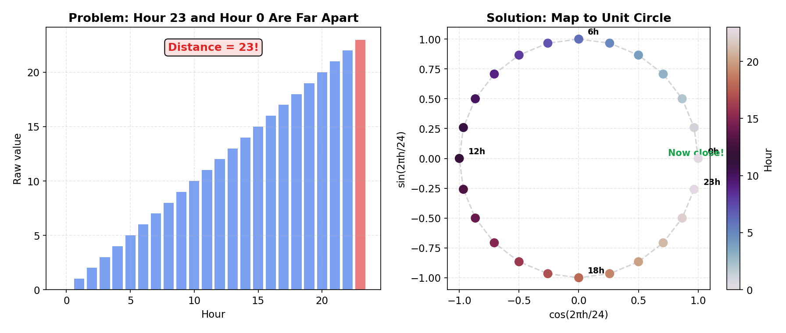
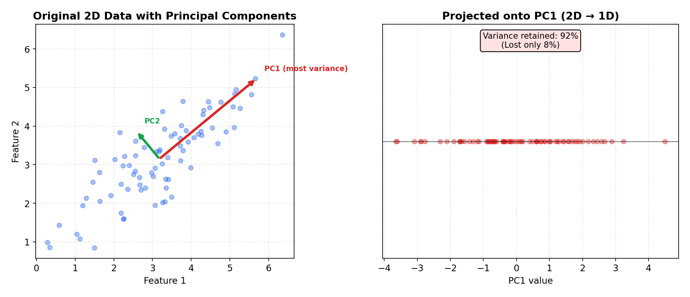

# Feature Engineering

> **🎯 Goal**: Learn to create meaningful features that make models actually work
> **⏱ Time**: 2–3h study + 1h exercises
> **📦 Deliverable**: A toolkit of feature engineering techniques for common data types

---

## Table of Contents

1. [What Is Feature Engineering?](#1-what-is-feature-engineering)
2. [Numerical Features](#2-numerical-features)
3. [Temporal Features](#3-temporal-features)
4. [Text Features](#4-text-features)
5. [Categorical Feature Tricks](#5-categorical-feature-tricks)
6. [Feature Selection](#6-feature-selection)
7. [PCA (Principal Component Analysis)](#7-pca-principal-component-analysis)
8. [Feature Store Concept](#8-feature-store-concept)

---

## 1. What Is Feature Engineering?

### Intuition (Backend Analogy)

Feature engineering is like designing a good database schema. The right representation makes
queries (models) fast and accurate — the wrong one makes everything slow and broken.

Raw data is almost never what a model needs. You don't store Unix timestamps and then query
"give me all weekend orders" — you precompute the right columns. Same idea here.

### How It Works

```
  Raw Data                    Engineered Features
  ┌──────────────────┐        ┌────────────┬───────────┬────────────┬─────────────────────┐
  │ created_at       │        │ hour_of_day│day_of_week│ is_weekend │ mins_since_last_event│
  ├──────────────────┤   ──►  ├────────────┼───────────┼────────────┼─────────────────────┤
  │ 2024-03-15 14:32 │        │     14     │   Friday  │     0      │        42           │
  │ 2024-03-16 09:05 │        │      9     │  Saturday │     1      │      1113           │
  │ 2024-03-16 09:12 │        │      9     │  Saturday │     1      │         7           │
  └──────────────────┘        └────────────┴───────────┴────────────┴─────────────────────┘

  One column ──► four useful signals
```

### Recipe

```python
import pandas as pd

df["hour"]       = df["created_at"].dt.hour
df["day_of_week"]= df["created_at"].dt.dayofweek
df["is_weekend"] = df["day_of_week"].isin([5, 6]).astype(int)
df["mins_since"] = df["created_at"].diff().dt.total_seconds() / 60
```

### When to Use

Always. Every ML project starts here. If your model performs poorly, the first question
is: "Are the features good?" — not "Is the model complex enough?"

---

## 2. Numerical Features

### Intuition (Backend Analogy)

Raw numbers are like unindexed columns — technically usable but often inefficient.
Transforming numbers is like adding the right indexes and computed columns so the
query optimizer (model) can do its job.

### 2a. Log Transform

Skewed data (income, prices, click counts) compresses the long tail so outliers
don't dominate. Like switching from a linear to a log scale in your monitoring dashboard.

```
  Before (skewed right)              After log transform (more normal)

  Count                              Count
  │████                              │    ████
  │████                              │  ████████
  │████                              │ ██████████
  │██████                            │████████████
  │████████                          │██████████████
  │██████████████                    │████████████████
  │████████████████████████          │██████████████████
  └──────────────────────── Value    └──────────────────── log(Value)
   0    50k   100k  500k  1M          0    3    5   8  10  14
```

```python
import numpy as np

df["income_log"] = np.log1p(df["income"])  # log1p handles zeros safely
```

**The Math:**

```
Log transform:     x' = log(1 + x)         handles zeros (log(0) is undefined) and right skew

Box-Cox (power transform — generalises log):

                   ⎧ (x^λ - 1) / λ    if λ ≠ 0
   x' = Box-Cox  = ⎨
                   ⎩ log(x)            if λ = 0

   λ is chosen by maximum-likelihood to make the distribution as normal as possible.
   λ = 1 → no transform, λ = 0.5 → sqrt, λ = 0 → log, λ = -1 → reciprocal.
```

### 2b. Binning / Discretization

Turn continuous values into categories. Like partitioning a database table by range.

```python
df["age_group"] = pd.cut(
    df["age"],
    bins=[0, 18, 35, 55, 100],
    labels=["teen", "young_adult", "middle", "senior"]
)
```

**The Math:**

```
Binning maps a continuous value into discrete buckets:

   bin(x) = k   where  b_k ≤ x < b_{k+1}

   Example: b = [0, 18, 35, 55, 100]
     age = 22  →  bin 1 ("young_adult")    since 18 ≤ 22 < 35
     age = 60  →  bin 3 ("senior")         since 55 ≤ 60 < 100
```

### 2c. Polynomial Features

Lets a linear model learn curves. `x → x, x², x³` captures non-linear relationships
without switching to a complex model.

```python
from sklearn.preprocessing import PolynomialFeatures

poly = PolynomialFeatures(degree=2, include_bias=False)
X_poly = poly.fit_transform(X)  # [x1, x2] → [x1, x2, x1², x1·x2, x2²]
```

**The Math:**

```
Polynomial expansion of degree d:

   φ(x) = [x, x², x³, ..., x^d]

For two features [x₁, x₂] with degree 2:

   φ(x₁, x₂) = [x₁, x₂, x₁², x₁·x₂, x₂²]
                                 ↑
                          interaction term

General interaction:  x_i · x_j   captures "the effect of x_i depends on x_j"
```

### 2d. Interaction Features

Combine features when the relationship is multiplicative, not additive.

```python
df["area"]  = df["width"] * df["height"]
df["bmi"]   = df["weight"] / (df["height_m"] ** 2)
df["speed"] = df["distance"] / df["duration"]
```

### When to Use

| Technique    | Use When                                        |
|--------------|-------------------------------------------------|
| Log transform| Heavily skewed distributions (income, counts)   |
| Binning      | Exact value doesn't matter, category does       |
| Polynomial   | Suspect non-linear relationships, linear model   |
| Interaction  | Domain knowledge says features combine           |

---

## 3. Temporal Features

### Intuition (Backend Analogy)

Like the time-series metrics in your monitoring dashboards — you never look at raw
timestamps, you look at "requests per minute", "p99 over last 5 min", "day-over-day
change". Same extraction logic applies.

### How It Works

```
  Raw: 2024-03-15 14:32:00

  ┌─────────────────────────────────────────────────────────┐
  │ Calendar Features        │ Cyclical Encoding            │
  │  hour = 14               │  hour_sin = sin(2π·14/24)    │
  │  day_of_week = 4 (Fri)   │  hour_cos = cos(2π·14/24)    │
  │  month = 3               │                              │
  │  quarter = 1             │  (hour 23 is close to hour 0 │
  │  is_holiday = 0          │   in sin/cos space — not     │
  │                          │   in integer space!)         │
  ├──────────────────────────┼──────────────────────────────┤
  │ Lag Features             │ Rolling Statistics           │
  │  value_t-1 = prev row    │  rolling_mean_7d             │
  │  value_t-2 = 2 rows ago  │  rolling_std_7d              │
  │  (sliding window buffer) │  (like moving avg in graphs) │
  └──────────────────────────┴──────────────────────────────┘
```

### Recipe: Cyclical Encoding

```python
import numpy as np

# Hour 23 and hour 0 are 1 apart in real life, 23 apart as integers.
# Sin/cos encoding fixes this.
df["hour_sin"] = np.sin(2 * np.pi * df["hour"] / 24)
df["hour_cos"] = np.cos(2 * np.pi * df["hour"] / 24)
```

**The Math:**

```
Cyclical encoding for a value h with period T:

   sin_h = sin(2π · h / T)
   cos_h = cos(2π · h / T)

   T = 24 for hour-of-day,  T = 7 for day-of-week,  T = 12 for month

Why two components?  sin alone can't distinguish h=6 from h=18 (both give sin=0).
The (sin, cos) pair maps each value to a unique point on the unit circle.

Why it matters — distance between hour 23 and hour 0:
   Raw integers:  |23 - 0| = 23            (maximum distance!)
   sin/cos space: √[(sin(2π·23/24) - sin(0))² + (cos(2π·23/24) - cos(0))²]
                = √[(-0.26)² + (0.97 - 1)²]  ≈ 0.26    (tiny — as it should be)
```



### Recipe: Lag and Rolling Features

```python
df["sales_lag1"]    = df["sales"].shift(1)
df["sales_lag7"]    = df["sales"].shift(7)
df["sales_roll7"]   = df["sales"].rolling(7).mean()
df["sales_rollstd"] = df["sales"].rolling(7).std()
```

**The Math:**

```
Lag features — look back k steps:

   x_{t-k}   for k = 1, 2, 3, ...

   Example: sales_lag1 = x_{t-1}  (yesterday's sales)
            sales_lag7 = x_{t-7}  (same day last week)

Rolling statistics — aggregate over a sliding window of size k:

   μ_rolling = (1/k) Σ_{i=t-k+1}^{t} xᵢ           (rolling mean)

   σ_rolling = √[ (1/(k-1)) Σ_{i=t-k+1}^{t} (xᵢ - μ_rolling)² ]   (rolling std)
```

### When to Use

| Technique         | Use When                                          |
|-------------------|---------------------------------------------------|
| Calendar extract  | Any timestamp column — always extract these first |
| Cyclical encoding | Feature wraps around (hour, day_of_week, month)   |
| Lag features      | Predicting next value in a sequence                |
| Rolling stats     | Detecting trends or volatility over time           |

---

## 4. Text Features

### Intuition (Backend Analogy)

Think of text feature extraction like building a search engine index.
Bag of Words is the inverted index. TF-IDF is the ranking function (like
a simplified PageRank for words). N-grams are compound index keys.

### How It Works

```
  Document: "the cat sat on the mat"

  Bag of Words (inverted index):
  ┌───────┬───────┐
  │  word │ count │
  ├───────┼───────┤
  │  the  │   2   │  ◄── high frequency, low information
  │  cat  │   1   │
  │  sat  │   1   │
  │  on   │   1   │
  │  mat  │   1   │
  └───────┴───────┘

  TF-IDF reweights:
  ┌───────┬──────┬────────┬────────────┐
  │  word │  TF  │  IDF   │  TF × IDF  │
  ├───────┼──────┼────────┼────────────┤
  │  the  │ 2/6  │  low   │   ~0.0     │  ◄── common word, downweighted
  │  cat  │ 1/6  │  high  │   ~0.4     │  ◄── rare word, boosted
  └───────┴──────┴────────┴────────────┘

  N-grams (compound keys):
    unigrams:  ["new", "york", "city"]
    bigrams:   ["new york", "york city"]    ◄── captures phrases
```

### Recipe: TF-IDF

```python
from sklearn.feature_extraction.text import TfidfVectorizer

tfidf = TfidfVectorizer(max_features=5000, ngram_range=(1, 2))
X_text = tfidf.fit_transform(df["description"])
```

**The Math:**

```
TF-IDF(t, d) = TF(t, d) × IDF(t)

   TF(t, d)  = count(t in d) / |d|           term frequency — how often t appears in doc d
   IDF(t)    = log(N / df_t)                  inverse doc frequency — rarity across corpus
   N         = total number of documents
   df_t      = number of documents containing term t

Worked example — 3 documents:
   d1 = "cat sat"      d2 = "cat played"      d3 = "dog sat"

   For term "cat" in d1:
     TF("cat", d1)  = 1/2 = 0.50
     df_"cat"        = 2  (appears in d1, d2)
     IDF("cat")      = log(3/2) ≈ 0.41
     TF-IDF          = 0.50 × 0.41 = 0.20

   For term "dog" in d3:
     TF("dog", d3)  = 1/2 = 0.50
     df_"dog"        = 1  (appears only in d3)
     IDF("dog")      = log(3/1) ≈ 1.10
     TF-IDF          = 0.50 × 1.10 = 0.55    ◄── rarer word → higher score
```

### Recipe: Quick Text Stats

```python
df["text_len"]    = df["text"].str.len()
df["word_count"]  = df["text"].str.split().str.len()
df["has_url"]     = df["text"].str.contains(r"https?://").astype(int)
df["caps_ratio"]  = df["text"].str.count(r"[A-Z]") / df["text_len"]
```

### When to Use

| Technique   | Use When                                          |
|-------------|---------------------------------------------------|
| BoW / TF-IDF| Classification, topic detection, simple NLP       |
| Text stats  | Any text column — cheap and surprisingly useful   |
| N-grams     | Phrases matter ("New York" ≠ "New" + "York")     |

> **Note**: For deep text understanding (sentiment, semantic similarity), see the
> embeddings chapter. TF-IDF is the "good enough" baseline.

---

## 5. Categorical Feature Tricks

### Intuition (Backend Analogy)

Categorical features are like enum columns. One-hot encoding (Chapter 4) is the
baseline. These tricks handle the edge cases: high cardinality, rare values, and
combining categories — like designing composite keys and lookup tables.

### 5a. Combining Categories

```python
# Like a composite key in a database
df["location"] = df["city"] + "_" + df["state"]
df["device_os"] = df["device_type"] + "_" + df["os_version"]
```

### 5b. Rare Category Grouping

The long tail problem — 1000 cities, 900 appear fewer than 10 times.

```python
freq = df["city"].value_counts()
rare = freq[freq < 10].index
df["city_clean"] = df["city"].replace(rare, "Other")
```

### 5c. Leave-One-Out Encoding

Encodes each category as the mean of the target *excluding the current row*.
Prevents target leakage that ruins naive target encoding.

```python
# Conceptual — use category_encoders in practice
# pip install category_encoders
from category_encoders import LeaveOneOutEncoder

enc = LeaveOneOutEncoder(cols=["city"])
df["city_encoded"] = enc.fit_transform(df["city"], df["target"])
```

**The Math:**

```
Leave-one-out target encoding for row i in category c:

   enc_i = (Σ_{j≠i, j∈c} yⱼ) / (n_c - 1)

   n_c = number of rows in category c
   yⱼ  = target value for row j

   The current row's target is excluded → prevents target leakage.

   Example: category "NYC" has rows with targets [1, 0, 1, 1]
     enc for row 0: (0 + 1 + 1) / 3 = 0.67
     enc for row 1: (1 + 1 + 1) / 3 = 1.00
```

### 5d. Hash Encoding

For high-cardinality features (user IDs, URLs). Like a hash table with fixed buckets —
you trade some collisions for a fixed-width representation.

```
  ┌─────────────────┐        hash(x) % N         ┌──────────────────┐
  │ 50,000 user IDs │  ──────────────────────►    │ 256 hash buckets │
  └─────────────────┘   fixed output size         └──────────────────┘
  Variable, huge                                   Fixed, manageable
```

```python
from sklearn.feature_extraction import FeatureHasher

hasher = FeatureHasher(n_features=256, input_type="string")
X_hashed = hasher.transform(df["user_id"].apply(lambda x: [x]))
```

**The Math:**

```
Hash encoding:  bucket = h(x) mod N

   h = hash function (e.g., MurmurHash)
   N = number of buckets (fixed, e.g., 256)

   Maps any category — including unseen ones — to a bucket in [0, N).
   Trade-off: collisions (two categories → same bucket) vs. dimensionality.
```

### When to Use

| Technique       | Use When                                       |
|-----------------|------------------------------------------------|
| Combine cats    | Two categories together are more meaningful    |
| Rare grouping   | Long-tail categories with few examples each    |
| Leave-one-out   | Want target encoding without leakage           |
| Hash encoding   | Very high cardinality (>1000 unique values)    |

---

## 6. Feature Selection

### Intuition (Backend Analogy)

Like removing unused indexes from a database — they take up space, slow down writes,
and don't help queries. Redundant or irrelevant features slow training, cause overfitting,
and add maintenance burden.

### How It Works: Correlation Matrix

```
  Feature Correlation Matrix (|r| values)
  ┌──────────┬──────┬──────┬──────┬──────┬──────┐
  │          │  f1  │  f2  │  f3  │  f4  │  f5  │
  ├──────────┼──────┼──────┼──────┼──────┼──────┤
  │  f1      │ 1.00 │ 0.95 │ 0.12 │ 0.34 │ 0.08 │
  │  f2      │ 0.95 │ 1.00 │ 0.15 │ 0.31 │ 0.10 │  ◄── f1 & f2: r=0.95
  │  f3      │ 0.12 │ 0.15 │ 1.00 │ 0.05 │ 0.72 │      DROP one of them
  │  f4      │ 0.34 │ 0.31 │ 0.05 │ 1.00 │ 0.03 │
  │  f5      │ 0.08 │ 0.10 │ 0.72 │ 0.03 │ 1.00 │  ◄── f3 & f5: r=0.72
  └──────────┴──────┴──────┴──────┴──────┴──────┘      maybe drop one
```

### Recipe: Correlation Filter

```python
corr = df.corr().abs()
upper = corr.where(np.triu(np.ones(corr.shape), k=1).astype(bool))
to_drop = [c for c in upper.columns if any(upper[c] > 0.90)]
df_clean = df.drop(columns=to_drop)
```

**The Math:**

```
Pearson correlation — linear relationship between x and y:

   ρ(x, y) = cov(x, y) / (σ_x · σ_y)

            = Σᵢ (xᵢ - x̄)(yᵢ - ȳ)  /  √[ Σᵢ (xᵢ - x̄)² · Σᵢ (yᵢ - ȳ)² ]

   ρ = +1 → perfect positive,  ρ = -1 → perfect negative,  ρ = 0 → no linear relation
   Drop one of two features when |ρ| > 0.90–0.95 (nearly redundant).

Mutual information — captures ANY relationship (not just linear):

   I(X; Y) = Σ_{x,y} p(x, y) · log[ p(x, y) / (p(x) · p(y)) ]

   I = 0 → X and Y are independent.  Higher I → stronger dependency.
   Unlike correlation, detects non-linear and non-monotonic relationships.

Variance threshold — drop near-constant features:

   Drop feature x if Var(x) < threshold

   Var(x) = (1/n) Σᵢ (xᵢ - x̄)²

   A feature with near-zero variance carries almost no information.
```

### Recipe: Model-Based Feature Importance

```python
from sklearn.ensemble import RandomForestClassifier

rf = RandomForestClassifier(n_estimators=100, random_state=42)
rf.fit(X_train, y_train)
importances = pd.Series(rf.feature_importances_, index=X_train.columns)
top_features = importances.nlargest(30).index.tolist()
```

### Recipe: Recursive Feature Elimination

```python
from sklearn.feature_extraction import RFE
from sklearn.linear_model import LogisticRegression

rfe = RFE(LogisticRegression(), n_features_to_select=30)
rfe.fit(X_train, y_train)
selected = X_train.columns[rfe.support_].tolist()
```

### When to Use

| Technique              | Use When                                      |
|------------------------|-----------------------------------------------|
| Correlation filter     | Quick first pass — drop obvious redundancy    |
| Mutual information     | Check non-linear relationships with target    |
| RF importance          | Want a quick ranking, don't need optimal set  |
| RFE                    | Need the best subset, willing to wait longer  |

---

## 7. PCA (Principal Component Analysis)

### Intuition (Backend Analogy)

PCA is lossy compression for features — like JPEG for images. It finds the
directions of maximum variance and projects your data onto them. You keep
the important signal and drop the noise.

Think of it like this: if you have 100 metrics for your service, but 90% of
the variation is captured by just 3 underlying factors (CPU, memory, network),
PCA will find those 3 factors automatically.

### How It Works

```
  Original 2D data                    PCA: find direction of max variance
                                      then project onto it

    y                                   y
    │       * *                         │       * *
    │     * * *  *                      │     * * *  *
    │   *  * * * *                      │   *  * * * *        PC1 (keeps ~90%
    │  * * * * *                        │  * * * * *    ╱      of information)
    │ * * * *                           │ * * * *   ╱
    │* *                                │* *     ╱
    │                                   │     ╱
    └────────────── x                   └──╱───────────── x

                                        Data projected onto PC1:
                                        ──*─*──**─*──**──*──*──*──► PC1
                                          (2D → 1D, minimal info loss)

  Eigenvalues tell you how much variance each component captures:
  ┌──────────────────────────────────────────────────┐
  │ PC1: ████████████████████████████████████  72%   │
  │ PC2: ██████████████                        18%   │
  │ PC3: ██████                                 7%   │
  │ PC4: ██                                     3%   │
  └──────────────────────────────────────────────────┘
  Keep PC1-PC3 → 97% of variance with 3 components instead of 4
```

### Recipe

```python
from sklearn.decomposition import PCA
import numpy as np

pca = PCA(n_components=5)
X_pca = pca.fit_transform(X_scaled)  # always scale first!

# How much variance is retained?
cumulative = np.cumsum(pca.explained_variance_ratio_)
print(f"Variance retained: {cumulative[-1]:.1%}")  # e.g., 92.3%
```

**The Math:**

```
PCA step-by-step:

1. Center the data:          X_c = X - μ           (subtract column means)

2. Compute covariance:       Σ = (1/(n-1)) X_cᵀ · X_c

3. Eigendecomposition:       Σ vₖ = λₖ vₖ          (eigenvectors vₖ, eigenvalues λₖ)
                             λ₁ ≥ λ₂ ≥ ... ≥ λ_p   (sorted by variance captured)

4. Choose top k eigenvectors: W_k = [v₁, v₂, ..., vₖ]

5. Project:                  Z = X_c · W_k          (n × p) · (p × k) → (n × k)

Variance retained by k components:

   Var_retained = Σᵢ₌₁ᵏ λᵢ  /  Σⱼ₌₁ᵖ λⱼ

   Rule of thumb: choose the smallest k such that Var_retained ≥ 95%.
```



### When to Use

| Scenario                        | PCA Helps?                            |
|---------------------------------|---------------------------------------|
| Too many features (>100)        | ✅ Compress to manageable size        |
| Multicollinearity               | ✅ Components are uncorrelated        |
| Visualization (3D → 2D)        | ✅ Classic use case                   |
| Features are interpretable      | ❌ PCA destroys interpretability      |
| Tree-based models               | ❌ Trees handle many features fine    |

---

## 8. Feature Store Concept

### Intuition (Backend Analogy)

A feature store is a centralized cache for computed features — like Redis for your ML
pipeline. Instead of every model recomputing "user_avg_order_value" from raw data,
compute it once, store it, and serve it to all models.

### How It Works

```
  Without Feature Store              With Feature Store

  ┌──────────┐                       ┌──────────┐
  │ Model A  │──compute features──┐  │ Model A  │──read──┐
  └──────────┘                    │  └──────────┘        │
                                  │                      ▼
  ┌──────────┐                    │  ┌──────────────────────────┐
  │ Model B  │──compute features──┼──│      Raw Database        │
  └──────────┘                    │  └──────────────────────────┘
                                  │
  ┌──────────┐                    │  ┌──────────┐        ┌─────────────────┐
  │ Model C  │──compute features──┘  │ Model B  │──read──│  Feature Store   │
  └──────────┘                       └──────────┘        │  (cached, fast)  │
                                                         │  • user_avg_val  │
  Everyone recomputes the same       ┌──────────┐        │  • click_rate_7d │
  features. Slow, inconsistent.      │ Model C  │──read──│  • text_tfidf    │
                                     └──────────┘        └─────────────────┘
                                     Compute once, serve many.
```

### Key Benefits

- **Consistency**: All models use the same feature definitions
- **Speed**: Precomputed features → fast serving at inference time
- **Reuse**: New models can leverage existing features immediately
- **Time-travel**: Retrieve feature values as of a past timestamp (avoid leakage)

### Production Tools

| Tool      | Description                                   |
|-----------|-----------------------------------------------|
| Feast     | Open-source, works with most data stores      |
| Tecton    | Managed, built for real-time features         |
| Hopsworks | Open-source platform with feature store       |
| SageMaker | AWS-integrated feature store                  |

> **For interview purposes**: Know that feature stores exist, why they matter,
> and the consistency + reuse benefits. You won't be asked to implement one.

---

## Exercises

### Exercise 1: Conceptual — Timestamp Feature Extraction

**Problem**: You have a `created_at` timestamp column in an e-commerce dataset.
List 5 different features you could extract from it and explain which ML problems
each would help with.

<details>
<summary>Solution</summary>

| Feature               | Extraction                        | Helps With                              |
|-----------------------|-----------------------------------|-----------------------------------------|
| `hour_of_day`         | `.dt.hour`                        | Predicting peak traffic / staffing      |
| `day_of_week`         | `.dt.dayofweek`                   | Weekend vs weekday purchase patterns    |
| `is_month_end`        | `.dt.is_month_end`                | Salary-cycle spending prediction        |
| `days_since_signup`   | `created_at - signup_date`        | Churn prediction (new vs. old users)    |
| `minutes_since_last`  | `.diff().dt.total_seconds() / 60` | Fraud detection (rapid-fire activity)   |

**Key insight**: A single timestamp can generate 10+ features. The best features
depend on the *problem* you're solving, not just the data you have.

</details>

---

### Exercise 2: Implementation — PCA Variance Retention

**Problem**: Apply PCA to reduce a 20-feature dataset to 5 components.
Show how much variance is retained.

<details>
<summary>Solution</summary>

```python
from sklearn.datasets import make_classification
from sklearn.preprocessing import StandardScaler
from sklearn.decomposition import PCA
import numpy as np

# Generate dataset with 20 features
X, y = make_classification(n_samples=500, n_features=20,
                           n_informative=8, random_state=42)
X_scaled = StandardScaler().fit_transform(X)

# Apply PCA
pca = PCA(n_components=5)
X_pca = pca.fit_transform(X_scaled)

# Report variance
cumulative = np.cumsum(pca.explained_variance_ratio_)
for i, (var, cum) in enumerate(zip(pca.explained_variance_ratio_, cumulative)):
    print(f"PC{i+1}: {var:.1%} (cumulative: {cum:.1%})")
```

Expected output (approximate):
```
PC1: 15.2% (cumulative: 15.2%)
PC2: 12.8% (cumulative: 28.0%)
PC3: 10.1% (cumulative: 38.1%)
PC4:  8.5% (cumulative: 46.6%)
PC5:  7.3% (cumulative: 53.9%)
```

**Takeaway**: 5 components from 20 features retains ~54% of variance here.
With only 8 informative features, you'd want ~8-10 components for good retention.
Use `PCA(n_components=0.95)` to auto-select the number that retains 95% variance.

</details>

---

### Exercise 3: Real-World — Feature Selection Strategy

**Problem**: Your e-commerce model uses 200 features but performs the same with 30.
What feature selection approach would you use to find the best 30?

<details>
<summary>Solution</summary>

**Step-by-step approach:**

1. **Quick filter — correlation** (~1 min):
   Drop features with >0.95 correlation to another feature. This removes
   obvious duplicates (e.g., `price` and `price_with_tax`).

2. **Model-based ranking — RF importance** (~5 min):
   Train a Random Forest, rank features by importance. Take top 50.

3. **Fine-tune — RFE on the top 50** (~10 min):
   Run Recursive Feature Elimination from 50 → 30 using your actual model.

4. **Validate — compare performance**:
   ```python
   # Compare 200-feature vs 30-feature model
   score_full = cross_val_score(model, X_200, y, cv=5).mean()
   score_slim = cross_val_score(model, X_30, y, cv=5).mean()
   print(f"Full: {score_full:.3f}, Slim: {score_slim:.3f}")
   ```

**Why this order matters**: Each step is faster than going straight to RFE on
200 features. Correlation filter is O(n²) on features but instant. RF importance
is one training run. RFE on 50 features is 20× faster than RFE on 200.

**Production benefit**: 30 features means faster inference, simpler monitoring,
cheaper storage, and easier debugging — like optimizing your database queries
to only SELECT the columns you actually need.

</details>

---

## Quick Reference Card

```
┌────────────────────────────────────────────────────────────────────────┐
│                    FEATURE ENGINEERING CHEAT SHEET                     │
├────────────────────┬───────────────────────────────────────────────────┤
│ Data Type          │ Go-To Techniques                                 │
├────────────────────┼───────────────────────────────────────────────────┤
│ Numbers            │ log1p, binning, polynomial, interactions         │
│ Timestamps         │ extract parts, cyclical sin/cos, lags, rolling   │
│ Text               │ TF-IDF, text stats, n-grams                     │
│ Categories         │ combine, group rare, hash encode, LOO encode     │
│ Too many features  │ correlation filter → RF importance → RFE → PCA  │
├────────────────────┼───────────────────────────────────────────────────┤
│ Rule of Thumb      │ Details                                          │
├────────────────────┼───────────────────────────────────────────────────┤
│ Always scale first │ Before PCA, KNN, SVM, regularized models        │
│ Check distribution │ Skewed? → log transform                         │
│ Encode cyclical    │ hour, day, month → sin/cos pairs                │
│ Group rare cats    │ < 10 samples? → "Other"                         │
│ Drop corr > 0.95  │ Redundant features hurt more than help           │
└────────────────────┴───────────────────────────────────────────────────┘
```
