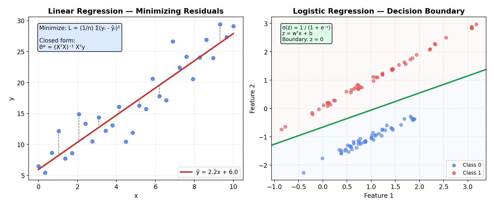
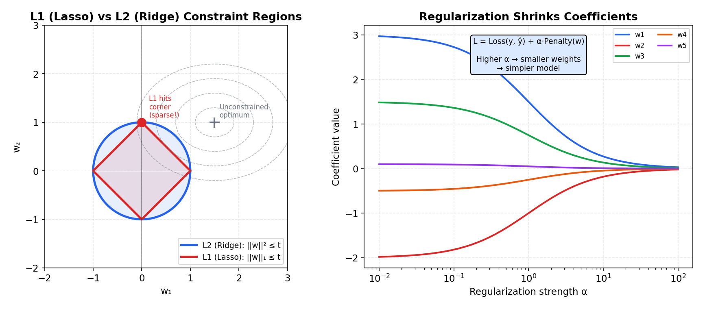

# Linear & Logistic Regression

> **🎯 Goal**: Master the foundational ML algorithms — the "Hello World" of supervised learning
> **⏱ Time**: 3–4h study + 1h exercises
> **📦 Deliverable**: Ability to build, interpret, and debug regression models

---

## Table of Contents

1. [Linear Regression](#1-linear-regression)
2. [Cost Function (MSE)](#2-cost-function-mse)
3. [Regularization](#3-regularization)
4. [Logistic Regression](#4-logistic-regression)
5. [Multi-class Classification](#5-multi-class-classification)
6. [Interpreting Coefficients](#6-interpreting-coefficients)
7. [Polynomial Regression](#7-polynomial-regression)
8. [Practical Tips](#8-practical-tips)
9. [Exercises](#9-exercises)

---

## 1. Linear Regression

### The Intuition (Backend Analogy)

> You're calibrating a **load balancer**. Each backend server has a weight that
> determines how much traffic it gets. Linear regression is the same idea: find the
> weight for each input feature that best predicts the output. The model literally
> learns: "for every 1-unit increase in feature X, the prediction changes by w."

```
y = w₁x₁ + w₂x₂ + ... + wₙxₙ + b

         Features (inputs)         Weights (learned)       Prediction
         ┌────────────┐            ┌────────────┐
         │ sq_feet    │───── × w₁ ─┤            │
         │ bedrooms   │───── × w₂ ─┤  Σ (sum)   │──→  price
         │ age        │───── × w₃ ─┤   + b      │
         └────────────┘            └────────────┘
```

### How It Works

**Goal**: Find the line (or hyperplane) that minimizes prediction errors.

```
  price ($k)
  500 |                          .  *
      |                     . *
  400 |                  .*        ← regression line (best fit)
      |              . *  *
  300 |          .*   *
      |       .* *
  200 |    .*  *
      |  .* *
  100 | *
      +──────────────────────────→ sq_feet
      500   1000   1500   2000

  Each * is a data point. The line minimizes
  total squared vertical distance to all points.
```

**Two ways to find the optimal weights:**

**Option A — Normal Equation (closed-form)**
Like running a direct SQL query — one shot, exact answer.

```
w = (XᵀX)⁻¹ Xᵀy
```

Fast for small datasets (< ~10k features). Requires matrix inverse — O(n³).

**Option B — Gradient Descent (iterative)**
Like iterative optimization: start with random weights, nudge them in the direction
that reduces error, repeat until convergence.

```
  Loss
   |  \   ← gradient points uphill,
   |    \_    so we go OPPOSITE direction
   |      \___
   |          \_____*  ← minimum (optimal weights)
   +──────────────────────→  weight w
```

Works for any dataset size. The workhorse of all ML optimization.



**The Math:**

```
Model (vector form):
  ŷ = Xθ  =  wᵀx + b

  where X is the (m × n) design matrix, θ = [w; b] is the parameter vector

MSE objective:
  J(θ) = (1/2m) Σᵢ (yᵢ - ŷᵢ)²

Normal equation (closed-form solution):
  θ* = (XᵀX)⁻¹ Xᵀy

Gradient of J with respect to θ:
  ∇J(θ) = (1/m) Xᵀ(Xθ - y)

Gradient descent update rule:
  θ ← θ - η · ∇J(θ)

  where η is the learning rate
```

**Worked Example — Normal Equation with 3 Points:**

```
Data: (1, 2), (2, 3), (3, 5)
We fit ŷ = θ₀ + θ₁x  (intercept + slope)

Design matrix X (with bias column) and target y:

       ┌     ┐         ┌   ┐
  X  = │ 1  1│    y  = │ 2 │
       │ 1  2│         │ 3 │
       │ 1  3│         │ 5 │
       └     ┘         └   ┘

Step 1: XᵀX
  XᵀX = ┌       ┐   ┌     ┐   ┌       ┐
         │ 1 1 1 │ × │ 1  1│ = │  3   6│
         │ 1 2 3 │   │ 1  2│   │  6  14│
         └       ┘   │ 1  3│   └       ┘
                      └     ┘

Step 2: Xᵀy
  Xᵀy = ┌       ┐   ┌   ┐   ┌    ┐
         │ 1 1 1 │ × │ 2 │ = │ 10 │
         │ 1 2 3 │   │ 3 │   │ 23 │
         └       ┘   │ 5 │   └    ┘
                      └   ┘

Step 3: (XᵀX)⁻¹
  det(XᵀX) = 3·14 - 6·6 = 42 - 36 = 6

  (XᵀX)⁻¹ = (1/6) ┌        ┐   ┌              ┐
                    │ 14  -6 │ = │  7/3    -1    │
                    │ -6   3 │   │  -1     1/2   │
                    └        ┘   └              ┘

Step 4: θ* = (XᵀX)⁻¹ Xᵀy
  θ* = ┌              ┐ ┌    ┐   ┌                        ┐   ┌      ┐
       │  7/3    -1   │ │ 10 │ = │ (7/3)·10 + (-1)·23    │ = │ 1/3  │
       │  -1     1/2  │ │ 23 │   │ (-1)·10 + (1/2)·23    │   │ 3/2  │
       └              ┘ └    ┘   └                        ┘   └      ┘

Result: ŷ = 1/3 + (3/2)x  ≈  0.33 + 1.5x

Verify: ŷ(1)=1.83, ŷ(2)=3.33, ŷ(3)=4.83  (close to 2, 3, 5 ✓)
```

### Recipe

```python
from sklearn.linear_model import LinearRegression
import numpy as np

X = np.array([[1400, 3], [1600, 3], [1700, 4], [1875, 4], [2200, 5]])
y = np.array([245, 312, 279, 308, 405])  # prices in $k

model = LinearRegression().fit(X, y)
print(f"Weights: {model.coef_}")       # [w_sqft, w_beds]
print(f"Bias:    {model.intercept_:.1f}")
print(f"Predict 1800 sqft, 3 bed: ${model.predict([[1800, 3]])[0]:.0f}k")
```

### When to Use

- Target is continuous (prices, latencies, counts)
- You want interpretable weights
- Baseline model before trying anything fancier

---

## 2. Cost Function (MSE)

### The Intuition (Backend Analogy)

> MSE is like an **SLA violation metric**: for each request, measure how far the actual
> latency was from the promised latency, square it (big violations hurt way more than
> small ones), then average. The model's job is to minimize this metric.

```
MSE = (1/n) Σ (yᵢ - ŷᵢ)²

       actual   predicted
```

### How It Works

The loss surface for linear regression is always **convex** — shaped like a bowl.
This means gradient descent is guaranteed to find the global minimum. No local minima
traps. This is a huge advantage over more complex models.

```
  Loss surface for linear regression (2 weights):

             Loss (MSE)
              |  ╲     ╱         ← bowl shape (convex)
              |    ╲ ╱
              |     *  ← global minimum (guaranteed!)
              +──────────→ w₁     No matter where you start,
             ╱                    GD rolls to the same optimum.
           w₂
```

**Why squared errors?**

| Property               | Why it matters                            |
|------------------------|-------------------------------------------|
| Penalizes big errors   | A prediction off by 10 costs 100, not 10  |
| Differentiable         | Gradient descent needs smooth derivatives  |
| Convex for linear      | Guarantees a single global minimum         |

**The Math:**

```
MSE objective (with the 1/2 convention for cleaner gradients):
  J(θ) = (1/2m) Σᵢ₌₁ᵐ (yᵢ - ŷᵢ)²

Expanded in terms of parameters:
  J(θ) = (1/2m) Σᵢ₌₁ᵐ (yᵢ - wᵀxᵢ - b)²

Gradient with respect to θ:
  ∇J(θ) = (1/m) Xᵀ(Xθ - y)

  Component-wise:
    ∂J/∂wⱼ = (1/m) Σᵢ₌₁ᵐ (ŷᵢ - yᵢ) · xᵢⱼ
    ∂J/∂b   = (1/m) Σᵢ₌₁ᵐ (ŷᵢ - yᵢ)

The 1/2 factor is a convention — it cancels with the exponent's derivative,
giving a cleaner gradient. Some formulations use 1/m without the 1/2.
```

### Recipe

```python
import numpy as np

y_true = np.array([300, 400, 250, 350])
y_pred = np.array([310, 380, 260, 340])

mse = np.mean((y_true - y_pred) ** 2)
rmse = np.sqrt(mse)  # same units as target
print(f"MSE: {mse:.1f}  RMSE: {rmse:.1f}")  # MSE: 150.0  RMSE: 12.2
```

---

## 3. Regularization

### The Intuition (Backend Analogy)

> Without regularization, a model with many features can **memorize** the training data
> by assigning huge weights to noise. It's like a microservice that caches every single
> request/response pair — perfect recall on seen data, useless for new requests.
>
> Regularization adds a **penalty for large weights**, forcing the model to keep things
> simple. Think of it as putting a budget constraint on your infrastructure spend.

### How It Works

We add a penalty term to the cost function:

```
Original loss:      L = MSE(y, ŷ)
L1 (Lasso):         L = MSE(y, ŷ) + α Σ|wᵢ|
L2 (Ridge):         L = MSE(y, ŷ) + α Σwᵢ²
ElasticNet:         L = MSE(y, ŷ) + α₁ Σ|wᵢ| + α₂ Σwᵢ²
```

**L1 (Lasso) — Automatic Feature Selection**

> Like **aggressive garbage collection**: kills unused weights entirely. Some weights
> go to exactly 0, effectively removing those features.

**L2 (Ridge) — Shrink Everything**

> Like **rate limiting**: doesn't kill any feature, but prevents any single one from
> dominating. All weights shrink toward zero but never reach it.

```
  Weight space constraint visualization (2D case):

  L1 (Lasso) — Diamond              L2 (Ridge) — Circle
       w₂                                w₂
       |  /\                              |    ___
       | /  \                             |  /     \
       |/    \                            | |       |
  ─────*──────*───→ w₁            ────────|─────────|──→ w₁
       |\    /                            | |       |
       | \  /                             |  \_____/
       |  \/                              |
                                  
  Diamond has CORNERS on axes      Circle is smooth — optimal point
  → optimal point often lands      rarely lands exactly on an axis
  at a corner → some wᵢ = 0       → all weights shrink, none = 0
```

**The α (alpha) hyperparameter** controls penalty strength:

```
  α = 0          α = small        α = medium        α = huge
  No penalty     Mild shrinkage   Strong shrinkage   All weights → 0
  (overfit risk) (usually good)   (usually good)     (underfit risk)
  
  ← more complex model                    simpler model →
```



**The Math:**

```
Ridge (L2) — penalizes sum of squared weights:
  J = (1/2m) Σ(yᵢ - ŷᵢ)² + α · ‖w‖₂²
    = (1/2m) Σ(yᵢ - ŷᵢ)² + α · Σⱼ wⱼ²

  Closed-form solution (note the αI term that makes XᵀX always invertible):
    θ* = (XᵀX + αI)⁻¹ Xᵀy

Lasso (L1) — penalizes sum of absolute weights:
  J = (1/2m) Σ(yᵢ - ŷᵢ)² + α · ‖w‖₁
    = (1/2m) Σ(yᵢ - ŷᵢ)² + α · Σⱼ |wⱼ|

  No closed-form solution (|w| is not differentiable at 0).
  Uses coordinate descent or subgradient methods.

ElasticNet — combines L1 and L2:
  J = (1/2m) Σ(yᵢ - ŷᵢ)² + α · (ρ · ‖w‖₁ + (1-ρ) · ‖w‖₂²)

  ρ = 1 → pure Lasso, ρ = 0 → pure Ridge

WHY L1 produces sparsity (geometric explanation):
  The constraint region for L1 is a diamond (‖w‖₁ ≤ t).
  The MSE contours are ellipses centered at the unconstrained optimum.
  The first point where an ellipse touches the diamond is usually
  at a CORNER — and corners lie on coordinate axes where some wⱼ = 0.
  L2's constraint region is a circle (sphere in higher-D), which is smooth.
  Ellipses typically touch circles at non-axis points → all wⱼ ≠ 0.
```

### Recipe

```python
from sklearn.linear_model import Lasso, Ridge, ElasticNet

# L1 — drives some weights to zero (feature selection)
lasso = Lasso(alpha=0.1).fit(X_train, y_train)
print(f"L1 weights: {lasso.coef_}")  # some will be exactly 0.0

# L2 — shrinks all weights (none to zero)
ridge = Ridge(alpha=1.0).fit(X_train, y_train)
print(f"L2 weights: {ridge.coef_}")  # all small, none exactly 0

# ElasticNet — best of both worlds
enet = ElasticNet(alpha=0.1, l1_ratio=0.5).fit(X_train, y_train)
```

### When to Use

| Scenario                          | Method       |
|-----------------------------------|--------------|
| Many features, suspect most noise | L1 (Lasso)   |
| All features likely relevant      | L2 (Ridge)   |
| Many correlated features          | ElasticNet   |
| Few features, lots of data        | No reg needed |

---

## 4. Logistic Regression

### The Intuition (Backend Analogy)

> **Despite the name, logistic regression is for CLASSIFICATION, not regression.**
>
> Think of it like a **circuit breaker** in a microservice. Linear regression computes
> a raw score (could be any number). The sigmoid function squashes it into [0, 1] —
> a probability. If P > 0.5, classify as positive (circuit open); otherwise negative
> (circuit closed). The "logistic" part is just the sigmoid transform.

### How It Works

**Step 1**: Compute a linear score (same as linear regression):

```
z = w₁x₁ + w₂x₂ + ... + b
```

**Step 2**: Pass through the **sigmoid function** to get a probability:

```
σ(z) = 1 / (1 + e^(-z))
```

```
  The Sigmoid (S-curve):

  P(y=1)
  1.0 |                     ─────────────
  0.5 |─ ─ ─ ─ ─ ─ ─ ─*─ ─ ─ ─ ─ ─   ← decision boundary (P = 0.5)
  0.0 |────────
      +──────────────────────────────→  z (linear score)
     -6   -4   -2    0    2    4    6

  z < 0 → P < 0.5 → Class 0  |  z > 0 → P > 0.5 → Class 1
```

**Step 3**: The **decision boundary** — where z = 0 — is a line (2D) or hyperplane (nD):

```
  feature₂
      |  ○ ○               ○ = class 0 (legit)
      |  ○   ╲ ● ●         ● = class 1 (fraud)
      |    ○   ╲   ● ●     ╲ = decision boundary (P = 0.5)
      |      ○   ╲ ● ●
      +──────────────────────→ feature₁
```

**Why NOT use MSE for classification?**

MSE with sigmoid creates a **non-convex** loss surface (multiple local minima).
Binary Cross-Entropy (log loss) stays convex — gradient descent finds the optimum.

```
  Binary Cross-Entropy Loss:
  L = -[ y·log(ŷ) + (1-y)·log(1-ŷ) ]

  If actual y=1:  L = -log(ŷ)      → low loss when ŷ→1, huge loss when ŷ→0
  If actual y=0:  L = -log(1-ŷ)    → low loss when ŷ→0, huge loss when ŷ→1
```

**The Math:**

```
Logistic link function (log-odds is linear):
  log(p / (1-p)) = wᵀx + b

  This means: the log of the odds ratio is a linear function of features.
  Inverting gives the sigmoid.

Sigmoid function:
  σ(z) = 1 / (1 + e⁻ᶻ)

  Key properties:
    σ(0) = 0.5          (decision boundary)
    σ(-z) = 1 - σ(z)    (symmetric about 0.5)
    σ'(z) = σ(z)(1 - σ(z))  (gradient — maximal at z=0, vanishes at extremes)

Binary Cross-Entropy (BCE) Loss:
  L = -(1/n) Σᵢ₌₁ⁿ [ yᵢ · log(pᵢ) + (1 - yᵢ) · log(1 - pᵢ) ]

Deriving BCE from MLE:
  Likelihood per sample: P(y|x) = pʸ · (1-p)^(1-y)
  Log-likelihood: ℓ(w) = Σᵢ [ yᵢ·log(pᵢ) + (1-yᵢ)·log(1-pᵢ) ]
  Negative log-likelihood = BCE loss  (minimize loss ↔ maximize likelihood)

Decision boundary (the hyperplane where P = 0.5):
  wᵀx + b = 0   →   σ(0) = 0.5
  Points on one side: wᵀx + b > 0 → P > 0.5 → class 1
  Points on other side: wᵀx + b < 0 → P < 0.5 → class 0

Gradient of BCE with respect to w:
  ∇L = (1/n) Xᵀ(σ(Xw) - y)

  Note: identical in form to linear regression gradient! The sigmoid
  is "absorbed" into the residual term (predictions - actuals).
```

### Recipe

```python
from sklearn.linear_model import LogisticRegression
from sklearn.metrics import accuracy_score

model = LogisticRegression(max_iter=1000).fit(X_train, y_train)
y_pred = model.predict(X_test)
y_prob = model.predict_proba(X_test)[:, 1]  # P(class=1)

print(f"Accuracy: {accuracy_score(y_test, y_pred):.2%}")
print(f"Coefficients: {model.coef_[0]}")  # feature importance
```

### When to Use

- Binary classification (spam/not, fraud/legit, churn/stay)
- You need probability outputs, not just labels
- You want interpretable feature importance
- Fast training, good baseline before complex models

---

## 5. Multi-class Classification

### The Intuition (Backend Analogy)

> Binary logistic regression is like a **single health check**: up or down. For
> multi-class, you need to route to one of N backend services. Two strategies:
> run N independent health checks (OvR), or one smart load balancer that scores
> all services simultaneously (Softmax).

### How It Works

**One-vs-Rest (OvR)**: Train N separate binary classifiers, pick the most confident.

```
  3-class problem (Cat / Dog / Bird):

  Classifier 1:  Cat vs [Dog, Bird]  → P(cat)  = 0.8  ← winner
  Classifier 2:  Dog vs [Cat, Bird]  → P(dog)  = 0.3
  Classifier 3:  Bird vs [Cat, Dog]  → P(bird) = 0.1

  Prediction: Cat (highest confidence)
```

**Softmax**: Generalize sigmoid to N classes. All probabilities sum to 1.

```
  softmax(zᵢ) = e^(zᵢ) / Σⱼ e^(zⱼ)

  Raw scores:   z = [2.0, 1.0, 0.5]
                         ↓ softmax
  Probabilities:   [0.59, 0.24, 0.17]   ← sum = 1.0
                     Cat   Dog   Bird
```

**The Math:**

```
Softmax function (generalization of sigmoid to K classes):
  pₖ = e^(zₖ) / Σⱼ₌₁ᴷ e^(zⱼ)

  where zₖ = wₖᵀx + bₖ  (each class has its own weight vector)

  Properties:
    0 < pₖ < 1  for all k
    Σₖ pₖ = 1   (valid probability distribution)
    When K=2, softmax reduces to sigmoid

Cross-entropy loss (multi-class):
  L = -(1/n) Σᵢ₌₁ⁿ Σₖ₌₁ᴷ yᵢₖ · log(pᵢₖ)

  where yᵢₖ is 1 if sample i belongs to class k, 0 otherwise (one-hot)

OvR vs Softmax:
  OvR:     K independent classifiers. Probabilities may NOT sum to 1.
  Softmax: One model, K outputs, jointly optimized. Probabilities sum to 1.
```

### Recipe

```python
from sklearn.linear_model import LogisticRegression

# sklearn auto-detects multi-class from y labels
model = LogisticRegression(multi_class='multinomial', max_iter=1000)
model.fit(X_train, y_train)  # y_train has 3+ classes

probs = model.predict_proba(X_test)  # shape: (n_samples, n_classes)
print(f"Classes: {model.classes_}")
print(f"Probabilities: {probs[0]}")  # [P(cat), P(dog), P(bird)]
```

---

## 6. Interpreting Coefficients

### The Intuition (Backend Analogy)

> Reading model coefficients is like reading a **query execution plan**. The plan
> tells you which indexes matter, which joins are costly, and where time is spent.
> Coefficients tell you which features matter, their direction, and their magnitude.

### How It Works

```
  House price model (AFTER feature scaling):

  Feature        Weight     Interpretation
  ─────────────  ─────────  ──────────────────────────────
  sq_feet        +0.72      Strongest positive driver
  bedrooms       +0.15      Moderate positive effect
  age            -0.33      Older = cheaper
  crime_rate     -0.51      Strong negative effect
  has_pool       +0.08      Weak positive effect
  random_noise   +0.002     ← basically zero (irrelevant)
```

**Critical: Scale features first!**

Without scaling, a feature in meters and one in kilometers have incomparable weights.
After scaling (StandardScaler), magnitudes are directly comparable.

```
  BEFORE scaling:                 AFTER scaling:
  sq_feet (1000s) → w = 0.1      sq_feet  → w = 0.72  ← NOW comparable
  bedrooms (1-5)  → w = 45.0     bedrooms → w = 0.15  |0.72| > |0.15| → sq_feet wins
```

**For logistic regression**, the interpretation changes slightly:

```
  Coefficient w = 0.5 for feature X means:
  → A 1-unit increase in X multiplies the ODDS by e^0.5 ≈ 1.65
  → The odds of class 1 increase by 65%
```

**The Math:**

```
Linear regression — interpreting wⱼ:
  ŷ = w₁x₁ + w₂x₂ + ... + b

  Holding all other features constant, a 1-unit increase in xⱼ changes ŷ by exactly wⱼ:
    Δŷ = wⱼ · Δxⱼ

  Example: w_sqft = 0.15 means each extra sq ft adds $0.15k to predicted price.

Logistic regression — interpreting wⱼ via odds ratio:
  log(p / (1-p)) = wᵀx + b

  A 1-unit increase in xⱼ adds wⱼ to the log-odds:
    log-odds_new = log-odds_old + wⱼ

  Exponentiating: odds_new = odds_old · e^(wⱼ)

  The odds ratio for feature j:  OR = e^(wⱼ)

  Example: wⱼ = 0.5  →  OR = e^0.5 ≈ 1.65  →  odds increase by 65%
  Example: wⱼ = -1.0 →  OR = e^-1  ≈ 0.37  →  odds decrease by 63%
```

### Recipe

```python
from sklearn.preprocessing import StandardScaler
import numpy as np

scaler = StandardScaler()
X_scaled = scaler.fit_transform(X_train)
model.fit(X_scaled, y_train)

# Rank features by importance (absolute weight)
importance = sorted(zip(feature_names, model.coef_[0]),
                    key=lambda x: abs(x[1]), reverse=True)
for name, w in importance:
    print(f"  {name:15s}  {w:+.3f}")
```

---

## 7. Polynomial Regression

### The Intuition (Backend Analogy)

> Sometimes the relationship is non-linear. Server response time doesn't increase
> linearly with load — it's more like a **hockey stick** (flat, then explosive). Adding
> polynomial features (x², x³) lets linear regression fit curves. But too many terms
> and you're overfitting — like building a cache key that includes the timestamp.

### How It Works

```
  Original: y = w₁x + b                (line)
  Degree 2: y = w₁x + w₂x² + b        (parabola)
  Degree 3: y = w₁x + w₂x² + w₃x³ + b (cubic)

  Trick: treat x² and x³ as NEW features, then use regular linear regression!
```

```
  Underfitting (degree 1)    Good fit (degree 2)      Overfitting (degree 15)

  y |        *               y |        *              y |     *  
    |   ──────── *             |      ╱   ╲  *           |    ╱ ╲╱╲ *
    |  * ───── *               |    ╱  *    ╲            |  *╱     ╲
    |  ──── *                  |  *╱         ╲           | ╱   *    ╲*
    | ───*                     | ╱  *                    |╱  *       ╲
    |── *                      |╱                        *╱           ╲
    +──────→ x                 +──────────→ x            +──────────→ x

  Too simple:                 Captures the real         Memorizes noise:
  misses the pattern          relationship              wiggles through
  (high bias)                 (low bias, low var)       every point
                                                        (high variance)
```

**The Math:**

```
Feature map (transform input into polynomial features):
  φ(x) = [1, x, x², x³, ..., xᵈ]

  For d features: include all cross-terms up to degree d
  Example (2 features, degree 2):
    φ(x₁, x₂) = [1, x₁, x₂, x₁², x₁x₂, x₂²]

The model is still LINEAR in its parameters:
  ŷ = wᵀφ(x) = w₀ + w₁x + w₂x² + ... + wₐxᵈ

  We only transformed the INPUTS, not the model form.
  All linear regression math (normal equation, gradient descent) still applies.
  This is why it's called "polynomial regression" but is really linear regression
  on polynomial features.

Number of features after polynomial expansion:
  For p original features at degree d:
    count = C(p + d, d) = (p + d)! / (p! · d!)

  Example: p=10, d=3 → 286 features (combinatorial explosion!)
  → Always pair with regularization for d > 2.
```

### Recipe

```python
from sklearn.preprocessing import PolynomialFeatures
from sklearn.pipeline import make_pipeline
from sklearn.linear_model import Ridge

# Degree 2 polynomial + Ridge regularization (prevents overfitting)
model = make_pipeline(
    PolynomialFeatures(degree=2, include_bias=False),
    Ridge(alpha=1.0)
)
model.fit(X_train, y_train)
print(f"R² score: {model.score(X_test, y_test):.3f}")
```

### When to Use

- Clear non-linear pattern in residuals
- Few features (polynomial features explode combinatorially)
- Always pair with regularization for degree > 2

---

## 8. Practical Tips

### Feature Scaling — Do It First

L1 and L2 penalties are **scale-sensitive**. A feature in thousands and one in
fractions will have wildly different treatment. Always scale.

```python
from sklearn.pipeline import make_pipeline
from sklearn.preprocessing import StandardScaler
from sklearn.linear_model import LogisticRegression

# StandardScaler first, then model — pipeline ensures correct transform on test
model = make_pipeline(StandardScaler(), LogisticRegression())
model.fit(X_train, y_train)
```

### Check Residual Plots

Residuals (errors) should look like random noise. Patterns signal a problem.

```
  GOOD residuals (random):         BAD residuals (pattern):

  error                            error
    + |  *     *                     + |            * * *
      |     *      *                   |         *
    0 |──*─────*────*──→               | ──*──*──────────→
      |    *     *                     |*      *
    - | *     *                      - |
      predicted                        predicted

  No pattern = model is OK.         Curved pattern = non-linear
                                    relationship not captured.
                                    → Try polynomial features.
```

### Choosing α (Regularization Strength)

Use cross-validation — let the data decide:

```python
from sklearn.linear_model import RidgeCV

# Tries each alpha, picks best via cross-validation
model = RidgeCV(alphas=[0.01, 0.1, 1.0, 10.0, 100.0])
model.fit(X_train, y_train)
print(f"Best alpha: {model.alpha_}")
```

### Decision Checklist

```
  Start here
      │
      ▼
  Target continuous? ──yes──→ LinearRegression
      │                            │
      no                     Many features?
      │                      │           │
      ▼                     yes          no
  Binary or Multi?           │           │
      │         │            ▼           ▼
   binary    multi      Ridge/Lasso   Plain LR
      │         │
      ▼         ▼
  Logistic   Logistic
  Regression (multinomial)
```

---

## 9. Exercises

### Exercise 1: Conceptual — Overfitting Diagnosis

> You train a linear regression with **100 features** on **50 samples**. Training MSE
> is near zero but test MSE is huge.
>
> **(a)** What's happening?
> **(b)** Would L1 or L2 regularization help more? Why?
> **(c)** What's the rough upper limit of features you'd want for 50 samples?

<details>
<summary>Solution</summary>

**(a)** Classic **overfitting**. With 100 features and only 50 samples, the model has
more degrees of freedom than data points. It can perfectly fit (memorize) the training
data, including noise. The model hasn't learned the real signal — it's learned the
noise. Think of it like a key-value cache with every training input stored: perfect
on training queries, useless for unseen ones.

**(b)** **L1 (Lasso)** would help more. You have 100 features but only 50 samples — most
features are likely noise. L1 drives irrelevant feature weights to exactly zero,
effectively performing feature selection. It might keep 10-20 meaningful features and
discard the rest. L2 (Ridge) would shrink all 100 weights but wouldn't eliminate any,
so you'd still carry the noise features (just with smaller weights).

**(c)** A common rule of thumb is **10-20 samples per feature**. For 50 samples, you'd
want at most ~5-10 features. With 100 features, you need either more data (~1000+
samples) or aggressive feature selection (L1 regularization).

</details>

---

### Exercise 2: Implementation — Logistic Regression

> Build a logistic regression classifier for binary classification. Show: fit, predict,
> print coefficients, and compute accuracy. Use sklearn. **Max 10 lines.**

<details>
<summary>Solution</summary>

```python
from sklearn.datasets import load_breast_cancer
from sklearn.linear_model import LogisticRegression
from sklearn.model_selection import train_test_split
from sklearn.metrics import accuracy_score

X, y = load_breast_cancer(return_X_y=True)
X_train, X_test, y_train, y_test = train_test_split(X, y, test_size=0.2)

model = LogisticRegression(max_iter=10000).fit(X_train, y_train)
print(f"Accuracy: {accuracy_score(y_test, model.predict(X_test)):.2%}")
top = sorted(zip(load_breast_cancer().feature_names, model.coef_[0]),
             key=lambda x: abs(x[1]), reverse=True)[:5]
for name, w in top:
    print(f"  {name:25s} {w:+.4f}")
```

</details>

---

### Exercise 3: Real-World Scenario — House Price Prediction

> Your team wants to predict house prices. Features: `square_feet`, `bedrooms`,
> `zip_code` (500 unique values), `has_pool`, `year_built`. Walk through your
> preprocessing and model selection decisions.

<details>
<summary>Solution</summary>

**Step 1: Feature Preprocessing**

```
  Feature        Type         Preprocessing
  ───────────    ──────────   ────────────────────────────────
  square_feet    numeric      StandardScaler
  bedrooms       numeric      StandardScaler
  zip_code       categorical  One-hot encode (500 → 500 binary columns!)
  has_pool       binary       Already 0/1, leave as-is
  year_built     numeric      StandardScaler (or engineer: age = 2025 - year_built)
```

**Step 2: Problem — High Dimensionality**

After one-hot encoding `zip_code`, you have ~504 features. Options:
1. **Ridge (L2)** — shrink all weights, keep all zip codes
2. **Lasso (L1)** — zero out irrelevant zip codes
3. **Target encode** zip_code — replace each zip with mean price (reduces 500 cols to 1)

**Step 3: Model Selection**

```python
from sklearn.pipeline import make_pipeline
from sklearn.preprocessing import StandardScaler, OneHotEncoder
from sklearn.compose import ColumnTransformer
from sklearn.linear_model import RidgeCV

preprocessor = ColumnTransformer([
    ('num', StandardScaler(), ['square_feet', 'bedrooms', 'year_built']),
    ('cat', OneHotEncoder(handle_unknown='ignore'), ['zip_code']),
    ('pass', 'passthrough', ['has_pool']),
])

model = make_pipeline(preprocessor, RidgeCV(alphas=[0.1, 1, 10, 100]))
model.fit(X_train, y_train)
```

**Step 4: Validate**

- Check residual plot — if curved, try polynomial features on `square_feet`
- Cross-validate R² score — expect 0.7-0.9 for a reasonable housing dataset
- Inspect coefficients — `square_feet` should dominate (sanity check)

</details>

---

## Quick Reference Card

```
┌────────────────┬────────────────────────────────────────────────────┐
│ Algorithm      │ Use Case                                          │
├────────────────┼────────────────────────────────────────────────────┤
│ Linear Reg     │ Continuous target, interpretable baseline          │
│ Ridge (L2)     │ Many features, prevent overfitting                 │
│ Lasso (L1)     │ Many features, want automatic selection            │
│ Logistic Reg   │ Binary/multi-class classification with probs      │
│ Polynomial     │ Non-linear patterns (pair with regularization!)   │
├────────────────┼────────────────────────────────────────────────────┤
│ Key Rules      │ Always scale │ Check residuals │ CV for alpha     │
│                │ Start: LinearReg → Ridge → Polynomial → complex   │
└────────────────┴────────────────────────────────────────────────────┘
```
