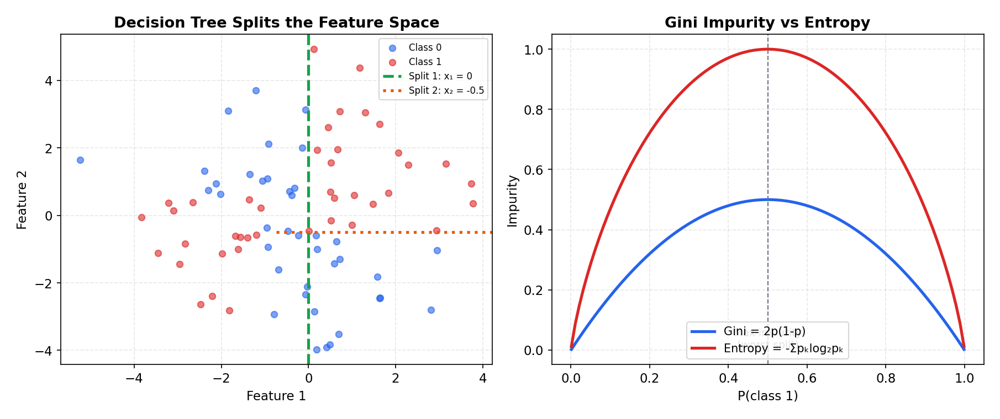
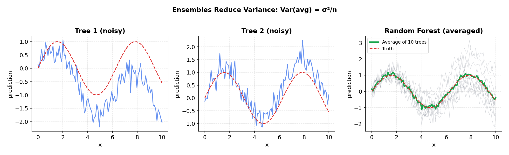

# Decision Trees & Ensembles

> **🎯 Goal**: Understand trees and Random Forests — the most practical algorithms for tabular data
> **⏱ Time**: 3–4h study + 1h exercises
> **📦 Deliverable**: Ability to build, tune, and interpret tree-based models

---

## Table of Contents

1. [Decision Trees](#1-decision-trees)
2. [How Trees Split](#2-how-trees-split)
3. [Overfitting in Trees](#3-overfitting-in-trees)
4. [Ensemble Methods — The Power of Crowds](#4-ensemble-methods--the-power-of-crowds)
5. [Random Forest](#5-random-forest)
6. [Feature Importance](#6-feature-importance)
7. [Advantages & Disadvantages](#7-advantages--disadvantages)
8. [Practical Tips](#8-practical-tips)
9. [Exercises](#9-exercises)

---

## 1. Decision Trees

### The Intuition (Backend Analogy)

> A decision tree is a **chain of if/else statements** that the model writes for itself.
> Think of a binary search tree, but instead of searching for a value, you're searching
> for a prediction. Each internal node asks a yes/no question about a feature. Each leaf
> holds the answer. The model's job: learn WHICH questions to ask and in what order.

### How It Works

```
              Will this user churn?

           [monthly_spend < $50?]
            /                  \
          Yes                   No
          /                      \
   [support_tickets > 3?]    [tenure < 6 months?]
     /            \              /            \
   Yes            No           Yes            No
   /               \            /              \
 [CHURN]     [stay: 82%]   [CHURN: 70%]    [STAY: 95%]
  leaf          leaf          leaf            leaf

  Reading one path: "User spends < $50/mo AND filed > 3 tickets → CHURN"
```

Each node splits on a feature + threshold. The tree greedily picks the split that
best separates the classes. Predictions flow from root to leaf — exactly like a
routing table forwarding a packet hop by hop.

### Recipe

```python
from sklearn.tree import DecisionTreeClassifier, export_text

X_train, y_train = load_data()  # your feature matrix + labels
tree = DecisionTreeClassifier(max_depth=4, random_state=42)
tree.fit(X_train, y_train)

# Print the learned if/else rules
print(export_text(tree, feature_names=list(X_train.columns)))
```

### When to Use

Decision trees are your go-to when you need **interpretability** — when a product
manager asks "why did the model flag this user?" you can trace the exact path. They're
also the building block for every ensemble method that follows.

---

## 2. How Trees Split

### The Intuition (Backend Analogy)

> Choosing a split is like choosing which column to index in your database. You want the
> index that separates your query results most cleanly. A perfect split puts all "churn"
> users on one side and all "stay" users on the other — like an index with perfect
> selectivity.

### How It Works

**Gini Impurity** — measures how "mixed" a node is:

```
  Gini = 1 - Σ(pᵢ²)     where pᵢ = fraction of class i

  Pure node (all same class):  Gini = 1 - 1² = 0        ← best
  50/50 split:                 Gini = 1 - 0.5² - 0.5² = 0.5  ← worst (binary)
```

**Entropy / Information Gain** — measures uncertainty reduction:

```
  Entropy = -Σ(pᵢ · log₂(pᵢ))

  Pure node:   Entropy = 0          ← no uncertainty
  50/50 split: Entropy = 1 bit      ← maximum uncertainty (binary)

  Info Gain = Entropy(parent) - weighted_avg(Entropy(children))
```

**For regression trees**: use variance reduction instead. Pick the split that minimizes
the variance within each child node.

**Good split vs bad split**:

```
  GOOD SPLIT (on "monthly_spend < $50")     BAD SPLIT (on "user_id is even")

  Parent: 50 churn, 50 stay                 Parent: 50 churn, 50 stay

        [spend < $50?]                           [id % 2 == 0?]
        /            \                            /            \
    Left             Right                    Left             Right
  40 churn          10 churn                25 churn          25 churn
  10 stay           40 stay                 25 stay           25 stay

  Gini left  = 1-(.8²+.2²) = 0.32          Gini left  = 1-(.5²+.5²) = 0.50
  Gini right = 1-(.2²+.8²) = 0.32          Gini right = 1-(.5²+.5²) = 0.50

  → Big improvement from parent!            → No improvement at all!
```

**The greedy algorithm**: at each node, the tree tries every feature × every threshold.
It picks the (feature, threshold) combo that yields the lowest weighted Gini in the
children. This is O(n × m × log n) per node — n samples, m features.

### Recipe

```python
from sklearn.tree import DecisionTreeClassifier

# Gini (default) vs Entropy — usually same results
tree_gini = DecisionTreeClassifier(criterion="gini", max_depth=4)
tree_entropy = DecisionTreeClassifier(criterion="entropy", max_depth=4)

# For regression: variance reduction is the default
from sklearn.tree import DecisionTreeRegressor
reg_tree = DecisionTreeRegressor(max_depth=4)
```

### When to Use

You rarely pick the splitting criterion manually — Gini and Entropy give nearly
identical trees. The key insight: **trees are greedy**. They find locally optimal
splits, not globally optimal ones. This is why single trees are fragile and ensembles
exist.

### **The Math:**

**Gini Impurity** (general form, K classes):

```
  G(node) = 1 - Σₖ pₖ²

  where pₖ = (# samples of class k in node) / (total samples in node)

  Binary case (K=2, class probabilities p and 1-p):
    G = 1 - p² - (1-p)² = 2p(1-p)

    Maximum at p = 0.5 → G = 0.5   (most impure)
    Minimum at p = 0 or 1 → G = 0  (pure node)
```

**Entropy** (general form, K classes):

```
  H(node) = -Σₖ pₖ · log₂(pₖ)

  Binary case:
    H = -p · log₂(p) - (1-p) · log₂(1-p)

    Maximum at p = 0.5 → H = 1 bit
    Minimum at p = 0 or 1 → H = 0 bits
```

**Information Gain** — the criterion the tree maximizes at each split:

```
  IG(split) = I(parent) - Σ_c (nᶜ / n) · I(child_c)

  where:
    I     = impurity function (Gini or Entropy)
    nᶜ    = number of samples in child c
    n     = total samples in parent
    Σ_c   = sum over all children (2 for binary splits)
```

**Regression split objective** — minimize total squared error:

```
  argmin   [ Σ_{i ∈ left}(yᵢ - c₁)²  +  Σ_{i ∈ right}(yᵢ - c₂)² ]
  (j, s)

  where:
    j  = feature index
    s  = split threshold
    c₁ = mean(y) for left child   = (1/|left|) Σ_{i ∈ left} yᵢ
    c₂ = mean(y) for right child  = (1/|right|) Σ_{i ∈ right} yᵢ
```

**Worked example** — Gini before and after a split:

```
  Parent node: 10 samples → 6 class-A, 4 class-B
    p_A = 0.6,  p_B = 0.4
    G(parent) = 1 - (0.6² + 0.4²) = 1 - (0.36 + 0.16) = 0.48

  Split on feature "age < 30":
    Left child:  7 samples → 5 A, 2 B
      G(left) = 1 - ((5/7)² + (2/7)²) = 1 - (0.510 + 0.082) = 0.408

    Right child: 3 samples → 1 A, 2 B
      G(right) = 1 - ((1/3)² + (2/3)²) = 1 - (0.111 + 0.444) = 0.444

  Weighted Gini after split:
    G(after) = (7/10) × 0.408 + (3/10) × 0.444
             = 0.286 + 0.133 = 0.419

  Information Gain (Gini):
    IG = 0.48 - 0.419 = 0.061   ← positive gain → split is worth it
```



---

## 3. Overfitting in Trees

### The Intuition (Backend Analogy)

> An unrestricted decision tree is like **caching every single request/response pair**
> instead of writing general routing logic. It gets 100% accuracy on past traffic but
> fails on anything new. A shallow tree is like a one-line redirect rule — too simple.
> You need to find the sweet spot in between.

### How It Works

```
  UNDERFIT (max_depth=1)         JUST RIGHT (max_depth=4)        OVERFIT (no limit)

       [age < 30?]                  [spend < $50?]               [spend < $49.73?]
       /         \                  /             \               /                \
   [churn]    [stay]         [tickets > 3?]  [tenure < 6?]   [age < 27.5?]    [...]
                              /        \       /       \       /       \
                          [churn]  [82%]  [70%]    [95%]   [...]    [...]
                                                             /  \     / \
  Train acc: 60%              Train acc: 88%                ...  ... ... ...
  Test acc:  58%              Test acc:  85%
  (too simple)                (generalizes)               Train acc: 99%
                                                          Test acc:  62%
                                                          (memorized training data)
```

**Controls to prevent overfitting**:

```
  +---------------------+------------------------------------------+-----------------+
  | Parameter           | What It Does                             | Typical Range   |
  +---------------------+------------------------------------------+-----------------+
  | max_depth           | Limits tree height                       | 3–10            |
  | min_samples_split   | Min samples needed to split a node       | 5–50            |
  | min_samples_leaf    | Min samples required in each leaf        | 3–20            |
  | max_leaf_nodes      | Hard cap on number of leaves             | 10–100          |
  +---------------------+------------------------------------------+-----------------+
```

**Pruning** — the alternative approach: grow the full tree first, then trim branches
that don't improve validation accuracy. Like writing a long function and then
refactoring to remove dead code. Sklearn uses `ccp_alpha` (cost-complexity pruning).

### Recipe

```python
from sklearn.tree import DecisionTreeClassifier
from sklearn.model_selection import cross_val_score

# Restrict tree complexity
tree = DecisionTreeClassifier(
    max_depth=5,
    min_samples_split=20,
    min_samples_leaf=10,
    random_state=42,
)
scores = cross_val_score(tree, X, y, cv=5, scoring="accuracy")
print(f"CV accuracy: {scores.mean():.3f} ± {scores.std():.3f}")
```

### When to Use

**Always** constrain your trees. An unrestricted tree on any real dataset will overfit.
The question isn't "should I regularize?" — it's "how much?" Use cross-validation to
find the right depth. Or better yet: skip the tuning headache and use an ensemble.

### **The Math:**

**Cost-complexity pruning** — grow the full tree, then penalize complexity:

```
  R_α(T) = R(T) + α|T|

  where:
    R(T)  = training error (misclassification rate or MSE) of tree T
    |T|   = number of terminal leaves (tree complexity)
    α     = complexity parameter (α ≥ 0)

  α = 0   → keep the full tree (no penalty for size)
  α → ∞   → prune to a single root node (maximum penalty)

  In sklearn: ccp_alpha parameter. Find optimal α via cross-validation:
    path = tree.cost_complexity_pruning_path(X_train, y_train)
    ccp_alphas = path.ccp_alphas  # candidate α values
```

**Pre-pruning constraints** — stop splitting early:

```
  +---------------------+-----------------------------------------------+
  | Parameter           | Formal Constraint                             |
  +---------------------+-----------------------------------------------+
  | max_depth = d       | depth(node) ≤ d                               |
  | min_samples_split=m | |node| ≥ m  to allow splitting                |
  | min_samples_leaf=l  | |child| ≥ l  for every child after split      |
  | max_leaf_nodes = L  | |{leaves}| ≤ L                                |
  +---------------------+-----------------------------------------------+

  These constraints act as regularizers — they increase bias to reduce variance,
  just like λ in L2 regularization for linear models.
```

---

## 4. Ensemble Methods — The Power of Crowds

### The Intuition (Backend Analogy)

> Think **microservices vs monolith**. One huge, complex service (a single deep tree)
> is fragile — a bad split at the top cascades to every prediction. Many small, simple
> services (shallow trees) that each handle a slice of traffic and vote on the answer
> are far more robust. Errors in individual services cancel out when you aggregate.

### How It Works

**Bagging** (Bootstrap Aggregating):

```
  Original Dataset (1000 rows)
  ┌──────────────────────────┐
  │ row 1, row 2, ... row 1000 │
  └──────────────────────────┘
       │          │          │
       ▼          ▼          ▼
   Sample 1    Sample 2    Sample 3       ← random samples WITH replacement
   (1000 rows) (1000 rows) (1000 rows)     (some rows repeated, some missing)
       │          │          │
       ▼          ▼          ▼
   ┌──────┐  ┌──────┐  ┌──────┐
   │Tree 1│  │Tree 2│  │Tree 3│          ← each tree trained independently
   └──────┘  └──────┘  └──────┘
       │          │          │
       ▼          ▼          ▼
   "churn"    "stay"     "churn"          ← individual predictions
       \         |         /
        \        |        /
         ▼       ▼       ▼
      ┌─────────────────────┐
      │   Majority Vote     │             ← final answer: "churn" (2 vs 1)
      └─────────────────────┘
```

**Why it works**: each bootstrap sample is slightly different, so each tree makes
slightly different errors. When you average (regression) or vote (classification),
individual mistakes cancel out — like how load balancing across replicas smooths out
latency spikes.

**The math**: if each tree has error rate ε < 0.5 and errors are independent, the
ensemble error drops **exponentially** with the number of trees. With 100 trees at
40% individual error, the ensemble error is near zero.

### Recipe

```python
from sklearn.ensemble import BaggingClassifier
from sklearn.tree import DecisionTreeClassifier

bag = BaggingClassifier(
    estimator=DecisionTreeClassifier(max_depth=10),
    n_estimators=100,
    max_samples=0.8,    # each tree sees 80% of data
    bootstrap=True,
    random_state=42,
)
bag.fit(X_train, y_train)
print(f"Bagging accuracy: {bag.score(X_test, y_test):.3f}")
```

### When to Use

Bagging is the foundation of Random Forests. You rarely use plain `BaggingClassifier`
directly — Random Forest adds one more trick that makes it even better.

### **The Math:**

**Bagging prediction** — aggregate B independently-trained base models:

```
  Regression:      ŷ = (1/B) Σ_{b=1}^{B} f_b(x)         (average)

  Classification:  ŷ = mode( f₁(x), f₂(x), ..., f_B(x) )  (majority vote)
```

**Variance reduction** — why averaging works:

```
  If B trees are independent, each with variance σ²:

    Var(ŷ) = Var( (1/B) Σ f_b ) = σ² / B

  With B = 100 trees:  variance drops to 1% of a single tree's variance.

  In practice, trees trained on bootstrap samples are NOT fully independent —
  they share the same dominant features, so errors are correlated. Let ρ be
  the average pairwise correlation between trees:

    Var(ŷ) = ρσ² + (1-ρ)σ²/B

  As B → ∞:  Var → ρσ²   (correlation is the bottleneck)

  This is exactly why Random Forest adds feature randomization —
  it reduces ρ, pushing variance lower than bagging alone.
```

---

## 5. Random Forest

### The Intuition (Backend Analogy)

> Random Forest = Bagging + **random feature selection at each split**. It's like having
> a committee of engineers where each person only sees a random subset of the metrics
> dashboard. Each person's diagnosis is biased by what they can see, but the group's
> consensus is remarkably accurate. The key: by limiting what each tree can see, you
> **force diversity**.

### How It Works

```
  Training Data (1000 rows × 20 features)
       │          │          │
       ▼          ▼          ▼
   Bootstrap 1  Bootstrap 2  Bootstrap 3   ← random row subsets (like bagging)
       │          │          │
       ▼          ▼          ▼
   Tree 1        Tree 2       Tree 3
   At each       At each      At each
   split:        split:       split:
   sees 4 of     sees 4 of    sees 4 of    ← random feature subsets (√20 ≈ 4)
   20 features   20 features  20 features

   Tree 1 splits on:  age, tenure, ...
   Tree 2 splits on:  spend, clicks, ...    ← different trees use different features
   Tree 3 splits on:  region, tenure, ...

       │          │          │
       ▼          ▼          ▼
   "churn"     "stay"     "churn"

       Classification: majority vote  → "churn"
       Regression:     average        → 0.67
```

**Why random features matter**: without it, if one feature (say `monthly_spend`) is
very predictive, EVERY tree splits on it first — all trees look alike and make the same
errors. Random feature selection decorrelates the trees so their errors are independent,
which is exactly what makes averaging powerful.

**Default feature subsets**:

```
  +--------------------+----------------------------------+
  | Task               | Features per split               |
  +--------------------+----------------------------------+
  | Classification     | √(total features)                |
  | Regression         | total_features / 3               |
  +--------------------+----------------------------------+
```

### Recipe

```python
from sklearn.ensemble import RandomForestClassifier
from sklearn.model_selection import cross_val_score

rf = RandomForestClassifier(
    n_estimators=200,
    max_depth=None,     # let trees grow deep — ensemble handles overfitting
    max_features="sqrt",
    random_state=42,
    n_jobs=-1,          # parallelize across CPU cores
)
rf.fit(X_train, y_train)
print(f"Test accuracy: {rf.score(X_test, y_test):.3f}")
print(f"OOB score:     {rf.oob_score_:.3f}")  # requires oob_score=True
```

### When to Use

Random Forest is the **default first choice** for any tabular dataset. It works well
out of the box, needs little tuning, handles missing-ish data gracefully, and rarely
embarrasses you. Reach for boosting (XGBoost, LightGBM) only when you need that extra
2-3% accuracy and are willing to tune hyperparameters.

### **The Math:**

**Bootstrap sampling** — why ~63.2% unique samples per tree:

```
  Each bootstrap sample draws n points WITH replacement from n total.

  P(row i NOT picked in one draw) = (1 - 1/n)
  P(row i NOT picked in n draws)  = (1 - 1/n)ⁿ

  As n → ∞:  (1 - 1/n)ⁿ → 1/e ≈ 0.368

  → P(row i IS in sample) ≈ 1 - 1/e ≈ 0.632

  So each tree sees ~63.2% unique rows; the remaining ~36.8% are "out-of-bag" (OOB).
```

**Feature subsampling** — at EACH split node, randomly select a subset:

```
  +--------------------+-----------------------------------+
  | Task               | Features considered per split     |
  +--------------------+-----------------------------------+
  | Classification     | m = √p   (p = total features)     |
  | Regression         | m = p/3                           |
  +--------------------+-----------------------------------+

  Example: 100 features → classification considers √100 = 10 features per split.
  Each split sees a different random subset → trees are decorrelated.
```

**OOB (Out-of-Bag) error** — free validation without a held-out set:

```
  For each training sample xᵢ:
    1. Identify all trees where xᵢ was NOT in the bootstrap sample
    2. Aggregate their predictions: ŷᵢ_OOB = average/vote of those trees
    3. Compare ŷᵢ_OOB to true yᵢ

  OOB Error = (1/n) Σᵢ L(yᵢ, ŷᵢ_OOB)

  where L is the loss function (0-1 loss for classification, MSE for regression).
  OOB error ≈ leave-one-out cross-validation error, but computed for free.
```



---

## 6. Feature Importance

### The Intuition (Backend Analogy)

> Feature importance is like running `EXPLAIN ANALYZE` on your model — it tells you
> which columns in your data are actually doing the heavy lifting. Like finding which
> indexes your database uses most in query plans.

### How It Works

**Gini Importance** (mean decrease in impurity):

```
  For each feature, sum up the Gini reduction at every split that uses it:

  Feature: monthly_spend
    Split at node 1: Gini drops 0.15   ──┐
    Split at node 7: Gini drops 0.08   ──┤ Total = 0.27
    Split at node 12: Gini drops 0.04  ──┘

  Feature: user_age
    Split at node 3: Gini drops 0.03   ──┐ Total = 0.05
    Split at node 9: Gini drops 0.02   ──┘

  → monthly_spend is ~5x more important than user_age
```

**Permutation Importance** (more reliable, model-agnostic):

```
  1. Train model, measure baseline accuracy: 85%
  2. Shuffle "monthly_spend" column randomly
  3. Re-measure accuracy: 72%  → drop of 13%  ← importance = 0.13
  4. Shuffle "user_age" column randomly
  5. Re-measure accuracy: 84%  → drop of 1%   ← importance = 0.01
  6. Repeat for all features
```

Permutation importance is preferred because Gini importance is biased toward
high-cardinality features (like user_id, which has many unique values but is useless).

### Recipe

```python
from sklearn.inspection import permutation_importance
import numpy as np

# Gini importance (built-in, fast but biased)
importances = rf.feature_importances_
for name, imp in sorted(zip(feature_names, importances), key=lambda x: -x[1])[:5]:
    print(f"  {name}: {imp:.3f}")

# Permutation importance (slower but more reliable)
perm = permutation_importance(rf, X_test, y_test, n_repeats=10, random_state=42)
for name, imp in sorted(zip(feature_names, perm.importances_mean), key=lambda x: -x[1])[:5]:
    print(f"  {name}: {imp:.3f}")
```

### When to Use

Run feature importance **after every model** you train. It answers: "which features
matter?", "are there useless features I can drop?", and "does the model rely on
something it shouldn't?" (like a timestamp leaking the label). It's also the easiest
way to explain your model to non-technical stakeholders.

### **The Math:**

**Mean Decrease in Impurity (MDI)** — Gini-based importance:

```
  Imp(j) = Σ_{nodes t where feature j is used} w_t · ΔI(t)

  where:
    w_t    = n_t / n  (fraction of samples reaching node t)
    ΔI(t)  = I(t) - [ (n_left/n_t)·I(t_left) + (n_right/n_t)·I(t_right) ]

  For a Random Forest, average across all B trees:
    Imp_RF(j) = (1/B) Σ_{b=1}^{B} Imp_b(j)

  Then normalize: Imp(j) / Σ_j Imp(j)  so importances sum to 1.

  ⚠ Bias: MDI favors high-cardinality features (many possible split points).
```

**Permutation Importance** — model-agnostic, measured on held-out data:

```
  1. Compute baseline score:  s = Score(model, X_test, y_test)
  2. For each feature j:
       a. Shuffle column j of X_test randomly → X̃_test
       b. Compute degraded score:  s_j = Score(model, X̃_test, y_test)
       c. Importance(j) = s - s_j   (drop in accuracy)
  3. Repeat k times, report mean ± std

  Positive importance → feature is useful
  Near-zero          → feature is irrelevant
  Negative           → feature adds noise (shuffling it helps!)
```

---

## 7. Advantages & Disadvantages

```
  ┌────────────────────────────────────────────────────────────────────────┐
  │                    DECISION TREES & RANDOM FORESTS                    │
  ├──────────────────────────────────┬─────────────────────────────────────┤
  │           ADVANTAGES             │          DISADVANTAGES              │
  ├──────────────────────────────────┼─────────────────────────────────────┤
  │ ✅ No feature scaling needed     │ ❌ Single trees overfit easily     │
  │    (trees split on thresholds,   │    (must constrain depth or use    │
  │    magnitude doesn't matter)     │    ensembles)                      │
  ├──────────────────────────────────┼─────────────────────────────────────┤
  │ ✅ Handle mixed types            │ ❌ Not great for linear relations  │
  │    (numerical + categorical      │    (need many axis-aligned splits  │
  │    with no encoding needed)      │    to approximate y = 2x + 1)     │
  ├──────────────────────────────────┼─────────────────────────────────────┤
  │ ✅ Interpretable                 │ ❌ Can't extrapolate               │
  │    (visualize the tree, trace    │    (RF predicts within training    │
  │    any prediction path)          │    range only — no "if trend       │
  ├──────────────────────────────────┤    continues" predictions)         │
  │ ✅ Fast to train & predict       ├─────────────────────────────────────┤
  │    (O(n·m·log n) per tree,       │ ❌ Random Forest = black box       │
  │    easily parallelizable)        │    (individual trees are readable  │
  ├──────────────────────────────────┤    but 200 trees voting? not so    │
  │ ✅ Built-in feature importance   │    much)                           │
  │    (know what matters for free)  │                                    │
  └──────────────────────────────────┴─────────────────────────────────────┘
```

---

## 8. Practical Tips

### Starting Point

> Start with Random Forest before reaching for boosting (XGBoost, LightGBM). It's
> harder to misconfigure and gives you a strong baseline with almost no tuning.

### Hyperparameter Cheat Sheet

```
  +--------------------+-----------------------+-----------------------------------+
  | Parameter          | Default / Good Start  | Notes                             |
  +--------------------+-----------------------+-----------------------------------+
  | n_estimators       | 100–500               | More is better but diminishing    |
  |                    |                       | returns after ~200                |
  +--------------------+-----------------------+-----------------------------------+
  | max_depth          | None (unlimited)      | Let ensemble handle overfitting   |
  |                    |                       | — or cap at 10–20 for speed       |
  +--------------------+-----------------------+-----------------------------------+
  | max_features       | "sqrt" (classification)| Lower = more diversity = better  |
  |                    | n/3 (regression)      | ensemble, but weaker individuals  |
  +--------------------+-----------------------+-----------------------------------+
  | min_samples_leaf   | 1–5                   | Increase to smooth predictions    |
  +--------------------+-----------------------+-----------------------------------+
  | n_jobs             | -1                    | Use all CPU cores                 |
  +--------------------+-----------------------+-----------------------------------+
```

### Out-of-Bag (OOB) Score

Each tree is trained on a bootstrap sample (~63% of data). The remaining ~37% is
"out-of-bag" for that tree. Use these leftover rows to estimate accuracy — no
cross-validation needed. It's free and surprisingly accurate.

```python
rf = RandomForestClassifier(n_estimators=200, oob_score=True, random_state=42)
rf.fit(X_train, y_train)
print(f"OOB accuracy: {rf.oob_score_:.3f}")  # no separate validation split needed
```

### Quick Decision Guide

```
  Need a model for tabular data?
       │
       ├── Need to explain individual predictions?
       │        │
       │        ├── Yes → Single tree (max_depth=4-6) or shallow Random Forest
       │        └── No  → Random Forest (n_estimators=200)
       │
       ├── Need maximum accuracy?
       │        │
       │        └── Try RF first, then XGBoost/LightGBM if RF isn't enough
       │
       └── Need to predict outside training range?
                │
                └── Trees can't extrapolate — use linear model or neural net
```

---

## 9. Exercises

### Exercise 1: Conceptual — Overfitting vs Ensemble

A single decision tree achieves 95% training accuracy but 60% test accuracy. A Random
Forest with 100 trees achieves 85% on both train and test. Explain why the ensemble is
better despite lower training accuracy.

<details>
<summary><strong>Solution</strong></summary>

The single tree has **high variance** — it memorized the training data (95% train) but
learned noise instead of signal, so it fails on new data (60% test). The 30+ point gap
is a classic overfitting symptom.

The Random Forest trades some training accuracy for **generalization**:

1. **Bootstrap sampling** means each tree sees slightly different data, so no single
   tree memorizes the full training set.
2. **Random feature selection** forces trees to use different features, making their
   errors independent (decorrelation).
3. **Averaging** cancels out individual mistakes — like how averaging 100 noisy sensor
   readings gives a more accurate result than any single reading.

```
  Single tree:   Train 95% ──────────────── Test 60%    (gap = 35% → overfitting)
  Random Forest: Train 85% ── Test 85%                  (gap = 0%  → good fit)
```

The ensemble's 85% is more trustworthy because the train-test gap is near zero. In
production, you'd rather have a model that reliably scores 85% than one that scores
95% on your test set and 60% on real traffic.

</details>

---

### Exercise 2: Implementation — Feature Importance

Train a Random Forest on a classification dataset. Print the top 5 most important
features. Use sklearn, max 10 lines.

<details>
<summary><strong>Solution</strong></summary>

```python
from sklearn.datasets import load_breast_cancer
from sklearn.ensemble import RandomForestClassifier
import numpy as np

data = load_breast_cancer()
rf = RandomForestClassifier(n_estimators=200, random_state=42)
rf.fit(data.data, data.target)

top5 = np.argsort(rf.feature_importances_)[-5:][::-1]
for i in top5:
    print(f"  {data.feature_names[i]}: {rf.feature_importances_[i]:.3f}")
```

Typical output shows `worst radius`, `worst concave points`, and `mean concave points`
as the top features — these are the measurements most useful for distinguishing
malignant from benign tumors.

</details>

---

### Exercise 3: Real-World Scenario — Model Selection

Your team needs a model to predict loan defaults. The business requires explanations
for each denial. Would you recommend a single deep tree, a shallow tree, or a Random
Forest? Justify your choice.

<details>
<summary><strong>Solution</strong></summary>

**Recommended: shallow tree (max_depth=4-6) OR a Random Forest with SHAP explanations.**

Analysis of each option:

**Single deep tree** — ❌ Bad choice. It will overfit to training data and give
unreliable predictions. A deep tree on financial data will memorize noise like specific
dollar amounts rather than learning real patterns.

**Shallow tree (max_depth=4-6)** — ✅ Good if explainability is the top priority. You
can print the entire tree and show the exact path for each denial: "Denied because
income < $30k AND debt_ratio > 0.5 AND missed_payments > 2." Regulators and customers
can understand this. Trade-off: lower accuracy.

**Random Forest** — ✅ Best for accuracy + explainability via post-hoc tools. Use
200 trees for strong predictions, then use permutation importance or SHAP values to
explain each decision:

```python
import shap

explainer = shap.TreeExplainer(rf_model)
shap_values = explainer.shap_values(applicant_features)
shap.force_plot(explainer.expected_value[1], shap_values[1], applicant_features)
# Shows: "debt_ratio pushed prediction toward default by +0.15"
```

**Real-world recommendation**: use the Random Forest for predictions, but generate a
per-applicant explanation using SHAP. This gives you both accuracy and the
explainability that regulators require. Many banks use exactly this approach.

</details>

---

## Quick Reference Card

```
  +---------------------+-------------------------------+---------------------------+
  | Concept             | Backend Analogy               | ML Use Case               |
  +---------------------+-------------------------------+---------------------------+
  | Decision Tree       | Chain of if/else statements    | Interpretable classifier  |
  | Gini Impurity       | Index selectivity metric       | Splitting criterion       |
  | Overfitting         | Caching every request          | High train, low test acc  |
  | Bagging             | Load balancing across replicas | Reduce variance           |
  | Random Forest       | Microservice committee vote    | Default for tabular data  |
  | Feature Importance  | EXPLAIN ANALYZE for models     | Feature selection         |
  | OOB Score           | Canary deployment validation   | Free accuracy estimate    |
  | max_depth           | Rate limiter for complexity    | Regularization knob       |
  +---------------------+-------------------------------+---------------------------+
```
