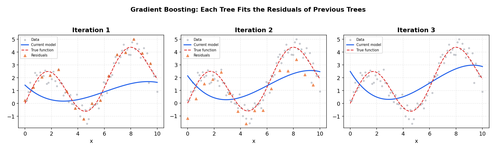

# Gradient Boosting — XGBoost, LightGBM & CatBoost

> **🎯 Goal**: Master the industry standard for tabular data — gradient boosting machines
> **⏱ Time**: 3–4h study + 1h exercises
> **📦 Deliverable**: Ability to train, tune, and deploy competition-winning gradient boosting models

---

## Table of Contents

1. [Boosting vs Bagging](#1--boosting-vs-bagging)
2. [How Gradient Boosting Works](#2--how-gradient-boosting-works)
3. [The Math (Intuition Only)](#3--the-math-intuition-only)
4. [XGBoost — The OG](#4--xgboost--the-og)
5. [LightGBM — The Fast One](#5--lightgbm--the-fast-one)
6. [CatBoost — The Categorical Expert](#6--catboost--the-categorical-expert)
7. [Hyperparameter Tuning Guide](#7--hyperparameter-tuning-guide)
8. [When to Use Which](#8--when-to-use-which)
9. [Practical Tips](#9--practical-tips)

---

## 1 · Boosting vs Bagging

### Intuition (Backend Analogy)

**Bagging** (Random Forest) = spinning up multiple junior devs who each independently
write a solution, then you take the majority vote. They never talk to each other.

**Boosting** = a code-review chain — Dev 1 writes a draft, Dev 2 reviews it and
fixes the bugs, Dev 3 reviews the updated code and fixes what Dev 2 missed, and so on.
Each reviewer focuses *only* on the remaining bugs.

### How It Works

```
  BAGGING (Random Forest)              BOOSTING (Gradient Boosting)
  ─────────────────────────            ──────────────────────────────

  Dataset                              Dataset
     │                                    │
     ├──► Tree 1 ──┐                      ▼
     ├──► Tree 2 ──┼──► Average        Tree 1  ──► residuals₁
     ├──► Tree 3 ──┤    / Vote            │
     └──► Tree N ──┘                      ▼
                                       Tree 2  ──► residuals₂
  Trees train IN PARALLEL                 │
  on random subsets.                      ▼
  Independent. No order.               Tree 3  ──► residuals₃
                                          │
                                          ▼
                                       Final = sum of all trees

                                       Trees train SEQUENTIALLY.
                                       Each fixes the previous errors.
```

### When to Use

| Aspect       | Bagging               | Boosting                    |
| ------------ | --------------------- | --------------------------- |
| Overfitting  | Harder to overfit     | Can overfit if not tuned    |
| Accuracy     | Good                  | Usually better              |
| Speed        | Parallelizable        | Sequential (slower to train)|
| Interpretability | Feature importance | SHAP values, feature importance |

---

## 2 · How Gradient Boosting Works

### Intuition (Backend Analogy)

Like iterative code reviews — each pass catches bugs the previous reviewer missed.
You never rewrite from scratch; you always *patch* the existing code.

### How It Works

```
Step-by-step: predicting house prices (true value = $300K)

ITERATION 0 — Start with the mean
┌────────────────────────────────────────────────────┐
│  Prediction = mean(all prices) = $250K             │
│  Residual   = $300K - $250K = +$50K                │
└────────────────────────────────────────────────────┘
                        │
                        ▼
ITERATION 1 — Tree₁ learns to predict the residual (+$50K)
┌────────────────────────────────────────────────────┐
│  Tree₁ predicts: +$40K  (not perfect)              │
│  New prediction = $250K + η·($40K)                 │
│                 = $250K + 0.1·($40K) = $254K       │
│  New residual   = $300K - $254K = +$46K            │
└────────────────────────────────────────────────────┘
                        │
                        ▼
ITERATION 2 — Tree₂ learns to predict the NEW residual (+$46K)
┌────────────────────────────────────────────────────┐
│  Tree₂ predicts: +$44K                             │
│  New prediction = $254K + 0.1·($44K) = $258.4K     │
│  New residual   = $300K - $258.4K = +$41.6K        │
└────────────────────────────────────────────────────┘
                        │
                        ▼
ITERATION 3 — Tree₃ learns the remaining residual (+$41.6K)
┌────────────────────────────────────────────────────┐
│  Tree₃ predicts: +$40K                             │
│  New prediction = $258.4K + 0.1·($40K) = $262.4K   │
│  New residual   = $300K - $262.4K = +$37.6K        │
└────────────────────────────────────────────────────┘

... after hundreds of iterations → prediction ≈ $300K

  η (learning rate) = 0.1 means each tree only contributes 10%.
  Smaller η = more trees needed, but more robust (less overfitting).
```

### The Algorithm

```
1. F₀(x) = mean(y)                          # initial guess
2. For m = 1 to M:
   a. rᵢ = yᵢ - Fₘ₋₁(xᵢ)                  # compute residuals
   b. Train tree hₘ on (xᵢ, rᵢ)            # fit tree to residuals
   c. Fₘ(x) = Fₘ₋₁(x) + η · hₘ(x)        # update prediction
3. Return F_M(x)                             # final model
```

---

## 3 · The Math (Intuition Only)

### Gradient Descent in Function Space

Traditional gradient descent updates *parameters* (weights in a neural net).
Gradient boosting updates *functions* — each new tree is a step in the direction
that reduces the loss the most.

```
Neural Net GD:        θ_new = θ_old - η · ∂Loss/∂θ
Gradient Boosting:    F_new = F_old + η · h(x)     where h(x) ≈ -∂Loss/∂F
                                                    (the negative gradient)
```

### Key Concepts

| Concept        | What It Does                             | Backend Analogy              |
| -------------- | ---------------------------------------- | ---------------------------- |
| Learning rate η| Scales each tree's contribution (0.01–0.3)| Throttle on a rate limiter  |
| Shrinkage      | Same as learning rate — prevents overfitting | Damping factor in a PID controller |
| n_estimators   | Number of trees (boosting rounds)        | Number of review passes      |
| max_depth      | How complex each tree can be             | Max nesting depth in code    |

**Rule of thumb**: Lower η + more trees = better accuracy but slower training.
Think of it like reducing batch size in a deploy pipeline — smaller steps, safer rollout.

**The Math:**

The gradient boosting framework generalises beyond MSE to *any* differentiable loss.

**Additive model** — each round adds a small tree to the running prediction:

```
Fₘ(x) = Fₘ₋₁(x) + η · hₘ(x)
```

**Pseudo-residuals** — the negative gradient of the loss w.r.t. the current prediction:

```
rᵢ = −[ ∂L(yᵢ, F(xᵢ)) / ∂F ]
                                F = Fₘ₋₁
```

For **MSE** loss `L = ½(y − F)²`, the pseudo-residuals reduce to the actual residuals:

```
rᵢ = yᵢ − Fₘ₋₁(xᵢ)
```

For **log-loss** (binary classification), they become probability residuals:

```
rᵢ = yᵢ − σ(Fₘ₋₁(xᵢ))        where σ(z) = 1 / (1 + e⁻ᶻ)
```

This is why the same algorithm works for both regression and classification —
only the loss function (and therefore the pseudo-residuals) changes.



---

## 4 · XGBoost — The OG

### Intuition (Backend Analogy)

XGBoost is the PostgreSQL of ML — battle-tested, well-documented, works everywhere.
It added regularization to gradient boosting (like adding input validation to an API).

### Key Features

```
XGBoost Innovations:
┌─────────────────────────────────────────────────┐
│  1. Regularized objective                       │
│     Loss = Σ L(yᵢ, ŷᵢ) + Σ Ω(tree_k)          │
│     Ω = γT + ½λ‖w‖²                            │
│     (T = num leaves, w = leaf weights)          │
│     Think: API rate limiting + input validation │
│                                                 │
│  2. Histogram-based splitting                   │
│     Bins continuous features into ~256 buckets  │
│     Like quantizing timestamps to hourly slots  │
│                                                 │
│  3. Built-in missing value handling             │
│     Learns which direction to send NaNs         │
│     No imputation needed!                       │
│                                                 │
│  4. Column subsampling                          │
│     Like Random Forest — samples features       │
│     per tree AND per split level                │
└─────────────────────────────────────────────────┘
```

**The Math:**

**Regularised objective** — XGBoost minimises the loss *plus* a complexity penalty on every tree:

```
Obj = Σᵢ l(yᵢ, ŷᵢ)  +  Σₖ Ω(fₖ)

Regulariser:  Ω(f) = γT + ½λ Σⱼ wⱼ²
              T  = number of leaves
              wⱼ = weight (prediction) of leaf j
```

**2nd-order Taylor expansion** — at each round, approximate the loss around the current prediction:

```
Obj ≈ Σᵢ [ gᵢ f(xᵢ) + ½ hᵢ f(xᵢ)² ]  +  Ω(f)

where  gᵢ = ∂l / ∂ŷ     (1st derivative — gradient)
       hᵢ = ∂²l / ∂ŷ²   (2nd derivative — Hessian)
```

**Optimal leaf weight** — closed-form solution for the best prediction in each leaf:

```
w*ⱼ = − Gⱼ / (Hⱼ + λ)

where  Gⱼ = Σ_{i ∈ leaf_j} gᵢ       (sum of gradients)
       Hⱼ = Σ_{i ∈ leaf_j} hᵢ       (sum of Hessians)
```

**Split gain** — decides whether to split a node into left (L) and right (R):

```
Gain = ½ [ G_L² / (H_L + λ)  +  G_R² / (H_R + λ)  −  G² / (H + λ) ]  −  γ

Split only if Gain > 0  (the γ term prunes weak splits).
```

**Worked example** — suppose a candidate split produces:

```
Left :  G_L = −4.0,  H_L = 5.0
Right:  G_R = −6.0,  H_R = 7.0
Parent: G   = −10.0, H   = 12.0
λ = 1.0,  γ = 0.5

Gain = ½ [ (−4)²/(5+1) + (−6)²/(7+1) − (−10)²/(12+1) ] − 0.5
     = ½ [ 16/6        + 36/8         − 100/13         ] − 0.5
     = ½ [ 2.667       + 4.500        − 7.692          ] − 0.5
     = ½ × (−0.525) − 0.5
     = −0.263 − 0.5
     = −0.763

Gain < 0  →  do NOT split (regularisation prevents this weak partition).
```

### Key Hyperparameters

| Parameter         | Default | Range       | What It Controls                |
| ----------------- | ------- | ----------- | ------------------------------- |
| n_estimators      | 100     | 100–10000   | Number of boosting rounds       |
| max_depth         | 6       | 3–10        | Tree depth (complexity)         |
| learning_rate     | 0.3     | 0.01–0.3    | Shrinkage per tree              |
| subsample         | 1.0     | 0.5–1.0     | Row sampling ratio              |
| colsample_bytree  | 1.0     | 0.5–1.0     | Feature sampling ratio          |
| reg_alpha (L1)    | 0       | 0–10        | Lasso regularization            |
| reg_lambda (L2)   | 1       | 0–10        | Ridge regularization            |

### Recipe

```python
import xgboost as xgb
from sklearn.model_selection import train_test_split

X_train, X_val, y_train, y_val = train_test_split(X, y, test_size=0.2)
model = xgb.XGBClassifier(
    n_estimators=1000, learning_rate=0.05, max_depth=6,
    early_stopping_rounds=50, eval_metric="logloss"
)
model.fit(X_train, y_train, eval_set=[(X_val, y_val)], verbose=False)
print(f"Best iteration: {model.best_iteration}, Acc: {model.score(X_val, y_val):.4f}")
```

---

## 5 · LightGBM — The Fast One

### Intuition (Backend Analogy)

LightGBM is like switching from PostgreSQL to ClickHouse — optimized for speed on
large datasets. Trades some precision in tree structure for massive speed gains.

### Key Innovations

```
XGBoost (Level-wise)              LightGBM (Leaf-wise)
────────────────────              ────────────────────

       [root]                            [root]
      /      \                          /      \
    [A]      [B]                      [A]      [B]
   /   \    /   \                    /   \
  [C] [D] [E] [F]                 [C]   [D]
                                  /   \
  Grows ALL nodes at             [G]   [H]
  each level. Balanced
  but slower.                    Grows the leaf with
                                 the HIGHEST loss reduction.
                                 Deeper but faster convergence.
```

```
GOSS (Gradient-based One-Side Sampling):
┌─────────────────────────────────────────────────┐
│  Keep ALL samples with large gradients (hard)   │
│  Randomly sample from small gradients (easy)    │
│                                                 │
│  Like a load balancer that prioritizes          │
│  failed requests for retry while sampling       │
│  successful ones at a lower rate.               │
└─────────────────────────────────────────────────┘

Exclusive Feature Bundling (EFB):
┌─────────────────────────────────────────────────┐
│  Bundles mutually exclusive sparse features     │
│  into single features.                          │
│                                                 │
│  Like compressing sparse columns in a DB —      │
│  if two columns are never non-zero at the       │
│  same time, store them as one.                  │
└─────────────────────────────────────────────────┘
```

**The Math:**

**Histogram-based splitting** — bin every continuous feature into ~256 discrete buckets.
Finding the best split then costs `O(n · bins)` instead of `O(n · log n)`,
because you iterate over bins rather than sorting all sample values.

**Leaf-wise growth** — instead of expanding all nodes at the same depth (level-wise),
LightGBM always splits the leaf with the highest loss reduction. This produces
deeper, asymmetric trees that converge faster for the same number of leaves.

**GOSS (Gradient-based One-Side Sampling)** — keep *all* samples with large
gradients (the hard examples), and randomly subsample from samples with small
gradients (the easy ones). This preserves the information needed for accurate
split finding while reducing the effective dataset size.

### Key Hyperparameters

| Parameter          | Default | Range       | What It Controls                  |
| ------------------ | ------- | ----------- | --------------------------------- |
| num_leaves         | 31      | 15–127      | Max leaves per tree (MOST IMPORTANT) |
| min_child_samples  | 20      | 5–100       | Min samples in a leaf             |
| feature_fraction   | 1.0     | 0.5–1.0     | Column sampling (= colsample_bytree) |
| bagging_fraction   | 1.0     | 0.5–1.0     | Row sampling (= subsample)        |
| learning_rate      | 0.1     | 0.01–0.3    | Shrinkage per tree                |
| num_iterations     | 100     | 100–10000   | Number of boosting rounds         |

### Recipe

```python
import lightgbm as lgb

dtrain = lgb.Dataset(X_train, label=y_train)
dval = lgb.Dataset(X_val, label=y_val, reference=dtrain)
params = {
    "objective": "binary", "metric": "binary_logloss",
    "num_leaves": 63, "learning_rate": 0.05, "feature_fraction": 0.8,
    "verbose": -1
}
model = lgb.train(params, dtrain, num_boost_round=1000,
                  valid_sets=[dval], callbacks=[lgb.early_stopping(50)])
```

---

## 6 · CatBoost — The Categorical Expert

### Intuition (Backend Analogy)

CatBoost is like an ORM that handles schema migrations automatically — it natively
handles categorical features so you don't have to manually encode them.

### Key Innovations

```
Traditional Pipeline:             CatBoost Pipeline:
─────────────────────             ────────────────────

  Raw Data                          Raw Data
     │                                 │
     ▼                                 │  (CatBoost handles
  Label Encode                         │   categoricals
     │                                 │   internally)
     ▼                                 │
  One-Hot / Target Encode              │
     │                                 │
     ▼                                 ▼
  XGBoost / LightGBM               CatBoost
     │                                 │
     ▼                                 ▼
  Predictions                       Predictions

  YOU handle encoding.              CatBoost handles it.
  Risk of target leakage!           Uses Ordered Target Statistics
                                    to prevent leakage.
```

```
Ordered Target Statistics:
┌──────────────────────────────────────────────────────────┐
│  For each sample, compute the target mean using ONLY     │
│  samples that come BEFORE it in a random permutation.    │
│                                                          │
│  Like computing a running average of code review scores  │
│  — you only look at past reviews, never future ones.     │
│  This prevents information leakage from the target.      │
└──────────────────────────────────────────────────────────┘
```

**The Math:**

**Ordered target statistics** — encode categorical feature value for sample *i*
using only samples that appear *before* it in a random permutation:

```
enc_i = (Σ_{j < i} yⱼ  +  a · p) / (nᵢ + a)

where  a = smoothing parameter (prevents noisy estimates for rare categories)
       p = prior (global target mean)
       nᵢ = number of samples before i with the same category value
```

**Symmetric (oblivious) trees** — every node at the same depth uses the *same*
split condition. This produces balanced trees that are extremely fast at inference
(each level is a single comparison) and act as a natural regulariser.

### Key Hyperparameters

| Parameter        | Default   | Range      | What It Controls                    |
| ---------------- | --------- | ---------- | ----------------------------------- |
| iterations       | 1000      | 100–10000  | Number of boosting rounds           |
| depth            | 6         | 4–10       | Tree depth (symmetric trees)        |
| learning_rate    | 0.03      | 0.01–0.3   | Shrinkage per tree                  |
| l2_leaf_reg      | 3.0       | 1–10       | L2 regularization                   |
| cat_features     | auto      | —          | List of categorical column indices  |

### Recipe

```python
from catboost import CatBoostClassifier

cat_cols = ["city", "device_type", "browser"]  # no encoding needed!
model = CatBoostClassifier(
    iterations=1000, learning_rate=0.05, depth=6,
    cat_features=cat_cols, early_stopping_rounds=50, verbose=0
)
model.fit(X_train, y_train, eval_set=(X_val, y_val))
print(f"Acc: {model.score(X_val, y_val):.4f}")
```

---

## 7 · Hyperparameter Tuning Guide

### Intuition (Backend Analogy)

Tuning a gradient boosting model is like tuning a database — there's a specific order
that gives you the most bang for your buck. You don't tune `work_mem` before deciding
on your indexing strategy.

### Tuning Order

```
Priority 1: n_estimators + learning_rate  (together!)
─────────────────────────────────────────────────────
  Set n_estimators=10000 (high) + learning_rate=0.01–0.05 (low)
  Use EARLY STOPPING to find the right number of trees.
  Like setting a generous timeout + letting the circuit breaker decide.

Priority 2: max_depth / num_leaves  (tree complexity)
─────────────────────────────────────────────────────
  Controls how complex each individual tree is.
  Too deep = overfitting.  Too shallow = underfitting.
  Start with max_depth=6 or num_leaves=63.

Priority 3: subsample + colsample  (randomization)
─────────────────────────────────────────────────────
  Row and column sampling per tree.
  Adds randomness → reduces overfitting.
  Like adding jitter to retry intervals.

Priority 4: reg_alpha + reg_lambda  (regularization)
─────────────────────────────────────────────────────
  L1 (sparsity) and L2 (smoothness) penalties.
  Usually only matters for final squeeze of performance.
```

### Default Hyperparameters — All 3 Frameworks

```
┌─────────────────────┬──────────────┬──────────────┬──────────────┐
│   Hyperparameter     │   XGBoost    │   LightGBM   │   CatBoost   │
├─────────────────────┼──────────────┼──────────────┼──────────────┤
│ # trees / rounds     │ 100          │ 100          │ 1000         │
│ learning_rate        │ 0.3          │ 0.1          │ 0.03         │
│ max_depth            │ 6            │ -1 (no lim)  │ 6            │
│ num_leaves           │ — (use depth)│ 31           │ — (symmetric)│
│ subsample / bagging  │ 1.0          │ 1.0          │ — (Bayesian) │
│ colsample / feature  │ 1.0          │ 1.0          │ — (auto)     │
│ L1 reg               │ 0            │ 0            │ — (not L1)   │
│ L2 reg               │ 1            │ 0            │ 3.0          │
│ min_child_samples    │ 1 (weight)   │ 20           │ 1            │
│ Missing values       │ Built-in     │ Built-in     │ Built-in     │
│ Categoricals         │ Manual       │ Manual       │ Native!      │
└─────────────────────┴──────────────┴──────────────┴──────────────┘
```

### Early Stopping — Your Circuit Breaker

```python
# XGBoost: stop if val loss doesn't improve for 50 rounds
model = xgb.XGBClassifier(n_estimators=5000, early_stopping_rounds=50)
model.fit(X_train, y_train, eval_set=[(X_val, y_val)], verbose=False)
print(f"Stopped at round {model.best_iteration} out of 5000")

# LightGBM: same idea
model = lgb.train(params, dtrain, num_boost_round=5000,
                  valid_sets=[dval], callbacks=[lgb.early_stopping(50)])
```

### Search Strategy Comparison

```
┌──────────────────┬───────────┬───────────┬──────────────────────────┐
│  Method          │  Speed    │  Quality  │  When to Use             │
├──────────────────┼───────────┼───────────┼──────────────────────────┤
│  GridSearch      │  Slow     │  Exact    │  ≤3 params, small grid   │
│  RandomSearch    │  Medium   │  Good     │  Quick baseline          │
│  Optuna (Bayes)  │  Fast     │  Best     │  Production tuning       │
└──────────────────┴───────────┴───────────┴──────────────────────────┘
```

### Recipe: Optuna Tuning

```python
import optuna

def objective(trial):
    params = {
        "max_depth": trial.suggest_int("max_depth", 3, 10),
        "learning_rate": trial.suggest_float("learning_rate", 0.01, 0.3, log=True),
        "num_leaves": trial.suggest_int("num_leaves", 15, 127),
        "subsample": trial.suggest_float("subsample", 0.5, 1.0),
    }
    model = lgb.LGBMClassifier(n_estimators=1000, **params, verbose=-1)
    model.fit(X_train, y_train, eval_set=[(X_val, y_val)],
              callbacks=[lgb.early_stopping(50, verbose=False)])
    return model.score(X_val, y_val)

study = optuna.create_study(direction="maximize")
study.optimize(objective, n_trials=50, show_progress_bar=True)
```

---

## 8 · When to Use Which

```
Decision Flow:
──────────────

  How big is your dataset?
       │
       ├──► < 100K rows ──► XGBoost (safe default, great docs)
       │
       └──► > 100K rows
               │
               ├──► Many categorical features? ──► CatBoost
               │    (high cardinality, > 10 cat cols)
               │
               └──► Mostly numerical / low-cardinality cats?
                       │
                       └──► LightGBM (fastest training)
```

```
┌─────────────────┬──────────────────────────────────────────────────┐
│  Framework      │  Best For                                        │
├─────────────────┼──────────────────────────────────────────────────┤
│  XGBoost        │  Safe default. Most documentation & community.   │
│                 │  Runs everywhere. Good when you want control.    │
├─────────────────┼──────────────────────────────────────────────────┤
│  LightGBM       │  Large datasets (>100K rows). Speed-critical     │
│                 │  pipelines. Kaggle competitions. Leaf-wise       │
│                 │  growth often converges faster.                  │
├─────────────────┼──────────────────────────────────────────────────┤
│  CatBoost       │  Many categorical features. Minimal feature      │
│                 │  engineering. Works well out-of-the-box.         │
│                 │  Best default hyperparameters.                   │
└─────────────────┴──────────────────────────────────────────────────┘
```

### All Three Beat Random Forest

```
Typical Kaggle Tabular Competition Leaderboard:

  1st   ──  Ensemble of GBMs (XGB + LGBM + CatBoost)
  2nd   ──  LightGBM with heavy tuning
  3rd   ──  XGBoost with feature engineering
  ...
  15th  ──  Random Forest
  ...
  50th  ──  Neural Network (on tabular data)

  GBMs dominate tabular data. Neural nets dominate images/text/audio.
```

---

## 9 · Practical Tips

### The Rules

1. **ALWAYS use early stopping.** Never set a fixed `n_estimators` without it.
   Like deploying without health checks — you'll overshoot.

2. **Lower learning rate + more trees = better** (but slower).
   Start with `learning_rate=0.05, n_estimators=5000, early_stopping_rounds=50`.

3. **Feature importance from boosting > Random Forest.**
   Use `model.feature_importances_` or SHAP for reliable feature ranking.

4. **For production: export to ONNX.**
   Train with XGBoost/LightGBM, convert to ONNX for fast inference in any language.

### Production Deployment Pattern

```
Training Pipeline                 Serving Pipeline
─────────────────                 ────────────────

  Raw Data                          Request
     │                                 │
     ▼                                 ▼
  Feature Engineering              Feature Store (cached)
     │                                 │
     ▼                                 ▼
  Train GBM (Python)               ONNX Runtime (C++/Java)
     │                                 │
     ▼                                 ▼
  Export to ONNX                    Prediction
     │                                 │
     ▼                                 ▼
  Model Registry                   < 1ms latency
  (MLflow / S3)
```

### Quick Comparison Cheat Sheet

```
┌──────────────────────┬────────┬──────────┬──────────┐
│  Feature             │ XGBoost│ LightGBM │ CatBoost │
├──────────────────────┼────────┼──────────┼──────────┤
│  Training speed      │  ★★★   │  ★★★★★   │  ★★★★    │
│  Accuracy (default)  │  ★★★★  │  ★★★★    │  ★★★★★   │
│  Categorical support │  ★★    │  ★★★     │  ★★★★★   │
│  Documentation       │  ★★★★★ │  ★★★★    │  ★★★     │
│  GPU support         │  ★★★★  │  ★★★★    │  ★★★★★   │
│  Ease of tuning      │  ★★★   │  ★★★     │  ★★★★★   │
│  Community size      │  ★★★★★ │  ★★★★    │  ★★★     │
└──────────────────────┴────────┴──────────┴──────────┘
```

---

## Exercises

### Exercise 1: Conceptual

> Boosting trains trees sequentially, each correcting the previous. What happens
> if you set `learning_rate=1.0` (no shrinkage)? Why is a smaller learning rate
> usually better?

### Exercise 2: Implementation

> Train XGBoost with early stopping on a train/validation split. Print best
> iteration and test accuracy. Max 10 lines.

### Exercise 3: Real-World Scenario

> You have a dataset with 1M rows, 50 features (30 categorical with high
> cardinality), and need to train a model in under 5 minutes. Which framework
> and key hyperparameters?

---

### Solutions

**Exercise 1: Conceptual**

With `learning_rate=1.0`, each tree's full prediction is added to the ensemble.
This is like applying every code review suggestion with zero dampening — early
trees have outsized influence, and the model overfits to training noise quickly.

A smaller learning rate (0.01–0.1) forces each tree to contribute only a small
correction. This means:
- More trees are needed, but each has less individual influence
- The ensemble is more robust — like gradual rollouts vs big-bang deploys
- Errors from individual trees are dampened
- The model generalizes better to unseen data

Think of it as step size in gradient descent: too large → overshoot, too small →
slow but stable.

**Exercise 2: Implementation**

```python
import xgboost as xgb
from sklearn.datasets import load_breast_cancer
from sklearn.model_selection import train_test_split

X, y = load_breast_cancer(return_X_y=True)
X_tr, X_val, y_tr, y_val = train_test_split(X, y, test_size=0.2, random_state=42)
model = xgb.XGBClassifier(
    n_estimators=1000, learning_rate=0.05, max_depth=4,
    early_stopping_rounds=50, eval_metric="logloss"
)
model.fit(X_tr, y_tr, eval_set=[(X_val, y_val)], verbose=False)
print(f"Best iter: {model.best_iteration}, Acc: {model.score(X_val, y_val):.4f}")
```

**Exercise 3: Real-World Scenario**

**Framework: CatBoost** — native categorical handling avoids encoding 30 high-cardinality
features (which would explode dimensionality with one-hot encoding).

```python
from catboost import CatBoostClassifier

model = CatBoostClassifier(
    iterations=2000, learning_rate=0.1, depth=6,
    cat_features=list(range(30)),  # first 30 cols are categorical
    early_stopping_rounds=50, task_type="GPU", verbose=0
)
model.fit(X_train, y_train, eval_set=(X_val, y_val))
```

Key decisions:
- **CatBoost** over LightGBM because of 30 categorical features with high cardinality
- `task_type="GPU"` for speed on 1M rows
- `depth=6` (default) keeps trees manageable
- `learning_rate=0.1` (higher than default 0.03) for faster convergence within time budget
- Early stopping prevents wasting time on unnecessary iterations
- If GPU not available: switch to LightGBM with `cat_feature` parameter for speed

---

## Key Takeaways

```
┌──────────────────────────────────────────────────────────────────┐
│                                                                  │
│  1. Gradient boosting = sequential trees fixing each other's     │
│     mistakes. Each tree does gradient descent in function space. │
│                                                                  │
│  2. XGBoost = safe default. LightGBM = fast. CatBoost = cats.   │
│                                                                  │
│  3. ALWAYS use early stopping. Never hardcode n_estimators.      │
│                                                                  │
│  4. Tune in order: LR + trees → depth → sampling → reg.         │
│                                                                  │
│  5. GBMs dominate tabular data. Period.                          │
│                                                                  │
└──────────────────────────────────────────────────────────────────┘
```
