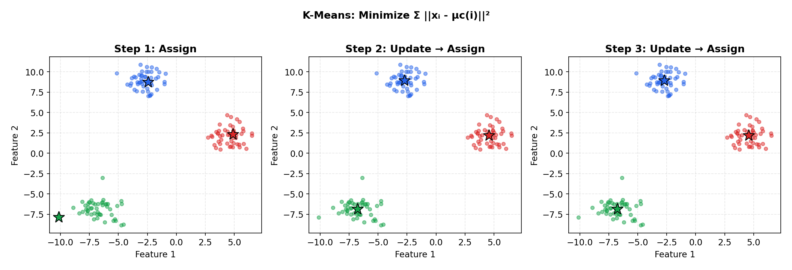
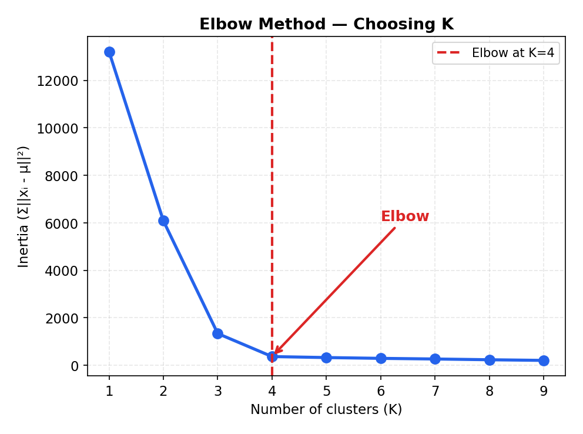
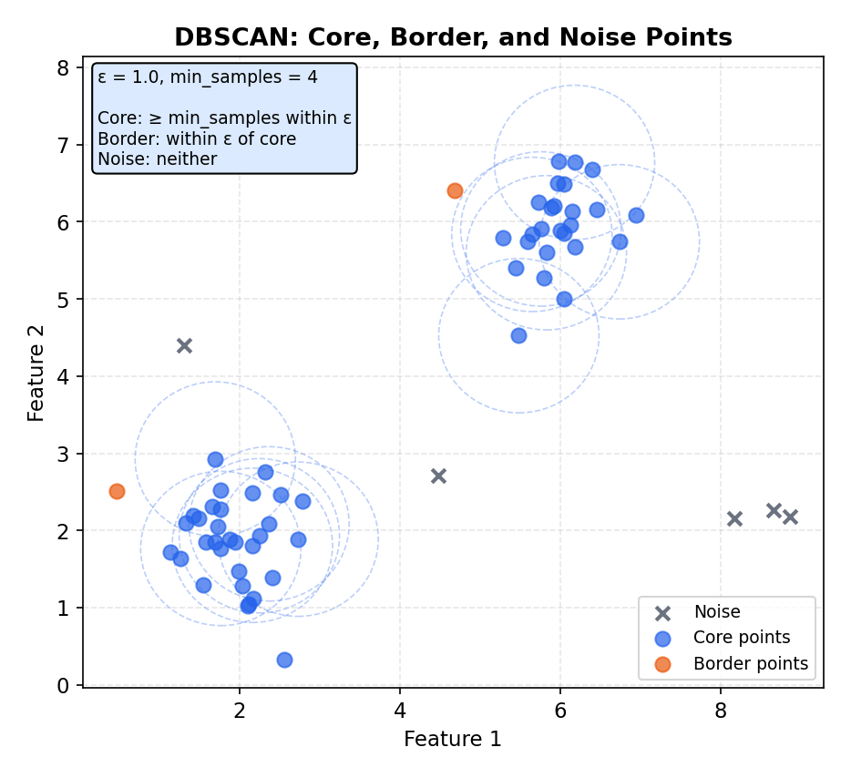

# Clustering & Unsupervised Learning

> **🎯 Goal**: Learn to find structure in unlabeled data — grouping without ground truth
> **⏱ Time**: 2–3h study + 1h exercises
> **📦 Deliverable**: Ability to choose and apply the right clustering algorithm

---

## Table of Contents

1. [Unsupervised vs Supervised](#1-unsupervised-vs-supervised)
2. [K-Means](#2-k-means)
3. [K-Means++](#3-k-means)
4. [DBSCAN](#4-dbscan)
5. [Hierarchical Clustering](#5-hierarchical-clustering)
6. [Evaluation Metrics](#6-evaluation-metrics)
7. [Practical Applications](#7-practical-applications)
8. [Algorithm Comparison](#8-algorithm-comparison)
9. [Exercises](#9-exercises)

---

## 1. Unsupervised vs Supervised

### The Intuition (Backend Analogy)

> **Supervised learning** is like having a labeled database: every row has a category
> column and you train a model to predict it. **Unsupervised learning** is the opposite —
> imagine inheriting a microservices mesh with zero documentation. No labels, no
> service map, no runbook. You have to discover which services belong together by
> observing their traffic patterns, latency profiles, and shared dependencies.

### How It Works

```
  Supervised (labels provided):           Unsupervised (no labels):

  Input       Label                       Input
  ─────────── ─────                       ───────────
  [0.2, 3.1]  "cat"                       [0.2, 3.1]
  [1.5, 0.8]  "dog"                       [1.5, 0.8]
  [0.3, 2.9]  "cat"                       [0.3, 2.9]
  [1.4, 0.9]  "dog"                       [1.4, 0.9]
       │                                       │
       ▼                                       ▼
  "Learn the mapping                    "Find natural groups
   input → label"                        in the data itself"
```

### Recipe

```python
from sklearn.cluster import KMeans
import numpy as np

X = np.array([[0.2, 3.1], [1.5, 0.8], [0.3, 2.9], [1.4, 0.9]])

# Unsupervised: no y labels passed
labels = KMeans(n_clusters=2, random_state=42, n_init=10).fit_predict(X)
print(labels)  # [1, 0, 1, 0] — discovered 2 groups on its own
```

### When to Use

- You don't have labels (most real-world data is unlabeled)
- You want to **discover** structure, not predict known categories
- Exploratory analysis before building a supervised model
- Anomaly detection, customer segmentation, log grouping

---

## 2. K-Means

### The Intuition (Backend Analogy)

> Imagine placing **K load balancers** in a data center and assigning each server to
> the nearest load balancer. Then you move each load balancer to the center of its
> assigned servers. Repeat until nothing moves. That's K-Means — find K centers that
> minimize total distance from each point to its assigned center.

### How It Works

K-Means iterates three steps: **assign → move → repeat**.

```
  Step 0: Random centroids         Step 1: Assign to nearest      Step 2: Move centroids
  (K=2: ★ and ◆)                   centroid                       to cluster mean

       · · ·                            a a a                          a a a
      · · ·                            a a a                          a a a
     ★        ·                        ★        b                      ★       b
              · · ·                            b b b                        b b b
            ◆   · ·                          ◆   b b                      ◆   b b


  Step 3: Reassign                 Step 4: Move again              Converged!
  (some points switch)             (centroids barely move)         (assignments stable)

       a a a                            a a a                          a a a
      a a a                            a a a                          a a a
       ★      b                          ★     b                        ★     b
              b b b                            b b b                          b b b
            ◆   b b                          ◆   b b                        ◆   b b
```

**The Math:**

**Objective (minimize total within-cluster sum of squares):**

```
  J = min      Σ  ||xᵢ - μ_c(i)||²
     μ₁...μ_K  i=1
```

**Assignment step** — assign each point to its nearest centroid:

```
  c(i) = argmin_k ||xᵢ - μₖ||²
```

**Update step** — move each centroid to the mean of its assigned points:

```
  μₖ = (1 / |Cₖ|)  Σ      xᵢ
                   xᵢ ∈ Cₖ
```

**Convergence**: The objective J is non-increasing at each step (assignments can only
decrease or maintain distance; centroids move to the mean which minimizes SSE).
Converges to a **local minimum** — not guaranteed global.

**Complexity**: O(n · K · d · I) where n = points, K = clusters, d = dimensions,
I = iterations (typically 10–50).

**Worked Example (K=2, 2D):**

```
  6 points: A(1,1)  B(1,2)  C(2,1)  D(8,8)  E(9,8)  F(8,9)

  Init: μ₁ = A(1,1), μ₂ = D(8,8)

  ── Iteration 1 ──
  Assign (nearest centroid):
    A(1,1)→μ₁  dist=0.0     B(1,2)→μ₁  dist=1.0     C(2,1)→μ₁  dist=1.0
    D(8,8)→μ₂  dist=0.0     E(9,8)→μ₂  dist=1.0     F(8,9)→μ₂  dist=1.0

  Update (mean of assigned points):
    μ₁ = mean(A,B,C) = ((1+1+2)/3, (1+2+1)/3) = (1.33, 1.33)
    μ₂ = mean(D,E,F) = ((8+9+8)/3, (8+8+9)/3) = (8.33, 8.33)

  ── Iteration 2 ──
  Assign: same assignments (all points still closest to same centroid)
  → Converged! Final clusters: {A,B,C} and {D,E,F}
  Final J = (0.11+0.56+0.56) + (0.11+0.56+0.56) = 2.44
```



**Choosing K — the Elbow Method**: plot inertia (within-cluster sum of squares) vs K.
The "elbow" where the curve bends is a good K:

```
  Inertia
    |
  50|*
    |  *
  30|    *
    |      *
  15|        *------*------*------*
    |
    +----+----+----+----+----+-----> K
         1    2    3    4    5    6
                   ^
                   |
              Elbow at K=3
```



### Recipe

```python
from sklearn.cluster import KMeans
import numpy as np

X = np.random.randn(300, 2)  # 300 points, 2D

# Elbow method: try K=1..8
inertias = [KMeans(n_clusters=k, n_init=10).fit(X).inertia_ for k in range(1, 9)]
for k, inertia in enumerate(inertias, 1):
    print(f"K={k}: inertia={inertia:.1f}")

# Final model with chosen K
km = KMeans(n_clusters=3, n_init=10, random_state=42).fit(X)
print(km.labels_[:10])  # cluster assignments for first 10 points
```

### When to Use

- Data is roughly **spherical/globular** clusters
- You have a rough idea of K (or can use the elbow method)
- Need a fast, interpretable baseline — K-Means is O(n·K·d·i) where i = iterations
- ⚠️ **Limitations**: assumes equal-sized spherical clusters, sensitive to initialization,
  must specify K upfront, sensitive to outliers

---

## 3. K-Means++

### The Intuition (Backend Analogy)

> Standard K-Means places initial centroids randomly — like dropping load balancers
> blindfolded. Two might land on top of each other, leaving a whole region unserved.
> **K-Means++** is smarter: place the first one randomly, then each subsequent one is
> placed **far from existing centroids** — like spreading out cell towers for maximum
> coverage.

### How It Works

```
  Standard K-Means init (bad luck):     K-Means++ init (spread out):

       · · · ·                               · · · ·
      · · · · ·                             · · · · ·
     · ★◆ · · ·    ← both centroids        · ★ · · ·    ← first centroid
      · · ·   · ·    clumped together        · · ·   · ·
       · · · · ·                              · · · · ·
        · · ·  ·                               · · ◆  ·  ← second centroid
                                                            placed far away

  Result: slow convergence,              Result: fast convergence,
  possibly bad local minimum             better final clusters
```

**Algorithm**:
1. Pick first centroid uniformly at random from data points
2. For each remaining point, compute distance to nearest existing centroid
3. Pick next centroid with probability proportional to distance² (farther = more likely)
4. Repeat until K centroids chosen, then run standard K-Means

**The Math:**

**Initialization probability** — after choosing centroids μ₁, ..., μⱼ, the next
centroid is sampled with probability proportional to squared distance:

```
  P(x chosen as next centroid) ∝ D(x)²

  where D(x) = min        ||x - μ||²
               existing μ
```

Points far from all existing centroids have higher probability of being chosen.

**Guarantee**: K-Means++ initialization achieves an expected objective that is
O(log K)-competitive with the optimal clustering — formal bound:

```
  E[J_kmeans++] ≤ 8(ln K + 2) · J_optimal
```

### Recipe

```python
from sklearn.cluster import KMeans

# K-Means++ is the default in scikit-learn (init='k-means++')
km = KMeans(n_clusters=3, init='k-means++', n_init=10, random_state=42)
km.fit(X)
print(f"Inertia: {km.inertia_:.1f}")
```

### When to Use

- **Always prefer K-Means++ over vanilla K-Means** — it's the default in scikit-learn
  for good reason. Same time complexity, much better results on average.
- Still has all K-Means limitations (spherical clusters, need to specify K) — just
  fixes the initialization problem.

---

## 4. DBSCAN

### The Intuition (Backend Analogy)

> Think of finding **neighborhoods in a city**. Dense areas with lots of houses close
> together form neighborhoods (clusters). Isolated houses in the countryside are
> outliers. You don't need to know how many neighborhoods there are in advance — the
> density tells you. DBSCAN works the same way: dense regions become clusters, sparse
> points become noise.

### How It Works

Two parameters: **eps** (search radius) and **min_samples** (minimum neighbors to be "core"):

```
  eps = radius around each point
  min_samples = 3 (need 3+ neighbors to be a "core" point)

  Core point (≥3 neighbors       Border point (<3 neighbors      Noise (no cluster)
   within eps):                   but near a core):

        · ·                             ·                            ·
       · ● ·    ← core                ● ○     ← border
        · ·                                                   (alone, far from cores)
```

DBSCAN discovers **arbitrarily shaped clusters** — something K-Means cannot do:

```
  K-Means fails here:               DBSCAN handles it:

       aaaaaaa                            1111111
      a       a                          1       1
     a   bbb   a                        1   222   1
     a   bbb   a                        1   222   1
      a       a                          1       1
       aaaaaaa                            1111111

    ★            ★                      Cluster 1 = ring
   (centroids)                          Cluster 2 = inner blob
   Both centroids land in               Density correctly separates
   the middle — WRONG                   the two shapes

  Also handles:

       1 1 1 1 1 1
        1 1 1 1 1              ·  ← noise (label = -1)
         1 1 1 1

                 2 2 2 2
                  2 2 2
                   2 2     ·  ← noise (label = -1)
```

**The Math:**

**ε-neighborhood** of a point p:

```
  N_ε(p) = { q ∈ D : dist(p, q) ≤ ε }
```

**Point classification:**

```
  Core point:   |N_ε(p)| ≥ min_samples
  Border point: |N_ε(p)| < min_samples  AND  ∃ core point q where dist(p,q) ≤ ε
  Noise point:  not core AND not border
```

**Density-reachable**: point p is density-reachable from q if there exists a chain
of core points p₁, p₂, ..., pₙ where p₁ = q, pₙ = p, and each consecutive pair
is within ε distance:

```
  dist(pᵢ, pᵢ₊₁) ≤ ε   and   each pᵢ is a core point (except possibly pₙ)
```

Two points are in the same cluster if and only if they are density-reachable from
a common core point.



### Recipe

```python
from sklearn.cluster import DBSCAN
import numpy as np

X = np.random.randn(300, 2)

db = DBSCAN(eps=0.5, min_samples=5).fit(X)
labels = db.labels_
n_clusters = len(set(labels)) - (1 if -1 in labels else 0)
n_noise = (labels == -1).sum()
print(f"Clusters: {n_clusters}, Noise points: {n_noise}")
```

### When to Use

- Clusters have **irregular shapes** (not just spheres)
- You **don't know K** in advance
- You need **outlier detection** (noise points labeled -1)
- ⚠️ **Limitations**: sensitive to eps and min_samples, struggles with varying-density
  clusters, O(n²) without spatial index (use `algorithm='ball_tree'` for large data)

---

## 5. Hierarchical Clustering

### The Intuition (Backend Analogy)

> Like a **git commit graph** or a company org chart. Start with every employee as
> their own team (one-person teams). Merge the two closest people into a team.
> Repeat until everyone is in one mega-team. The merge history is a tree
> (dendrogram). Cut the tree at any level to get the number of teams you want —
> like choosing the right zoom level on an org chart.

### How It Works

**Agglomerative** (bottom-up): merge closest pairs step by step.

```
  Step 0:  Each point is its own cluster
  [A]  [B]  [C]  [D]  [E]

  Step 1:  Merge closest pair (B, C)
  [A]  [B,C]  [D]  [E]

  Step 2:  Merge closest pair (D, E)
  [A]  [B,C]  [D,E]

  Step 3:  Merge (A) with (B,C)
  [A,B,C]  [D,E]

  Step 4:  Merge all
  [A,B,C,D,E]
```

The **dendrogram** records the merge history and distances:

```
  Distance
    5.0 |          ┌──────────────┐
        |          │              │
    3.2 |     ┌────┤              │
        |     │    │              │
    2.1 |     │    │         ┌────┤
        |     │    │         │    │
    1.0 | ┌───┤    │         │    │
        | │   │    │         │    │
    0.0 +-A---B----C---------D----E---
              ▲                   ▲
         cut here (K=2)      cut here (K=3)
         → {A,B,C} {D,E}    → {A} {B,C} {D,E}
```

Cut the dendrogram at a chosen distance to get K clusters.

**The Math:**

**Ward linkage** — merge the pair of clusters (A, B) that causes the smallest
increase in total within-cluster sum of squares:

```
  Δ(A, B) = (nₐ · n_b) / (nₐ + n_b) · ||μₐ - μ_b||²
```

where nₐ, n_b = number of points in clusters A and B, and μₐ, μ_b = their centroids.
Ward linkage tends to produce compact, roughly equal-sized clusters.

### Recipe

```python
from sklearn.cluster import AgglomerativeClustering
from scipy.cluster.hierarchy import dendrogram, linkage
import numpy as np

X = np.random.randn(20, 2)

# Fit hierarchical clustering
hc = AgglomerativeClustering(n_clusters=3).fit(X)
print(hc.labels_)

# Build linkage matrix for dendrogram (use scipy)
Z = linkage(X, method='ward')
# dendrogram(Z)  # call matplotlib to visualize
```

### When to Use

- You want to **explore multiple granularities** without re-running
- Dendrogram provides visual insight into cluster structure
- Good for small-medium datasets (taxonomy, gene expression, document hierarchies)
- ⚠️ **Limitations**: O(n²) memory for distance matrix, O(n³) time for naive
  implementation — doesn't scale beyond ~10k points

---

## 6. Evaluation Metrics

### The Intuition (Backend Analogy)

> You built a load-balancing scheme but have no "correct answer" to compare against.
> How do you know it's good? You measure **internal quality**: are servers within each
> group close together (low latency)? Are groups far apart (good separation)? That's
> exactly what clustering evaluation metrics do.

### How It Works — Without Labels

**Silhouette Score** — "How well does each point fit its cluster?"

```
  For each point i:

  a(i) = avg distance to points in SAME cluster     (cohesion)
  b(i) = avg distance to points in NEAREST OTHER     (separation)
         cluster

                b(i) - a(i)
  s(i) = ─────────────────────
          max(a(i), b(i))

  Range: [-1, 1]
  +1 = perfectly clustered
   0 = on the boundary
  -1 = probably in the wrong cluster

  Overall silhouette = mean of all s(i)
```

**Inertia** (within-cluster sum of squares):

```
  Inertia = Σ  Σ  ||x - μ_k||²
           k  x∈k

  Lower = tighter clusters (but always decreases with more K)
```

**Davies-Bouldin Index** — ratio of within-cluster scatter to between-cluster separation:

```
  Lower = better separation between clusters
  No bounded range, but 0 is perfect
```

**The Math:**

**Silhouette coefficient** for point i:

```
  s(i) = (b(i) - a(i)) / max(a(i), b(i))

  a(i) = mean distance from i to all other points in the SAME cluster     (cohesion)
  b(i) = mean distance from i to all points in the NEAREST OTHER cluster  (separation)

  Range: [-1, 1]   →   +1 = perfect, 0 = boundary, -1 = misassigned
  Overall silhouette score = (1/n) Σᵢ s(i)
```

**Inertia (within-cluster SSE):**

```
           K
  J =  Σ    Σ       ||xᵢ - μₖ||²
      k=1  xᵢ ∈ Cₖ

  Monotonically decreases as K increases — use elbow method to pick K.
```

**Davies-Bouldin Index:**

```
  DB = (1/K)  Σ   max   (Sᵢ + Sⱼ) / M_ij
              i=1  j≠i

  Sᵢ = (1/|Cᵢ|) Σ_{x ∈ Cᵢ} ||x - μᵢ||    (avg distance to centroid in cluster i)
  M_ij = ||μᵢ - μⱼ||                        (distance between centroids i and j)

  Lower = better.  0 = perfect separation.
```


### How It Works — With Labels

When you DO have ground-truth labels (rare in practice, useful for benchmarks):

- **Adjusted Rand Index (ARI)**: measures agreement between predicted and true labels,
  adjusted for chance. Range [-1, 1], higher = better.
- **Normalized Mutual Information (NMI)**: measures shared information between
  clusterings. Range [0, 1], higher = better.

### Recipe

```python
from sklearn.metrics import silhouette_score, davies_bouldin_score
from sklearn.cluster import KMeans
import numpy as np

X = np.random.randn(200, 2)
km = KMeans(n_clusters=3, n_init=10, random_state=42).fit(X)

sil = silhouette_score(X, km.labels_)
dbi = davies_bouldin_score(X, km.labels_)
print(f"Silhouette: {sil:.3f}")   # closer to 1 = better
print(f"Davies-Bouldin: {dbi:.3f}")  # closer to 0 = better
print(f"Inertia: {km.inertia_:.1f}")
```

### When to Use

- **Silhouette** is the go-to metric when you have no labels — interpretable, bounded
- **Inertia** for the elbow method (choosing K)
- **Davies-Bouldin** as a second opinion alongside silhouette
- **ARI/NMI** only when you have ground-truth labels for validation

---

## 7. Practical Applications

### Customer Segmentation

> Group users by behavior (purchase frequency, spend, recency) to target marketing.
> Classic use of K-Means on normalized features.

```python
# RFM segmentation: Recency, Frequency, Monetary
from sklearn.preprocessing import StandardScaler
from sklearn.cluster import KMeans

# X = df[['recency', 'frequency', 'monetary']].values
X_scaled = StandardScaler().fit_transform(X)
segments = KMeans(n_clusters=4, n_init=10).fit_predict(X_scaled)
```

### Anomaly Detection

> DBSCAN's noise points (label = -1) are natural anomalies. No need for labeled
> fraud data — just find what doesn't fit any dense region.

```python
from sklearn.cluster import DBSCAN

db = DBSCAN(eps=0.5, min_samples=10).fit(X_scaled)
anomalies = X_scaled[db.labels_ == -1]
print(f"Detected {len(anomalies)} anomalies out of {len(X_scaled)}")
```

### Log/Error Clustering

> Group 50k daily error messages into categories. Vectorize with TF-IDF, cluster
> with K-Means or DBSCAN. New error types show up as new clusters or noise.

```python
from sklearn.feature_extraction.text import TfidfVectorizer
from sklearn.cluster import KMeans

vectorizer = TfidfVectorizer(max_features=1000)
X_tfidf = vectorizer.fit_transform(error_messages)
clusters = KMeans(n_clusters=20, n_init=10).fit_predict(X_tfidf)
```

### Feature Engineering

> Use cluster ID as a new categorical feature for a downstream supervised model.
> The cluster captures nonlinear relationships that linear models miss.

```python
km = KMeans(n_clusters=5, n_init=10).fit(X_train)
X_train['cluster'] = km.labels_
X_test['cluster'] = km.predict(X_test_features)
```

---

## 8. Algorithm Comparison

```
+---------------------+-------------+----------+-----------------+-----------+-------------+
| Algorithm           | Cluster     | Need K?  | Handles         | Time      | Scalability |
|                     | Shape       |          | Outliers?       |           |             |
+---------------------+-------------+----------+-----------------+-----------+-------------+
| K-Means             | Spherical   | Yes      | No (forced      | O(nKdi)   | Excellent   |
|                     | (globular)  |          | into clusters)  | fast      | (millions)  |
+---------------------+-------------+----------+-----------------+-----------+-------------+
| K-Means++           | Spherical   | Yes      | No              | O(nKdi)   | Excellent   |
|                     | (globular)  |          |                 | fast      | (millions)  |
+---------------------+-------------+----------+-----------------+-----------+-------------+
| DBSCAN              | Arbitrary   | No       | Yes (label=-1)  | O(n²) or  | Good with   |
|                     | shapes      | (needs   |                 | O(n logn) | spatial     |
|                     |             | eps)     |                 | w/ index  | index       |
+---------------------+-------------+----------+-----------------+-----------+-------------+
| Hierarchical        | Arbitrary   | No       | No (but         | O(n²)     | Poor        |
| (Agglomerative)     | shapes      | (cut     | dendrogram      | memory    | (< 10k)     |
|                     |             | later)   | reveals them)   | O(n³)     |             |
+---------------------+-------------+----------+-----------------+-----------+-------------+
```

**Decision flowchart**:

```
  Start
    │
    ▼
  Know K? ──Yes──► Spherical clusters? ──Yes──► K-Means (++ init)
    │                    │
    No                   No
    │                    │
    ▼                    ▼
  Need outlier     Try Hierarchical
  detection?       (explore dendrogram)
    │
   Yes──► DBSCAN
    │
    No──► Try DBSCAN anyway (auto-discovers K)
          or Hierarchical (explore granularity)
```

---

## 9. Exercises

### Exercise 1: Conceptual — Why Different Results?

You run K-Means with K=3 twice on the same data and get different results. Why?
How would you fix this?

<details>
<summary><strong>Solution</strong></summary>

**Why**: K-Means initializes centroids **randomly**. Different starting positions lead
to different local minima — the algorithm converges to the nearest minimum, not the
global one.

```
  Run 1 starting centroids:         Run 2 starting centroids:
       ★                                    ★
            ★                          ★
                 ★                               ★

  Different start → different        Different start → different
  convergence → different clusters   convergence → different clusters
```

**Fixes** (use all three):

1. **K-Means++** initialization (`init='k-means++'`) — spreads initial centroids,
   reduces bad starts
2. **Multiple restarts** (`n_init=10`) — run 10 times, keep the best (lowest inertia)
3. **Set random_state** for reproducibility during development:

```python
km = KMeans(n_clusters=3, init='k-means++', n_init=10, random_state=42)
```

scikit-learn uses `n_init=10` and `init='k-means++'` by default, so this is mostly
handled for you — but always be aware of it in interviews.

</details>

---

### Exercise 2: Implementation — Elbow + Silhouette

Cluster a 2D dataset using K-Means. Use the elbow method to find optimal K.
Print silhouette scores. Max 10 lines.

<details>
<summary><strong>Solution</strong></summary>

```python
from sklearn.cluster import KMeans
from sklearn.datasets import make_blobs
from sklearn.metrics import silhouette_score

X, _ = make_blobs(n_samples=300, centers=4, random_state=42)

for k in range(2, 8):
    km = KMeans(n_clusters=k, n_init=10, random_state=42).fit(X)
    sil = silhouette_score(X, km.labels_)
    print(f"K={k}  inertia={km.inertia_:7.1f}  silhouette={sil:.3f}")
# Look for: inertia "elbow" + highest silhouette → optimal K
```

**Expected output** (approximately):
```
K=2  inertia= 2491.8  silhouette=0.579
K=3  inertia= 1530.3  silhouette=0.571
K=4  inertia=  556.9  silhouette=0.686   ← best silhouette + elbow
K=5  inertia=  467.2  silhouette=0.563
K=6  inertia=  393.5  silhouette=0.491
K=7  inertia=  340.1  silhouette=0.446
```

K=4 wins: biggest inertia drop (elbow) and highest silhouette score — matching the
true 4 centers used in `make_blobs`.

</details>

---

### Exercise 3: Real-World Scenario — Error Log Clustering

Your logs show 50,000 error messages per day. You want to group similar errors
and identify unusual ones. Which algorithm and why?

<details>
<summary><strong>Solution</strong></summary>

**Best approach: DBSCAN on TF-IDF vectors.**

**Why DBSCAN**:
1. You **don't know how many error types** exist (K unknown) — rules out K-Means
2. You want to **detect unusual errors** (outliers = noise points in DBSCAN)
3. Error clusters may have **irregular shapes** in TF-IDF space

**Why not the others**:
- K-Means: requires you to guess K, forces every error into a cluster (no outliers)
- Hierarchical: too slow at 50k points (O(n²) memory = 50k² = 2.5 billion entries)

**Implementation**:

```python
from sklearn.feature_extraction.text import TfidfVectorizer
from sklearn.cluster import DBSCAN

tfidf = TfidfVectorizer(max_features=500, stop_words='english')
X = tfidf.fit_transform(error_messages)

db = DBSCAN(eps=0.7, min_samples=3, metric='cosine').fit(X)
n_clusters = len(set(db.labels_)) - (1 if -1 in db.labels_ else 0)
n_anomalies = (db.labels_ == -1).sum()
print(f"Error groups: {n_clusters}, Unusual errors: {n_anomalies}")
```

**Production tips**:
- Tune eps using a **k-distance plot** (sort distances to kth nearest neighbor)
- Use `metric='cosine'` for text data (TF-IDF vectors vary in magnitude)
- Run daily, alert on new clusters or spike in anomalies
- Store cluster centroids to classify new errors without re-clustering

</details>

---

## Quick Reference Card

```
+---------------------+-------------------------------+---------------------------+
| Concept             | Backend Analogy               | Key Takeaway              |
+---------------------+-------------------------------+---------------------------+
| Unsupervised        | Undocumented service mesh     | Find structure, no labels |
| K-Means             | K load balancers + servers    | Fast, need K, spherical   |
| K-Means++           | Spread out cell towers        | Better init, always use   |
| DBSCAN              | Finding city neighborhoods    | Any shape, finds outliers |
| Hierarchical        | Git merge history / org chart | Explore granularity       |
| Silhouette Score    | "How happy is each server?"   | [-1,1], higher = better   |
| Inertia             | Total latency within groups   | Elbow method to choose K  |
| Elbow Method        | Diminishing returns on infra  | Plot inertia vs K         |
+---------------------+-------------------------------+---------------------------+
```
