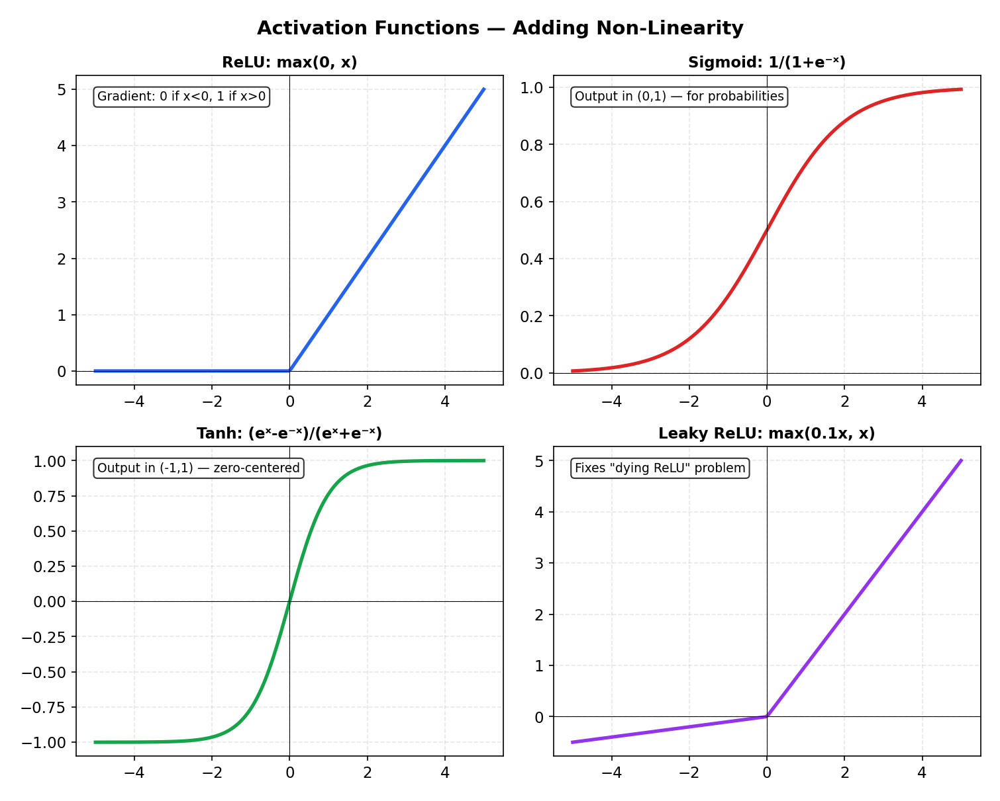
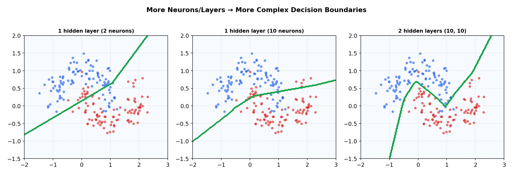

# Neural Networks Fundamentals

> **🎯 Goal**: Understand how neural networks work — from neurons to training
> **⏱ Time**: 3–4h study + 1h exercises
> **📦 Deliverable**: Ability to build, train, and debug a neural network in PyTorch

---

## Table of Contents

1. [A Neuron is a Function](#1-a-neuron-is-a-function)
2. [Layers — Organizing Neurons](#2-layers--organizing-neurons)
3. [Activation Functions — Adding Non-Linearity](#3-activation-functions--adding-non-linearity)
4. [Forward Pass](#4-forward-pass)
5. [Loss Functions for Neural Nets](#5-loss-functions-for-neural-nets)
6. [Backward Pass (Backpropagation)](#6-backward-pass-backpropagation)
7. [The Training Loop](#7-the-training-loop)
8. [Common Problems & Solutions](#8-common-problems--solutions)
9. [Dropout — Chaos Engineering for Neural Nets](#9-dropout--chaos-engineering-for-neural-nets)
10. [Batch Normalization — Standardizing Layer Contracts](#10-batch-normalization--standardizing-layer-contracts)
11. [Optimizers Beyond SGD](#11-optimizers-beyond-sgd)

---

## 1. A Neuron is a Function

### Intuition (Backend Analogy)

A neuron is like a **microservice** that receives requests (inputs), processes them with
configurable parameters (weights + bias), and returns a response (output). The "processing"
is just: multiply each input by a weight, sum everything up, add a bias, and apply an
activation function.

```
output = activate(w₁x₁ + w₂x₂ + ... + wₙxₙ + b)
```

### How It Works

```
        Inputs       Weights
        ──────       ───────
  x₁ ───[ w₁ ]──┐
                  │
  x₂ ───[ w₂ ]──┼──→ [ Σ + b ] ──→ [ activation ] ──→ output
                  │
  x₃ ───[ w₃ ]──┘

  Step 1: Multiply each input by its weight
  Step 2: Sum all products + bias
  Step 3: Apply activation function
```

**The Math:**

```
  Weighted sum (pre-activation):

    z = w^T · x + b = Σᵢ wᵢxᵢ + b

  Activated output:

    a = f(z)

  where f is the activation function (ReLU, Sigmoid, etc.)
  w ∈ ℝⁿ (weight vector), x ∈ ℝⁿ (input vector), b ∈ ℝ (bias scalar)
```

### Recipe

```python
import torch
import torch.nn as nn

# A single neuron: 3 inputs → 1 output
neuron = nn.Linear(in_features=3, out_features=1)
x = torch.tensor([1.0, 2.0, 3.0])
output = torch.relu(neuron(x))  # activate(w·x + b)
```

### When to Use

You never use a single neuron alone — but understanding it is the foundation. Every
neural network is just neurons composed together.

---

## 2. Layers — Organizing Neurons

### Intuition (Backend Analogy)

Think of a neural network as an **API gateway → middleware chain → response**:

| Layer         | Analogy                    | Role                          |
|---------------|----------------------------|-------------------------------|
| Input layer   | API request body           | Raw features come in          |
| Hidden layers | Middleware / business logic | Learn useful transformations  |
| Output layer  | API response               | Final prediction goes out     |

### How It Works

```
  INPUT LAYER      HIDDEN LAYER       OUTPUT LAYER
  (features)       (learned)          (prediction)
  ───────────      ────────────       ────────────

    x₁ ●──────────→ h₁ ●──────────→ y₁ ●
        ╲╱              ╲╱
    x₂ ●──────────→ h₂ ●──────────→ y₂ ●
        ╲╱              ╲╱
    x₃ ●──────────→ h₃ ●
        ╲╱
    x₄ ●──────────→ h₄ ●

  Every input connects to every hidden neuron (fully connected).
  Every hidden neuron connects to every output neuron.
  Arrows carry weights — learned during training.
```

**The Math:**

```
  Layer-wise forward pass for layer l:

    z^(l) = W^(l) · a^(l-1) + b^(l)       (weighted sum)
    a^(l) = f(z^(l))                        (activation)

  Shapes:
    W^(l) ∈ ℝ^{n_l × n_{l-1}}    — weight matrix
    b^(l) ∈ ℝ^{n_l}              — bias vector
    a^(l) ∈ ℝ^{n_l}              — activation vector (layer output)

  where n_l = number of neurons in layer l
```

### Recipe

```python
model = nn.Sequential(
    nn.Linear(4, 8),   # input(4) → hidden(8)
    nn.ReLU(),
    nn.Linear(8, 2),   # hidden(8) → output(2)
)
output = model(torch.randn(4))  # forward pass
```

### When to Use

Start with 1–2 hidden layers. Add more only if underfitting. Width (neurons per layer)
matters more than depth for tabular data.

---

## 3. Activation Functions — Adding Non-Linearity

### Intuition (Backend Analogy)

Without activation functions, stacking layers is useless — it all collapses to one linear
transformation. Activations add **non-linearity**, like how middleware can reject, transform,
or gate requests rather than just passing them through.

### How It Works

```
  ReLU: max(0, x)              Sigmoid: 1/(1+e⁻ˣ)
  ┌────────────────┐           ┌────────────────┐
  │            /   │           │          ----  │
  │           /    │           │        /       │
  │          /     │           │      /         │
  │─────────/      │           │────/           │
  │                │           │                │
  └────────────────┘           └────────────────┘
   Dead below 0, linear above   Squashes to [0, 1]

  Tanh: (eˣ-e⁻ˣ)/(eˣ+e⁻ˣ)   Softmax: eˣⁱ / Σeˣʲ
  ┌────────────────┐           ┌────────────────┐
  │          ----  │           │ Outputs: [0.7, │
  │        /       │           │  0.2, 0.1]     │
  │      /         │           │                │
  │----            │           │ All sum to 1.0 │
  │                │           │ (like a load   │
  └────────────────┘           │  balancer)     │
   Squashes to [-1, 1]        └────────────────┘
```

| Function | Range    | Use Case             | Analogy                          |
|----------|----------|----------------------|----------------------------------|
| ReLU     | [0, ∞)   | Hidden layers (default) | Threshold gate: pass or block |
| Sigmoid  | [0, 1]   | Binary output        | Probability converter            |
| Tanh     | [-1, 1]  | Centered output      | Centered probability converter   |
| Softmax  | [0, 1]   | Multi-class output   | Load balancer splitting 100% traffic |

**The Math:**

```
  ReLU:
    f(x) = max(0, x)
    f'(x) = { 0  if x < 0
            { 1  if x > 0       (undefined at x=0, typically set to 0)

  Sigmoid:
    f(x) = 1 / (1 + e^{-x})
    f'(x) = f(x) · (1 - f(x))

  Tanh:
    f(x) = (e^x - e^{-x}) / (e^x + e^{-x})
    f'(x) = 1 - f(x)²

  Softmax (for class k):
    pₖ = e^{zₖ} / Σⱼ e^{zⱼ}
    Outputs form a probability distribution: Σₖ pₖ = 1
```



### Recipe

```python
# In practice, just pick the right one:
hidden = nn.ReLU()            # hidden layers — almost always
binary_out = nn.Sigmoid()     # binary classification output
multi_out = nn.Softmax(dim=1) # multi-class output (but see note below)
```

> **⚠️ Note**: `nn.CrossEntropyLoss` includes softmax internally — don't add softmax
> to your output layer when using it.

### When to Use

**Default**: ReLU for hidden layers, no activation on output (let the loss function handle it).

---

## 4. Forward Pass

### Intuition (Backend Analogy)

The forward pass is a **request flowing through a middleware chain**. Each layer receives
data, transforms it, and passes it to the next. No going back — data flows in one direction.

### How It Works

```
  Input        Layer 1           Layer 2           Output
  ─────        ───────           ───────           ──────

  [x₁]    W₁·x + b₁        W₂·h₁ + b₂
  [x₂] ──→ ReLU(·) ──→ h₁ ──→ Sigmoid(·) ──→ ŷ (prediction)
  [x₃]

  Each layer computes: output = activation(weights × input + bias)
```

**The Math:**

```
  Full network forward pass (L layers):

    a^(0) = x                                    (input)
    z^(l) = W^(l) · a^(l-1) + b^(l)    for l = 1, ..., L
    a^(l) = f(z^(l))                    for l = 1, ..., L
    ŷ = a^(L)                                    (output / prediction)

  Example (2-layer network, 3 inputs → 1 output):

    z^(1) = W^(1) · x + b^(1)          W^(1) ∈ ℝ^{8×3}, b^(1) ∈ ℝ^8
    a^(1) = ReLU(z^(1))                a^(1) ∈ ℝ^8
    z^(2) = W^(2) · a^(1) + b^(2)      W^(2) ∈ ℝ^{1×8}, b^(2) ∈ ℝ^1
    ŷ     = Sigmoid(z^(2))             ŷ ∈ ℝ^1
```

### Recipe

```python
class MyNet(nn.Module):
    def __init__(self):
        super().__init__()
        self.layer1 = nn.Linear(3, 8)
        self.layer2 = nn.Linear(8, 1)

    def forward(self, x):
        x = torch.relu(self.layer1(x))
        return torch.sigmoid(self.layer2(x))
```

### When to Use

Every prediction is a forward pass. Training adds backward pass on top.

---

## 5. Loss Functions for Neural Nets

### Intuition (Backend Analogy)

The loss function is your **monitoring/alerting system**. It tells the network exactly
"how wrong you are" — like a metric that measures how far your service is from its SLA.

### How It Works

```
  Prediction (ŷ) ──┐
                     ├──→ [ Loss Function ] ──→ loss (scalar)
  True Label (y) ──┘

  Lower loss = better predictions
  Training = minimize this number
```

| Loss Function     | Task               | Input → Output                  |
|-------------------|--------------------|---------------------------------|
| BCELoss           | Binary classif.    | sigmoid output → 0 or 1        |
| CrossEntropyLoss  | Multi-class        | raw logits → class index        |
| MSELoss           | Regression         | any number → any number         |

**The Math:**

```
  Mean Squared Error (regression):
    L = (1/n) Σᵢ (yᵢ - ŷᵢ)²

  Binary Cross-Entropy (binary classification):
    L = -(1/n) Σᵢ [ yᵢ · log(pᵢ) + (1 - yᵢ) · log(1 - pᵢ) ]

  Categorical Cross-Entropy (multi-class classification):
    L = -(1/n) Σᵢ Σₖ yᵢₖ · log(pᵢₖ)

  where:
    n = number of samples, K = number of classes
    yᵢ = true label, ŷᵢ = prediction, pᵢ = predicted probability
    yᵢₖ = 1 if sample i belongs to class k (one-hot), else 0
```

### Recipe

```python
# Binary classification
loss_fn = nn.BCELoss()            # expects sigmoid output + float labels

# Multi-class (INCLUDES softmax — use raw logits)
loss_fn = nn.CrossEntropyLoss()   # expects raw logits + integer labels

# Regression
loss_fn = nn.MSELoss()            # expects float predictions + float targets
```

### When to Use

Pick based on your task. **CrossEntropyLoss is the most common** — it handles softmax
internally, so your model's final layer should output raw logits (no activation).

---

## 6. Backward Pass (Backpropagation)

### Intuition (Backend Analogy)

Backpropagation is like an **incident postmortem**: you trace the error from the final
output back through every component to find which parameters contributed most to the
failure. Each layer gets a "blame score" (gradient) proportional to its contribution.

### How It Works

```
  ════════════ FORWARD (prediction) ═══════════→

  Input ──→ Layer 1 ──→ Layer 2 ──→ Output ──→ Loss
                                                 │
  ←═══════════ BACKWARD (gradients) ═════════════╛

  Input ←── ∂L/∂W₁ ←── ∂L/∂W₂ ←── ∂L/∂ŷ ←── Loss

  Chain Rule:  ∂L/∂W₁ = ∂L/∂ŷ × ∂ŷ/∂h₁ × ∂h₁/∂W₁
               (error    (how output  (how layer 1
                at end)   depends on   depends on
                          layer 1)     its weights)
```

**The Math:**

```
  Error signal at output layer L:
    δ^(L) = ∂L/∂z^(L)

  Backpropagation to layer l:
    δ^(l) = (W^(l+1))^T · δ^(l+1) ⊙ f'(z^(l))

    where ⊙ is element-wise multiplication (Hadamard product)

  Weight gradient:
    ∂L/∂W^(l) = δ^(l) · (a^(l-1))^T

  Bias gradient:
    ∂L/∂b^(l) = δ^(l)

  ── Worked Example (2-layer network) ──────────────────────────

  Given: input x ∈ ℝ², one hidden layer (2 neurons), one output

    Forward pass:
      z^(1) = W^(1)·x + b^(1)          → e.g. z^(1) = [0.8, -0.3]
      a^(1) = ReLU(z^(1))              → a^(1) = [0.8, 0.0]
      z^(2) = W^(2)·a^(1) + b^(2)      → e.g. z^(2) = [0.5]
      ŷ     = Sigmoid(z^(2))           → ŷ = 0.622

    Loss (BCE, single sample, y=1):
      L = -[1·log(0.622) + 0·log(0.378)] = 0.475

    Backward pass:
      Step 1 — Output error:
        δ^(2) = ŷ - y = 0.622 - 1.0 = -0.378

      Step 2 — Output layer gradients:
        ∂L/∂W^(2) = δ^(2) · (a^(1))^T = -0.378 · [0.8, 0.0]^T
                   = [-0.302, 0.0]
        ∂L/∂b^(2) = δ^(2) = -0.378

      Step 3 — Hidden layer error:
        δ^(1) = (W^(2))^T · δ^(2) ⊙ ReLU'(z^(1))
        ReLU'(z^(1)) = [1, 0]   (since z^(1) = [0.8, -0.3])
        δ^(1) = W^(2)^T · (-0.378) ⊙ [1, 0]

      Step 4 — Hidden layer gradients:
        ∂L/∂W^(1) = δ^(1) · x^T
        ∂L/∂b^(1) = δ^(1)

      Step 5 — Update all weights:
        W ← W - η · ∂L/∂W   (for each layer)
        b ← b - η · ∂L/∂b
```

### Recipe

```python
loss = loss_fn(model(X), y)  # forward pass + compute loss
loss.backward()               # backward pass — computes ALL gradients
# Now every parameter has a .grad attribute
for name, p in model.named_parameters():
    print(name, p.grad.shape)  # each weight knows its gradient
```

### When to Use

Called every training step. PyTorch's autograd handles all the calculus — you just
call `.backward()`.

---

## 7. The Training Loop

### Intuition (Backend Analogy)

The training loop is like a **CI/CD pipeline that runs on repeat**: build (forward pass),
test (compute loss), analyze failures (backward pass), fix (update weights), clean up
(zero gradients).

### How It Works

```
  ┌──────────────────────────────────────────────┐
  │              TRAINING LOOP                    │
  │                                               │
  │   ┌─→ Forward Pass (predict)                  │
  │   │        │                                  │
  │   │   Compute Loss (how wrong?)               │
  │   │        │                                  │
  │   │   Backward Pass (compute gradients)       │
  │   │        │                                  │
  │   │   Update Weights (optimizer.step)         │
  │   │        │                                  │
  │   │   Zero Gradients (clean slate)            │
  │   │        │                                  │
  │   └── Next Epoch ←────────────────────────────│
  └──────────────────────────────────────────────┘
```

### Recipe — THE Pattern

```python
model = MyNet()
optimizer = torch.optim.Adam(model.parameters(), lr=0.001)
loss_fn = nn.BCELoss()

for epoch in range(100):
    preds = model(X_train)               # 1. forward
    loss = loss_fn(preds, y_train)        # 2. compute loss
    loss.backward()                       # 3. backward (gradients)
    optimizer.step()                      # 4. update weights
    optimizer.zero_grad()                 # 5. reset gradients
```

> **⚠️ Forgetting `optimizer.zero_grad()`** is the #1 PyTorch beginner bug. Gradients
> accumulate by default — if you don't zero them, each step uses stale gradients from
> previous iterations.

### When to Use

**Every single time you train a neural network in PyTorch.** This 5-line pattern is
universal. Memorize it.

---

## 8. Common Problems & Solutions

### Intuition (Backend Analogy)

Neural network debugging is like **distributed system debugging** — symptoms appear far from
the root cause. Here's your runbook.

### Problem Runbook

```
  PROBLEM              SYMPTOM                    FIX
  ──────────────────────────────────────────────────────────────
  Vanishing            Loss plateaus early.       → ReLU activation
  Gradients            Deep layers don't learn.   → Residual connections
                       Gradients → ~0.            → Batch normalization

  Exploding            Loss goes to NaN/Inf.      → Gradient clipping
  Gradients            Weights grow huge.          → Lower learning rate
                       Training is unstable.      → Smaller initialization

  Overfitting          Train acc >> Test acc.      → Dropout
                       Test loss rises while      → Early stopping
                       train loss falls.          → Data augmentation
                                                  → L2 regularization
  ──────────────────────────────────────────────────────────────
```

**The Math — Gradient Clipping:**

```
  If ||g|| > τ:   g ← g · τ / ||g||

  where g = gradient vector, τ = max norm threshold, ||g|| = L2 norm
  This rescales the gradient to have norm τ without changing its direction.
```



*More layers and neurons → more complex, non-linear decision boundaries.*

### Recipe — Gradient Clipping

```python
loss.backward()
torch.nn.utils.clip_grad_norm_(model.parameters(), max_norm=1.0)
optimizer.step()
```

### Recipe — Early Stopping (Pseudocode)

```python
best_loss, patience_counter = float('inf'), 0
for epoch in range(1000):
    val_loss = evaluate(model, X_val, y_val)
    if val_loss < best_loss:
        best_loss, patience_counter = val_loss, 0
        torch.save(model.state_dict(), "best.pt")
    else:
        patience_counter += 1
        if patience_counter >= 10: break  # stop early
```

---

## 9. Dropout — Chaos Engineering for Neural Nets

### Intuition (Backend Analogy)

Dropout is **chaos engineering**: randomly kill pods (neurons) during training so the system
can't rely on any single component. This forces redundancy and robustness — exactly like
Netflix's Chaos Monkey.

### How It Works

```
  TRAINING (dropout=0.5)          INFERENCE (no dropout)
  ─────────────────────           ──────────────────────

  ● ──→ ● ──→ ● ──→ ●            ● ──→ ● ──→ ● ──→ ●
  ● ──→ ✗     ● ──→ ●            ● ──→ ● ──→ ● ──→ ●
  ● ──→ ● ──→ ✗     ●            ● ──→ ● ──→ ● ──→ ●
  ● ──→ ✗     ● ──→ ●            ● ──→ ● ──→ ● ──→ ●

  ✗ = neuron turned off           All neurons active,
  (randomly each batch)           outputs scaled down
```

**The Math:**

```
  During training (inverted dropout):
    mask ~ Bernoulli(p)          p = keep probability (e.g. 0.7)
    h̃ = (mask ⊙ h) / p          scale up to compensate for dropped neurons

  During inference:
    h̃ = h                        no dropout — use full network as-is

  Why divide by p? If you drop 30% of neurons (p=0.7), the remaining 70%
  must be scaled up by 1/0.7 ≈ 1.43 so the expected output magnitude
  stays the same between training and inference.
```

### Recipe

```python
model = nn.Sequential(
    nn.Linear(64, 128),
    nn.ReLU(),
    nn.Dropout(0.3),        # drop 30% of neurons
    nn.Linear(128, 10),
)
model.train()   # dropout ON
model.eval()    # dropout OFF (inference)
```

### When to Use

- Overfitting? Add dropout (start with 0.2–0.3).
- Already underfitting? Don't add dropout — it makes capacity worse.
- **Always call `model.eval()` before inference** — forgetting this is a common bug.

---

## 10. Batch Normalization — Standardizing Layer Contracts

### Intuition (Backend Analogy)

Batch norm is like **standardizing API contracts between microservices**. Without it, each
layer receives inputs with wildly different scales, making training slow and fragile. Batch
norm normalizes inputs to each layer (mean≈0, std≈1), so every layer gets consistent input.

### How It Works

```
  Without BatchNorm:                With BatchNorm:
  ─────────────────                 ───────────────

  Layer 1 → [0.01, 500, -30]       Layer 1 → [-0.5, 1.2, -0.7]
       │                                 │
       ▼                                 ▼
  Layer 2 struggles with             Layer 2 receives
  wildly different scales            normalized inputs
```

```
  For each mini-batch:
  1. Compute mean μ and variance σ² of inputs
  2. Normalize: x̂ = (x - μ) / √(σ² + ε)
  3. Scale and shift: y = γx̂ + β   (γ, β are learnable)
```

**The Math:**

```
  For a mini-batch B = {x₁, ..., xₘ}:

    Mini-batch mean:       μ_B = (1/m) Σᵢ xᵢ
    Mini-batch variance:   σ²_B = (1/m) Σᵢ (xᵢ - μ_B)²
    Normalize:             x̂ᵢ = (xᵢ - μ_B) / √(σ²_B + ε)
    Scale and shift:       yᵢ = γ · x̂ᵢ + β

  where:
    ε = small constant for numerical stability (e.g. 1e-5)
    γ, β = learnable parameters (initialized to γ=1, β=0)

  At inference time, use running averages of μ and σ² computed
  during training (not the current batch statistics).
```

### Recipe

```python
model = nn.Sequential(
    nn.Linear(64, 128),
    nn.BatchNorm1d(128),    # normalize after linear, before activation
    nn.ReLU(),
    nn.Linear(128, 10),
)
```

### When to Use

- Deep networks (5+ layers): almost always helps.
- Training is slow or unstable: try adding batch norm.
- **Place it after Linear/Conv, before activation** (most common convention).

---

## 11. Optimizers Beyond SGD

### Intuition (Backend Analogy)

SGD is like a **fixed retry policy** — same step size every time. Better optimizers adapt,
like an **exponential backoff** that adjusts based on recent history.

### How It Works

```
  SGD:              SGD + Momentum:         Adam:
  ────              ───────────────         ─────

  Step = lr × grad  Step = lr × grad       Step = lr × grad
                     + momentum × prev      / √(running_avg²)
                                            (adapts per-param)

  Fixed step size.   Adds inertia —         Adapts learning rate
  Can get stuck in   rolls past small       for each weight.
  local minima.      bumps. Faster.         Best default choice.
```

**The Math:**

```
  SGD + Momentum:
    vₜ = β · vₜ₋₁ + ∇L(θ)
    θ  ← θ - η · vₜ

  Adam (Adaptive Moment Estimation):
    gₜ = ∇L(θ)                                 (gradient at step t)
    mₜ = β₁ · mₜ₋₁ + (1 - β₁) · gₜ            (1st moment — mean)
    vₜ = β₂ · vₜ₋₁ + (1 - β₂) · gₜ²           (2nd moment — variance)
    m̂ₜ = mₜ / (1 - β₁^t)                       (bias correction)
    v̂ₜ = vₜ / (1 - β₂^t)                       (bias correction)
    θ  ← θ - η · m̂ₜ / (√v̂ₜ + ε)

    Defaults: β₁=0.9, β₂=0.999, ε=1e-8

  Gradient Clipping:
    if ||g|| > τ:  g ← g · τ / ||g||
    Prevents exploding gradients by capping the gradient norm.
```

```
  Learning Rate Schedulers:

  Loss │╲
       │  ╲         Step Decay: cut LR by 10x every N epochs
       │   ╲╲
       │     ╲──    Cosine Annealing: smooth LR decrease
       │        ──
       └──────────→ Epochs
```

### Recipe

```python
# Adam — the default choice
optimizer = torch.optim.Adam(model.parameters(), lr=1e-3)

# SGD with momentum
optimizer = torch.optim.SGD(model.parameters(), lr=0.01, momentum=0.9)

# Learning rate scheduler — reduce LR when loss plateaus
scheduler = torch.optim.lr_scheduler.ReduceLROnPlateau(optimizer, patience=5)
# Call after each epoch: scheduler.step(val_loss)
```

### When to Use

| Optimizer    | When                                     |
|-------------|------------------------------------------|
| Adam         | Default. Start here.                    |
| SGD+Momentum | When you need precise fine-tuning (e.g., vision models). |
| AdamW        | Adam + proper weight decay. Use for transformers. |

> **Rule of thumb**: Start with Adam(lr=1e-3). If training works but final accuracy is
> mediocre, switch to SGD+Momentum with a scheduler for that last few %.

---

## Putting It All Together — Complete Example

```python
import torch
import torch.nn as nn

# 1. Define model
class BinaryClassifier(nn.Module):
    def __init__(self, input_dim):
        super().__init__()
        self.net = nn.Sequential(
            nn.Linear(input_dim, 64),
            nn.BatchNorm1d(64),
            nn.ReLU(),
            nn.Dropout(0.3),
            nn.Linear(64, 1),
            nn.Sigmoid(),
        )
    def forward(self, x):
        return self.net(x)

# 2. Setup
model = BinaryClassifier(input_dim=10)
optimizer = torch.optim.Adam(model.parameters(), lr=1e-3)
loss_fn = nn.BCELoss()

# 3. Training loop
for epoch in range(100):
    model.train()
    preds = model(X_train)
    loss = loss_fn(preds, y_train)
    loss.backward()
    optimizer.step()
    optimizer.zero_grad()

# 4. Inference
model.eval()
with torch.no_grad():
    predictions = model(X_test)
```

---

## Exercises

### Exercise 1: Conceptual

> A neural network with **only linear activations** (no ReLU/sigmoid) and 10 hidden
> layers — is it more powerful than a single linear layer? Why or why not?

<details>
<summary>Solution</summary>

**No.** A stack of linear transformations collapses into a single linear transformation.

```
Layer 1:  y = W₁x + b₁
Layer 2:  z = W₂y + b₂ = W₂(W₁x + b₁) + b₂ = (W₂W₁)x + (W₂b₁ + b₂)
```

This is just `z = W'x + b'` where `W' = W₂W₁`. No matter how many layers you stack,
the result is still a linear function. **Non-linear activations are what give depth its
power** — they let the network learn curved decision boundaries.

Analogy: chaining 10 middleware functions that each do `return a * input + b` is the same
as one middleware with different `a` and `b`. You need non-linear logic to add expressiveness.

</details>

---

### Exercise 2: Implementation

> Build a 2-layer neural network in PyTorch for binary classification. Show the model
> definition, training loop, and prediction. Max 15 lines total.

<details>
<summary>Solution</summary>

```python
import torch
import torch.nn as nn

model = nn.Sequential(
    nn.Linear(10, 32), nn.ReLU(), nn.Dropout(0.2),
    nn.Linear(32, 1), nn.Sigmoid()
)
optimizer = torch.optim.Adam(model.parameters(), lr=1e-3)
loss_fn = nn.BCELoss()

for epoch in range(100):                          # training loop
    loss = loss_fn(model(X_train), y_train)
    loss.backward(); optimizer.step(); optimizer.zero_grad()

model.eval()                                      # prediction
with torch.no_grad(): preds = (model(X_test) > 0.5).float()
```

15 lines. Includes model definition (4 lines), training loop (3 lines), inference (2 lines).

</details>

---

### Exercise 3: Real-World Debugging

> Your neural network achieves **98% training accuracy** but **60% test accuracy**.
> Training loss decreases every epoch, test loss increases after epoch 5.
> List your debugging steps in order.

<details>
<summary>Solution</summary>

This is textbook **overfitting**. The model memorized training data but doesn't generalize.

**Debugging steps (in order of effort):**

1. **Check data split** — Is test set from the same distribution? Any data leakage?
2. **Add regularization** (quick wins):
   - Add `Dropout(0.3)` after hidden layers
   - Add weight decay: `Adam(params, lr=1e-3, weight_decay=1e-4)`
3. **Early stopping** — Save model at epoch 5 (where test loss was best), stop training
4. **Reduce model capacity** — Fewer layers or fewer neurons. Your model is too big for
   your data.
5. **Get more training data** — or use data augmentation
6. **Add batch normalization** — can improve generalization
7. **Cross-validate** — Make sure epoch 5 wasn't a fluke

```
  Loss │
       │ ╲  Train loss (keeps falling)
       │  ╲──────────────
       │   ╲╱╲
       │      ╲   Test loss (rises after epoch 5)
       │       ╲──────────
       └──────────────────→ Epochs
             ↑
          Epoch 5: stop here (early stopping)
```

Analogy: like a student who memorizes all practice questions word-for-word but can't solve
new problems. The fix isn't more studying — it's studying differently (regularization) or
getting more diverse practice problems (more data).

</details>

---

## Quick Reference Card

```
  ┌──────────────────────────────────────────────────────┐
  │              NEURAL NETWORK CHEAT SHEET              │
  ├──────────────────────────────────────────────────────┤
  │                                                      │
  │  ARCHITECTURE DEFAULTS                               │
  │  ─────────────────────                               │
  │  Activation (hidden):  ReLU                          │
  │  Activation (output):  None (let loss handle it)     │
  │  Optimizer:            Adam(lr=1e-3)                 │
  │  Loss (classify):      CrossEntropyLoss              │
  │  Loss (binary):        BCELoss + Sigmoid output      │
  │  Loss (regression):    MSELoss                       │
  │                                                      │
  │  TRAINING LOOP (memorize this)                       │
  │  ─────────────────────────────                       │
  │  preds = model(X)                                    │
  │  loss  = loss_fn(preds, y)                           │
  │  loss.backward()                                     │
  │  optimizer.step()                                    │
  │  optimizer.zero_grad()                               │
  │                                                      │
  │  OVERFITTING? (train >> test)                        │
  │  ───────────                                         │
  │  1. Dropout(0.2-0.5)                                 │
  │  2. Early stopping                                   │
  │  3. Weight decay (L2)                                │
  │  4. More data / augmentation                         │
  │  5. Simpler model                                    │
  │                                                      │
  │  COMMON BUGS                                         │
  │  ───────────                                         │
  │  ✗ Forgot optimizer.zero_grad()                      │
  │  ✗ Forgot model.eval() before inference              │
  │  ✗ Added Softmax + CrossEntropyLoss (double softmax) │
  │  ✗ Wrong loss for task (MSE for classification)      │
  │                                                      │
  └──────────────────────────────────────────────────────┘
```
