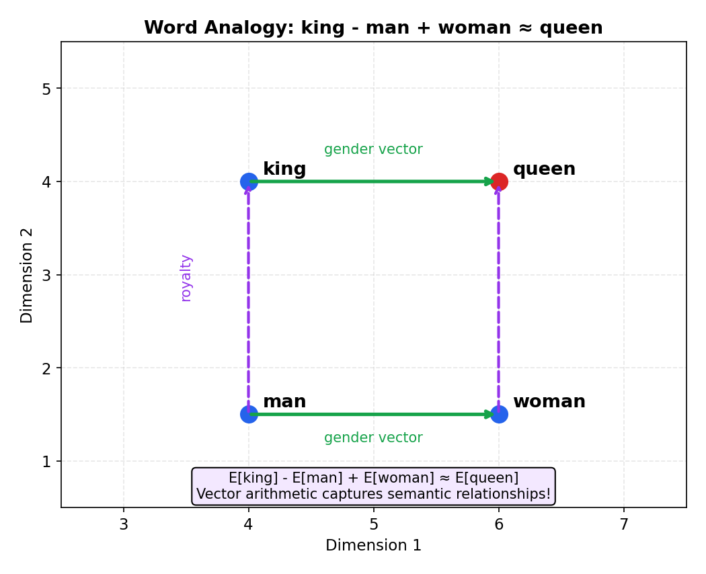
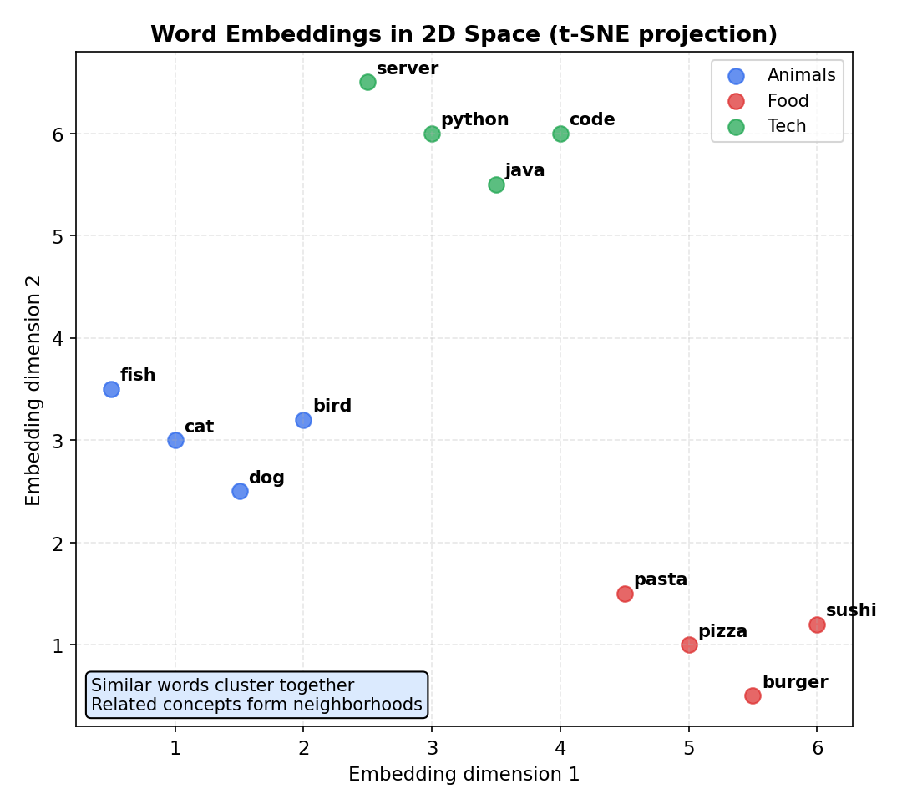

# Embeddings — Turning Everything into Vectors

> **🎯 Goal**: Understand how ML represents words, images, and entities as dense vectors
> **⏱ Time**: 2–3h study + 1h exercises
> **📦 Deliverable**: Intuition for how embeddings work and how to use pre-trained ones

---

## Table of Contents

1. [Why Embeddings?](#1-why-embeddings)
2. [Word2Vec — The Original Embedding](#2-word2vec--the-original-embedding)
3. [How Embedding Layers Work](#3-how-embedding-layers-work)
4. [Training Embeddings](#4-training-embeddings)
5. [Beyond Words — Embeddings for Everything](#5-beyond-words--embeddings-for-everything)
6. [Similarity Search with Embeddings](#6-similarity-search-with-embeddings)
7. [Transfer Learning with Embeddings](#7-transfer-learning-with-embeddings)
8. [Practical Tips](#8-practical-tips)

---

## 1. Why Embeddings?

### The Intuition (Backend Analogy)

Imagine storing a million users in a database where each user is a row and every other
user is a boolean column: `is_user_0`, `is_user_1`, … `is_user_999999`. That's
**one-hot encoding** — absurdly wasteful and it tells you nothing about relationships.
User 42 and User 43 are just as "different" as User 42 and User 999999.

An embedding is like replacing that million-column row with a compact **profile vector**
— say 256 floats — where similar users naturally end up with similar vectors.

### How It Works

```
  ONE-HOT (sparse, 10000-dim)           EMBEDDING (dense, 256-dim)

  "cat" → [0 0 0 ... 1 ... 0 0 0]      "cat" → [0.21, -0.05, 0.88, ..., 0.14]
            10,000 entries                          256 entries
            exactly one 1                           all entries meaningful
            no similarity info                      similar words → similar vectors

  Distance:                              Distance:
  d("cat","dog") = √2                   d("cat","dog") = 0.15   ← close!
  d("cat","fish") = √2   ← same!       d("cat","fish") = 0.68  ← farther
```

### When to Use

- You have **categorical features** with many values (words, user IDs, product IDs)
- You want the model to learn that some categories are **similar**
- Your vocabulary is too large for one-hot (>1000 categories)

---

## 2. Word2Vec — The Original Embedding

### The Intuition (Backend Analogy)

Like collaborative filtering in a recommendation engine: users who buy similar products
get similar profiles. Word2Vec does the same — words that appear in similar **contexts**
get similar vectors.

### How It Works

Two training approaches:

```
  SKIP-GRAM: given target, predict context

  "The [cat] sat on the mat"
       ↓
     target: "cat"
     predict: "The", "sat"

  CBOW: given context, predict target

  "The [???] sat on the mat"
       ↓
     context: "The", "sat"
     predict: "cat"
```

The famous vector arithmetic result:

```
     king - man + woman ≈ queen

     In 2D (simplified):

                  queen ♛
                 ·
                /
     king ♚ ···          ← "royalty" direction
      |       /
      | man→woman        ← "gender" direction
      |  /
     man ♂ ·········· woman ♀
```

**The Math:**

**Skip-gram** — given a target word, maximize the probability of its context words:

```
  Objective:  maximize  Σ         log P(context | target)
                       (target,context)

  Full softmax (expensive):

                         exp(v'_o · v_i)
  P(w_o | w_i)  =  ─────────────────────────
                     Σ_w  exp(v'_w · v_i)

  where v_i  = embedding of target word i
        v'_o = output embedding of context word o
        sum is over ALL words in vocabulary (slow!)

  Negative sampling approximation (practical):

  L = log σ(v'_o · v_i)  +  Σ_{k=1}^{K}  𝔼[ log σ(−v'_k · v_i) ]

  where σ = sigmoid, K negative samples drawn from noise distribution
        P_noise(w) ∝ freq(w)^{3/4}
```

**CBOW** (Continuous Bag of Words) — given context words, predict the target:

```
  Objective:  maximize  Σ  log P(target | context_window)

  Context vector = average of surrounding word vectors:

         1
  h  =  ───  Σ  v_w       (average over context window words)
         C   w∈context

  Then predict target from h using softmax (or negative sampling).
```

**Analogy property** — vector arithmetic captures semantic relationships:

```
  E[king] − E[man] + E[woman]  ≈  E[queen]

  The embedding space encodes directions as relationships:
    "royalty" direction  ≈  E[king] − E[man]  ≈  E[queen] − E[woman]
    "gender"  direction  ≈  E[woman] − E[man] ≈  E[queen] − E[king]
```



### Recipe

```python
from gensim.models import KeyedVectors

# Load pre-trained Word2Vec (Google News, 3M words, 300-dim)
wv = KeyedVectors.load_word2vec_format("GoogleNews-vectors.bin", binary=True)

print(wv.most_similar("python", topn=3))
# [('java', 0.85), ('perl', 0.79), ('ruby', 0.77)]

result = wv.most_similar(positive=["king", "woman"], negative=["man"], topn=1)
print(result)  # [('queen', 0.71)]
```

### When to Use

- Quick baseline for NLP tasks
- Small datasets where you can't train BERT-scale models
- When you need interpretable vector arithmetic

---

## 3. How Embedding Layers Work

### The Intuition (Backend Analogy)

An embedding layer is a **lookup table** — like a HashMap<Integer, float[]>. You give it
an ID, it returns a vector. The difference: the vectors are **learnable parameters**,
updated by gradient descent during training.

### How It Works

```
  Embedding(vocab_size=5, dim=3)

  Internal matrix (5 rows × 3 cols):        Lookup:
  ┌─────────────────────────┐
  │ row 0: [ 0.12, -0.34,  0.56] │         input: 3
  │ row 1: [ 0.78,  0.91, -0.23] │            ↓
  │ row 2: [-0.45,  0.67,  0.11] │         output: row 3
  │ row 3: [ 0.33, -0.88,  0.44] │ ◄────   = [0.33, -0.88, 0.44]
  │ row 4: [ 0.99,  0.01, -0.77] │
  └─────────────────────────┘
              ↑
     These values ARE the learned parameters
     (updated by backpropagation)
```

**The Math:**

```
  Embedding matrix:   E ∈ ℝ^{V × d}
    where V = vocabulary size, d = embedding dimension

  Lookup for word i:

    v_i  =  E[i]          (row selection — just an array index)

  Mathematically equivalent to one-hot × E:

    v  =  e_i^T · E

    where e_i is the one-hot vector with a 1 at position i.
    The matrix multiply selects row i, but in practice we
    skip the multiply and do a direct table lookup (O(1)).

  Total parameters:  V × d
    e.g. vocab=10,000, dim=256 → 2,560,000 learnable floats
```

### Recipe

```python
import torch
import torch.nn as nn

embed = nn.Embedding(num_embeddings=10000, embedding_dim=256)

# Look up word IDs 5, 42, 99
ids = torch.tensor([5, 42, 99])
vectors = embed(ids)          # shape: (3, 256)
print(vectors.shape)          # torch.Size([3, 256])
# Total params: 10000 * 256 = 2,560,000
```

### When to Use

- Any model that takes categorical inputs (words, user IDs, product IDs)
- First layer in most NLP models
- Recommendation systems mapping users/items to vectors

---

## 4. Training Embeddings

### The Intuition (Backend Analogy)

Like choosing between Docker images:
- **Build from scratch**: full control, but you need all the ingredients and time
- **Use a pre-built image**: someone did the heavy lifting, you customize the last layer
- **Multi-stage build**: start with a base, add your specifics

### How It Works

```
  Option 1: TRAIN FROM SCRATCH
  ┌─────────────┐    backprop     ┌──────────┐
  │  Random      │ ◄──────────── │  Your     │
  │  Embedding   │   all params   │  Task     │
  │  Matrix      │   updated      │  Loss     │
  └─────────────┘                 └──────────┘
  Need: millions of samples

  Option 2: PRE-TRAINED + FINE-TUNE
  ┌─────────────┐    backprop     ┌──────────┐
  │  GloVe /     │ ◄──────────── │  Your     │
  │  Word2Vec    │   small LR     │  Task     │
  │  weights     │   gentle       │  Loss     │
  └─────────────┘   updates       └──────────┘
  Need: thousands of samples

  Option 3: CONTEXTUAL (BERT/GPT)
  "bank" in "river bank"  → vector A
  "bank" in "bank account" → vector B   ← different!
  Need: GPU + patience
```

### Recipe

```python
import torch.nn as nn

# Pre-trained GloVe → your embedding layer
embed = nn.Embedding(vocab_size, 300)
embed.weight = nn.Parameter(torch.tensor(glove_vectors))

# Freeze: use as-is (no training)
embed.weight.requires_grad = False

# Fine-tune: allow small updates
embed.weight.requires_grad = True  # + use small LR (1e-5)
```

### When to Use

| Scenario | Strategy |
|---|---|
| Millions of samples, domain-specific vocab | Train from scratch |
| Thousands of samples, general NLP | Pre-trained + fine-tune |
| Any size, need best accuracy | Contextual (BERT/GPT) |
| Tiny dataset, quick prototype | Pre-trained, frozen |

---

## 5. Beyond Words — Embeddings for Everything

### The Intuition (Backend Analogy)

Embeddings are the universal **serialization format** for ML. Just as JSON can represent
any structured data, embeddings can represent any entity as a fixed-size vector. Once
everything is a vector, you can compare, search, and combine anything.

### How It Works

```
  THE UNIVERSAL PATTERN:

  Entity                    Embedding Model              Dense Vector
  ─────────────────────     ──────────────────           ─────────────
  "laptop bag"         ──→  Word2Vec / BERT          ──→ [0.2, -0.1, ...]
  User #4821           ──→  Collaborative Filtering  ──→ [0.8,  0.3, ...]
  Product SKU-9912     ──→  Product2Vec              ──→ [0.5, -0.7, ...]
  Image (cat.jpg)      ──→  ResNet / CLIP            ──→ [0.1,  0.9, ...]
  Graph Node A         ──→  Node2Vec                 ──→ [0.6,  0.2, ...]

  Once everything is a vector:
  ┌──────────────┐
  │  similarity  │  cos(user_vec, product_vec) → recommendation score
  │  search      │  nearest neighbors → find similar items
  │  clustering  │  k-means on vectors → group similar entities
  │  arithmetic  │  vec("king") - vec("man") + vec("woman") ≈ vec("queen")
  └──────────────┘
```

### Recipe

```python
from sentence_transformers import SentenceTransformer

model = SentenceTransformer("all-MiniLM-L6-v2")

sentences = ["deploy to production", "ship to prod", "database backup"]
embeddings = model.encode(sentences)

from sklearn.metrics.pairwise import cosine_similarity
sims = cosine_similarity(embeddings)
print(f"deploy↔ship: {sims[0][1]:.2f}")   # ~0.82 (similar!)
print(f"deploy↔backup: {sims[0][2]:.2f}") # ~0.25 (different)
```

### When to Use

- **Recommendations**: embed users and items in the same space
- **Search**: embed queries and documents, find nearest neighbors
- **Clustering**: group similar entities without manual feature engineering
- **Multi-modal**: compare images to text (CLIP)

---

## 6. Similarity Search with Embeddings

### The Intuition (Backend Analogy)

Think of it as a **database index** for meaning. A B-tree index finds exact matches fast.
An embedding index (like FAISS or Annoy) finds **approximate nearest neighbors** fast —
items that are semantically close to your query.

### How It Works

```
  COSINE SIMILARITY (most common)

                    A · B           dot product of vectors
  cos(A, B) = ─────────────── = ──────────────────────────
               ||A|| × ||B||     product of their magnitudes

  Range: -1 (opposite) → 0 (unrelated) → 1 (identical)


  NEAREST NEIGHBOR SEARCH

  Query: "wireless headphones"
         ↓ embed
  q = [0.82, -0.15, 0.44, ...]
         ↓ search index
  ┌─────────────────────────────────────────┐
  │  Embedding Index (FAISS / Annoy / HNSW) │
  │                                         │
  │   · bluetooth earbuds    (cos=0.91) ◄── │── top 1
  │   · noise-cancelling     (cos=0.87) ◄── │── top 2
  │   · USB keyboard         (cos=0.12)     │
  │   · running shoes        (cos=0.05)     │
  └─────────────────────────────────────────┘
```

**The Math:**

```
  Cosine similarity:

                a · b           Σ_i  a_i · b_i
  cos(a, b) = ────────── = ──────────────────────────
               ‖a‖ · ‖b‖    √(Σ_i a_i²) · √(Σ_i b_i²)

  Range: −1 (opposite) → 0 (orthogonal) → +1 (identical direction)

  Nearest neighbor retrieval:

  result  =  argmax_j  cos(q, v_j)

  where q = query vector, v_j = j-th stored vector
  Brute force is O(n·d); ANN indexes (FAISS, HNSW) give ≈O(log n).
```



### Recipe

```python
import faiss
import numpy as np

dim = 256
index = faiss.IndexFlatIP(dim)  # inner product (use normalized vecs → cosine)

# Add 100K product embeddings
vectors = np.random.randn(100_000, dim).astype("float32")
faiss.normalize_L2(vectors)
index.add(vectors)

# Query: find 5 nearest neighbors
query = np.random.randn(1, dim).astype("float32")
faiss.normalize_L2(query)
distances, ids = index.search(query, k=5)
print(ids)  # top-5 most similar product indices
```

### When to Use

- Semantic search (search by meaning, not keywords)
- Recommendation retrieval (find candidate items)
- Deduplication (find near-duplicate documents/images)
- Anomaly detection (find items far from all clusters)

---

## 7. Transfer Learning with Embeddings

### The Intuition (Backend Analogy)

Like using a well-tested open-source library vs writing everything from scratch.
Someone trained embeddings on billions of words — you get that knowledge for free and
customize it for your specific task.

### How It Works

```
  Strategy 1: FREEZE (use as-is)
  ┌──────────────────┐     ┌─────────────┐
  │  Pre-trained      │ ──→ │  Your small  │ ──→ output
  │  Embeddings       │     │  classifier  │
  │  (LOCKED 🔒)      │     │  (trained)   │
  └──────────────────┘     └─────────────┘
  Best when: tiny dataset, embeddings match your domain

  Strategy 2: FINE-TUNE (gentle updates)
  ┌──────────────────┐     ┌─────────────┐
  │  Pre-trained      │ ──→ │  Your small  │ ──→ output
  │  Embeddings       │     │  classifier  │
  │  (small LR 🔓)    │     │  (trained)   │
  └──────────────────┘     └─────────────┘
  Best when: moderate data, domain shift from pre-training

  Strategy 3: FEATURE EXTRACTION
  ┌──────────────────┐     ┌─────────────┐
  │  Pre-trained      │ ──→ │  Any ML      │ ──→ output
  │  Model (BERT)     │     │  model       │
  │  → extract vecs   │     │  (XGBoost,   │
  │  (LOCKED 🔒)      │     │   SVM, etc.) │
  └──────────────────┘     └─────────────┘
  Best when: you want embeddings as features, not end-to-end training
```

### Recipe

```python
from transformers import AutoModel, AutoTokenizer
import torch

tokenizer = AutoTokenizer.from_pretrained("bert-base-uncased")
model = AutoModel.from_pretrained("bert-base-uncased")

tokens = tokenizer("deploy to production", return_tensors="pt")
with torch.no_grad():
    output = model(**tokens)

# Use [CLS] token embedding as sentence vector (768-dim)
sentence_embedding = output.last_hidden_state[:, 0, :]
print(sentence_embedding.shape)  # torch.Size([1, 768])
```

### When to Use

| Your Data Size | Strategy | Effort |
|---|---|---|
| < 1K samples | Freeze pre-trained | Low |
| 1K–100K samples | Fine-tune pre-trained | Medium |
| > 100K samples | Fine-tune or train from scratch | High |
| Non-neural downstream | Feature extraction | Low |

---

## 8. Practical Tips

### Embedding Dimension

```
  Rule of thumb: dim ≈ √(vocab_size), capped at 64–512

  Vocab Size     Suggested Dim    Notes
  ──────────     ─────────────    ─────
  100            16–32            Small category
  10,000         64–128           Typical NLP
  100,000        128–256          Large vocab
  1,000,000      256–512          Don't go much higher
```

### Pre-trained vs From Scratch

```
  Decision Tree:

  Do you have > 1M domain-specific samples?
  ├── YES → Train from scratch (or fine-tune)
  └── NO
      └── Is your domain close to general text?
          ├── YES → Use pre-trained (GloVe, BERT)
          └── NO  → Fine-tune pre-trained on your domain
```

### Sentence / Document Embeddings

```python
# Simple but effective: average word embeddings
def avg_embedding(words, wv, dim=300):
    vecs = [wv[w] for w in words if w in wv]
    return np.mean(vecs, axis=0) if vecs else np.zeros(dim)

# Better: use sentence-transformers (one line)
from sentence_transformers import SentenceTransformer
model = SentenceTransformer("all-MiniLM-L6-v2")
vec = model.encode("deploy the service to production")
```

**The Math:**

```
  Mean pooling — average all token embeddings into one sentence vector:

         1
  s  =  ───  Σ_{i=1}^{n}  v_i
         n

  where v_i = embedding of the i-th token, n = number of tokens.
  Simple, effective, and the default in many sentence-transformer models.

  [CLS] token pooling — use the first token's hidden state:

  s  =  h_[CLS]  =  last_hidden_state[:, 0, :]

  BERT-style models pack the "sentence meaning" into the [CLS] token
  during pre-training (via next-sentence prediction).
```

### Visualize to Verify Quality

```python
from sklearn.manifold import TSNE
import matplotlib.pyplot as plt

# Reduce 256-dim embeddings to 2D for visualization
coords = TSNE(n_components=2, random_state=42).fit_transform(embeddings)
plt.scatter(coords[:, 0], coords[:, 1])
for i, label in enumerate(labels):
    plt.annotate(label, (coords[i, 0], coords[i, 1]))
plt.title("Embedding Space (t-SNE)")
plt.show()
```

### Common Pitfalls

| Pitfall | Fix |
|---|---|
| Embeddings for rare words are garbage | Use subword tokenization (FastText, BPE) |
| Cosine similarity all near 1.0 | Normalize your vectors, check for bugs |
| Embedding dim too large for small data | Reduce dim or use pre-trained |
| Different embedding spaces not comparable | Only compare vectors from the same model |

---

## Exercises

### Exercise 1: Conceptual

**Why can't you use one-hot encoding for a vocabulary of 1 million words fed into a
neural network? What would the input dimension be? How does an embedding layer solve
this?**

<details>
<summary>Solution</summary>

With one-hot encoding, each word becomes a vector of 1,000,000 dimensions — the first
linear layer alone would have `1,000,000 × hidden_size` parameters. For hidden_size=512,
that's **512 million parameters** just for the input layer.

An embedding layer replaces this with a lookup table: `Embedding(1_000_000, 256)` has
only 256M parameters, and the lookup is O(1) — no matrix multiplication. The network
sees a dense 256-dim input instead of a sparse 1M-dim input.

```
  One-hot:    [0, 0, ..., 1, ..., 0] × W(1M × 512) = expensive matmul
  Embedding:  ID=42 → lookup row 42 → [0.12, -0.34, ..., 0.56]  ← just an index!
```

</details>

### Exercise 2: Implementation

**Create an embedding layer in PyTorch for 1000 users with 64-dim embeddings. Look up
embeddings for users [5, 23, 42] and compute pairwise cosine similarity.**

<details>
<summary>Solution</summary>

```python
import torch
import torch.nn as nn
import torch.nn.functional as F

embed = nn.Embedding(1000, 64)
user_ids = torch.tensor([5, 23, 42])
vecs = embed(user_ids)                    # shape: (3, 64)

# Pairwise cosine similarity
normed = F.normalize(vecs, dim=1)
sim_matrix = normed @ normed.T            # shape: (3, 3)
print(sim_matrix)
# Diagonal = 1.0 (self-similarity), off-diag = pairwise cosine sim
```

</details>

### Exercise 3: Real-World Scenario

**Your product search returns exact keyword matches but misses semantically similar
products ("laptop" doesn't find "notebook computer"). How would you use embeddings to
improve this?**

<details>
<summary>Solution</summary>

Build a **hybrid search** pipeline:

```
  User Query: "laptop"
       ↓
  ┌────────────────────┐     ┌─────────────────────┐
  │  Keyword Search     │     │  Embedding Search    │
  │  (Elasticsearch)    │     │  (FAISS / Pinecone)  │
  │  exact: "laptop"    │     │  similar: "notebook   │
  │                     │     │  computer", "MacBook" │
  └────────┬───────────┘     └────────┬────────────┘
           └──────────┬───────────────┘
                      ↓
              Merge & Re-rank
                      ↓
              Final Results
```

**Steps:**
1. Encode all product titles with a sentence-transformer model
2. Store vectors in FAISS or a vector database (Pinecone, Weaviate)
3. At query time, encode the query → find top-K nearest product vectors
4. Merge with keyword results and re-rank by combined score

```python
from sentence_transformers import SentenceTransformer
import faiss, numpy as np

model = SentenceTransformer("all-MiniLM-L6-v2")
product_vecs = model.encode(product_titles).astype("float32")
faiss.normalize_L2(product_vecs)

index = faiss.IndexFlatIP(product_vecs.shape[1])
index.add(product_vecs)

query_vec = model.encode(["laptop"]).astype("float32")
faiss.normalize_L2(query_vec)
_, ids = index.search(query_vec, k=10)  # top-10 semantic matches
```

</details>

---

## Key Takeaways

```
  ┌──────────────────────────────────────────────────────────┐
  │                    EMBEDDINGS CHEAT SHEET                 │
  │                                                          │
  │  What:  Dense vector representation of any entity        │
  │  Why:   Captures similarity, compact, learnable          │
  │  How:   Lookup table trained by backprop (or pre-trained)│
  │                                                          │
  │  Pre-trained options:                                    │
  │    Words     → Word2Vec, GloVe, FastText                 │
  │    Sentences → sentence-transformers, BERT [CLS]         │
  │    Images    → CLIP, ResNet features                     │
  │    General   → OpenAI embeddings API                     │
  │                                                          │
  │  Similarity: cosine (normalized dot product)             │
  │  Search:     FAISS, Annoy, HNSW for nearest neighbors    │
  │  Dimension:  64–512, use √(vocab) as starting point      │
  │  Rule #1:    Use pre-trained unless you have tons of data │
  └──────────────────────────────────────────────────────────┘
```
