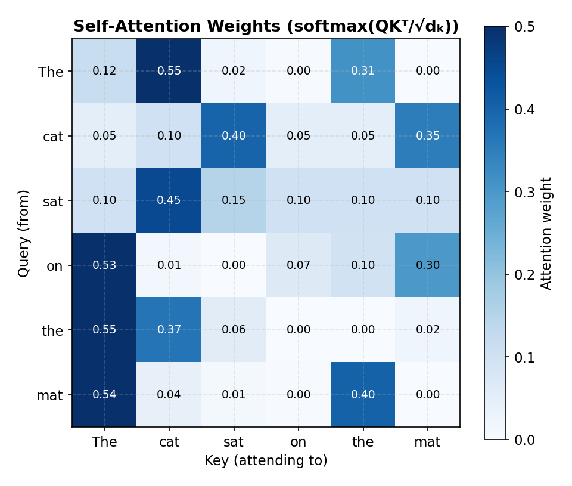
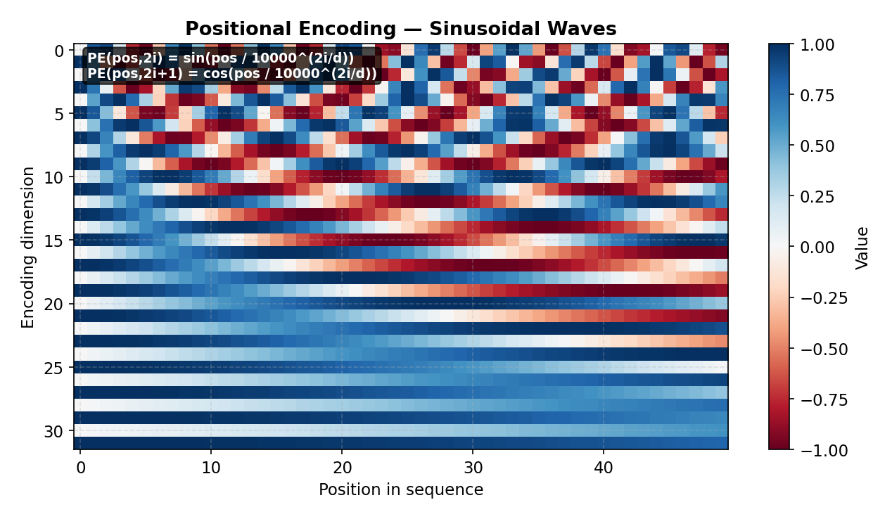

# Transformers & Attention Mechanism

> **🎯 Goal**: Understand the architecture behind GPT, BERT, and every modern LLM
> **⏱ Time**: 3–4h study + 1h exercises
> **📦 Deliverable**: Deep intuition for how attention works and why transformers dominate

---

## Table of Contents

1. [Why Transformers?](#1-why-transformers)
2. [The Attention Mechanism](#2-the-attention-mechanism)
3. [Self-Attention Step by Step](#3-self-attention-step-by-step)
4. [Multi-Head Attention](#4-multi-head-attention)
5. [Positional Encoding](#5-positional-encoding)
6. [The Full Transformer Block](#6-the-full-transformer-block)
7. [Encoder vs Decoder](#7-encoder-vs-decoder)
8. [Why Transformers Scale](#8-why-transformers-scale)
9. [Practical Transformer Usage](#9-practical-transformer-usage)
10. [Key Numbers to Know](#10-key-numbers-to-know)

---

## 1. Why Transformers?

### Intuition (Backend Analogy)

RNNs process tokens one-by-one — like a single-threaded server handling requests
sequentially. Token 50 has to wait for tokens 1–49 to finish. Worse, by the time you
reach token 500, the model has largely forgotten token 1 (the vanishing gradient
problem).

Transformers process ALL tokens in parallel. It's like upgrading from a
single-threaded event loop to a massively multi-threaded system where every request
is handled simultaneously.

```
  RNN (Sequential)              Transformer (Parallel)
  ┌───┐ ┌───┐ ┌───┐ ┌───┐     ┌───┐ ┌───┐ ┌───┐ ┌───┐
  │ t1├─►t2 ├─►t3 ├─►t4 │     │ t1│ │ t2│ │ t3│ │ t4│
  └───┘ └───┘ └───┘ └───┘     └─┬─┘ └─┬─┘ └─┬─┘ └─┬─┘
  ════════════════════►          │     │     │     │
  Must wait for prev token       ▼     ▼     ▼     ▼
                               ┌───────────────────────┐
                               │   All attend to all    │
                               │     (in parallel)      │
                               └───────────────────────┘
```

### When to Use

Always. Transformers have replaced RNNs/LSTMs for virtually every NLP task and are
expanding into vision, audio, code, and robotics.

---

## 2. The Attention Mechanism

### Intuition (Backend Analogy)

Think of a **database query**:

| Concept | Database Analogy | Attention Role |
|---------|------------------|----------------|
| **Query (Q)** | Your SQL `WHERE` clause | "What am I looking for?" |
| **Key (K)**   | The indexed column | "What does each row offer?" |
| **Value (V)** | The actual row data | "What do I return?" |

You compare your Query against every Key to find the best matches, then return a
weighted blend of the matching Values.

### How It Works

The core formula:

```
Attention(Q, K, V) = softmax(Q · K^T / √d_k) × V
```

```
  ┌──────────────────────────────────────────────────────┐
  │                  Attention Mechanism                  │
  │                                                      │
  │  Input: token embeddings (X)                         │
  │    │                                                 │
  │    ├──► × W_Q ──► Q (Queries)  ─┐                   │
  │    │                             │                   │
  │    ├──► × W_K ──► K (Keys)    ──┤                   │
  │    │                             │                   │
  │    └──► × W_V ──► V (Values)  ──┘                   │
  │                                  │                   │
  │              ┌───────────────────┘                   │
  │              ▼                                       │
  │     ┌────────────────┐                               │
  │     │  Q · K^T       │  ◄── dot product of every    │
  │     │  ─────────     │      query with every key     │
  │     │    √d_k        │  ◄── scale to prevent         │
  │     │                │      softmax saturation        │
  │     └───────┬────────┘                               │
  │             ▼                                        │
  │     ┌────────────────┐                               │
  │     │   softmax( )   │  ◄── normalize to             │
  │     │                │      probabilities (0–1)      │
  │     └───────┬────────┘                               │
  │             ▼                                        │
  │     ┌────────────────┐                               │
  │     │  × V (values)  │  ◄── weighted combination     │
  │     │                │      of value vectors          │
  │     └───────┬────────┘                               │
  │             ▼                                        │
  │         Output: context-aware embeddings             │
  └──────────────────────────────────────────────────────┘
```

**The Math:**

```
  Projections from input X (each token's embedding):
    Q = X · W_Q          K = X · W_K          V = X · W_V

  Shapes:
    X  ∈ ℝ^{n × d_model}     (n tokens, each of dimension d_model)
    W_Q ∈ ℝ^{d_model × d_k}   W_K ∈ ℝ^{d_model × d_k}   W_V ∈ ℝ^{d_model × d_v}
    Q, K ∈ ℝ^{n × d_k}        V ∈ ℝ^{n × d_v}

  Scaled dot-product attention:
    Attention(Q, K, V) = softmax(Q · K^T / √d_k) · V

  Step by step:
    1. Q · K^T  ∈ ℝ^{n × n}   — raw attention scores (every token vs every token)
    2. ÷ √d_k                  — scale to stabilize gradients
    3. softmax (row-wise)      — normalize each row to probabilities
    4. × V     ∈ ℝ^{n × d_v}  — weighted combination of value vectors

  Why divide by √d_k?
    If Q and K entries ~ N(0,1), then q · k = Σᵢ qᵢ·kᵢ has variance d_k.
    So dot products grow as O(d_k), pushing softmax into saturation
    (outputs near 0 or 1 → tiny gradients → slow learning).
    Dividing by √d_k rescales variance back to 1.

  ── Worked example: 3 tokens, d_k = 2 ──

  Q = ┌ 1  0 ┐    K = ┌ 1  0 ┐    V = ┌ 1  2 ┐
      │ 0  1 │        │ 0  1 │        │ 3  4 │
      └ 1  1 ┘        └ 1  1 ┘        └ 5  6 ┘

  Step 1: Q · K^T =  ┌ 1  0  1 ┐
                      │ 0  1  1 │
                      └ 1  1  2 ┘

  Step 2: ÷ √2 ≈     ┌ 0.71  0.00  0.71 ┐
                      │ 0.00  0.71  0.71 │
                      └ 0.71  0.71  1.41 ┘

  Step 3: softmax (row-wise):
    Row 0: softmax([0.71, 0.00, 0.71]) ≈ [0.39, 0.19, 0.39]
    Row 1: softmax([0.00, 0.71, 0.71]) ≈ [0.19, 0.39, 0.39]
    Row 2: softmax([0.71, 0.71, 1.41]) ≈ [0.24, 0.24, 0.49]

  Step 4: Weights × V:
    Output₀ = 0.39·[1,2] + 0.19·[3,4] + 0.39·[5,6] = [2.92, 3.92]
    Output₁ = 0.19·[1,2] + 0.39·[3,4] + 0.39·[5,6] = [3.32, 4.32]
    Output₂ = 0.24·[1,2] + 0.24·[3,4] + 0.49·[5,6] = [3.41, 4.42]
```

### Concrete Example

Sentence: **"The cat sat on the mat because it was tired"**

When processing **"it"**, attention scores might be:

```
  "it" attends to:
  The: 0.02 | cat: 0.71 ◄── highest! | sat: 0.04 | mat: 0.08 | rest: ≤0.05
```

Coreference resolution ("it" → "cat") emerges naturally from training.

---

## 3. Self-Attention Step by Step

### How It Works

Walk through a 4-token sequence: `["I", "love", "good", "code"]`

```
  Step 1: Start with token embeddings (d=4 for illustration)
  ┌──────────────────────────────────────────────┐
  │  "I"     →  [0.2, 0.1, 0.5, 0.3]            │
  │  "love"  →  [0.8, 0.4, 0.1, 0.7]            │
  │  "good"  →  [0.3, 0.9, 0.2, 0.4]            │
  │  "code"  →  [0.6, 0.2, 0.8, 0.1]            │
  └──────────────────────────────────────────────┘

  Step 2: Project to Q, K, V using learned weight matrices
  ┌──────────────────────────────────────────────┐
  │  Q = X × W_Q    (each token gets a query)    │
  │  K = X × W_K    (each token gets a key)      │
  │  V = X × W_V    (each token gets a value)    │
  │                                              │
  │  W_Q, W_K, W_V are learned during training   │
  └──────────────────────────────────────────────┘

  Step 3: Compute attention scores (Q · K^T)
  ┌──────────────────────────────────────────────┐
  │  Every query dot-producted with every key:   │
  │                                              │
  │         K: "I"  "love" "good" "code"         │
  │  Q:     ┌─────┬──────┬──────┬──────┐        │
  │  "I"    │ 1.2 │  0.8 │  0.3 │  0.9 │        │
  │  "love" │ 0.5 │  1.5 │  1.1 │  0.7 │        │
  │  "good" │ 0.3 │  1.0 │  0.9 │  1.3 │        │
  │  "code" │ 0.7 │  0.6 │  1.2 │  1.4 │        │
  │         └─────┴──────┴──────┴──────┘        │
  └──────────────────────────────────────────────┘

  Step 4: Scale by √d_k (here √4 = 2) to prevent softmax saturation

  Step 5: Apply softmax (row-wise)
  ┌──────────────────────────────────────────────┐
  │         K: "I"  "love" "good" "code"         │
  │  Q:     ┌─────┬──────┬──────┬──────┐        │
  │  "I"    │ .38 │  .27 │  .12 │  .23 │ = 1.0  │
  │  "love" │ .13 │  .36 │  .25 │  .16 │ = 1.0  │
  │  "good" │ .11 │  .24 │  .21 │  .34 │ = 1.0  │
  │  "code" │ .18 │  .15 │  .29 │  .38 │ = 1.0  │
  │         └─────┴──────┴──────┴──────┘        │
  │  Each row sums to 1.0 — these are the       │
  │  attention weights (probabilities)            │
  └──────────────────────────────────────────────┘

  Step 6: Output = attention_weights × V
    Each token's embedding is now a weighted blend of ALL value vectors,
    carrying context from the entire sequence.
```

**The Math:**

```
  Self-attention: Q, K, V all come from the SAME sequence X.

  For token i attending to token j:
    Score(i, j) = qᵢ · kⱼ / √d_k       (dot product of query i with key j)
    Weight(i, j) = softmax(Score(i, :))ⱼ  (normalize across all j for row i)
    Outputᵢ = Σⱼ Weight(i, j) · vⱼ       (weighted sum of all value vectors)

  In matrix form (all tokens at once):
    Scores   = Q · K^T / √d_k    ∈ ℝ^{n × n}
    Weights  = softmax(Scores)     ∈ ℝ^{n × n}   (row-wise softmax)
    Output   = Weights · V         ∈ ℝ^{n × d_v}

  Each row of Weights sums to 1 — it's a probability distribution over
  which tokens to attend to. Each output is a convex combination of values.
```



### Recipe

```python
import torch
import torch.nn.functional as F

def self_attention(X, W_q, W_k, W_v):
    Q, K, V = X @ W_q, X @ W_k, X @ W_v
    d_k = K.shape[-1]
    scores = Q @ K.transpose(-2, -1) / d_k ** 0.5
    weights = F.softmax(scores, dim=-1)
    return weights @ V
```

---

## 4. Multi-Head Attention

### Intuition (Backend Analogy)

Single-head attention is like having one index on a database table. Multi-head
attention is like having **multiple specialized indexes** — one for syntax, one for
semantics, one for position, etc. Each head can specialize in finding different
types of relationships.

### How It Works

```
  ┌──────────────── Multi-Head Attention ────────────────┐
  │                                                      │
  │  Input (X)                                           │
  │    │                                                 │
  │    ├───────────┬───────────┬───────────┐             │
  │    ▼           ▼           ▼           ▼             │
  │  ┌─────┐    ┌─────┐    ┌─────┐    ┌─────┐          │
  │  │Head1│    │Head2│    │Head3│    │Head4│           │
  │  │Q,K,V│    │Q,K,V│    │Q,K,V│    │Q,K,V│          │
  │  │     │    │     │    │     │    │     │           │
  │  │synta│    │coref│    │prox-│    │sema-│           │
  │  │x    │    │erence│   │imity│    │ntics│           │
  │  └──┬──┘    └──┬──┘    └──┬──┘    └──┬──┘          │
  │     │          │          │          │               │
  │     ▼          ▼          ▼          ▼               │
  │  ┌──────────────────────────────────────────┐       │
  │  │  Concat(heads) → Linear(W_O) → Output   │       │
  │  └──────────────────────────────────────────┘       │
  └─────────────────────────────────────────────────────┘
```

**The Math:**

```
  Each head i has its own projection matrices:
    headᵢ = Attention(Q · Wᵢ^Q,  K · Wᵢ^K,  V · Wᵢ^V)

  Combine all heads:
    MultiHead(Q, K, V) = Concat(head₁, head₂, ..., headₕ) · W^O

  Dimensions:
    d_model = total model dimension (e.g., 768)
    h       = number of heads (e.g., 12)
    d_k = d_v = d_model / h  (e.g., 768/12 = 64 per head)

    Wᵢ^Q ∈ ℝ^{d_model × d_k}    (projects to smaller head dimension)
    Wᵢ^K ∈ ℝ^{d_model × d_k}
    Wᵢ^V ∈ ℝ^{d_model × d_v}
    W^O  ∈ ℝ^{h·d_v × d_model}   (projects concatenated heads back)

  Compute cost — same as single-head with full d_model:
    Single head:  Q ∈ ℝ^{n × d_model}  →  QK^T costs O(n² · d_model)
    Multi-head:   h heads × QK^T each costs O(n² · d_k) = O(n² · d_model/h)
    Total:        h × O(n² · d_model/h) = O(n² · d_model)  ← identical!

  The win: each head can learn DIFFERENT attention patterns
  (syntax, coreference, proximity) at no extra compute cost.
```

### Recipe

```python
class MultiHeadAttention(torch.nn.Module):
    def __init__(self, d_model, n_heads):
        super().__init__()
        self.n_heads = n_heads
        self.d_head = d_model // n_heads
        self.W_qkv = torch.nn.Linear(d_model, 3 * d_model)
        self.W_o = torch.nn.Linear(d_model, d_model)

    def forward(self, x):
        B, T, C = x.shape
        qkv = self.W_qkv(x).reshape(B, T, 3, self.n_heads, self.d_head)
        q, k, v = qkv.permute(2, 0, 3, 1, 4)  # (3, B, heads, T, d)
        att = (q @ k.transpose(-2, -1)) / self.d_head**0.5
        att = F.softmax(att, dim=-1)
        out = (att @ v).transpose(1, 2).reshape(B, T, C)
        return self.W_o(out)
```

### When to Use

Always use multi-head over single-head. The standard choices:
- BERT-base: 12 heads, d_model=768
- GPT-2: 12 heads, d_model=768
- GPT-3: 96 heads, d_model=12288

---

## 5. Positional Encoding

### Intuition (Backend Analogy)

Attention is a **set operation** — it has no notion of order. "The cat chased the
dog" and "The dog chased the cat" would produce identical attention scores without
position info.

It's like log entries without timestamps. The data is there, but you can't tell
what happened in what order. Positional encoding = adding timestamps to every log
entry.

### How It Works

The original Transformer uses sinusoidal positional encoding:

```
  PE(pos, 2i)   = sin(pos / 10000^(2i/d_model))
  PE(pos, 2i+1) = cos(pos / 10000^(2i/d_model))
```

```
  Token Embeddings         Positional Encoding         Final Input
  ┌─────────────┐         ┌─────────────┐         ┌─────────────┐
  │ "The"  [.2,.1,.5,.3]│  │ pos=0 [0, 1, 0, 1]│    │ [.2,1.1,.5,1.3]│
  │ "cat"  [.8,.4,.1,.7]│  │ pos=1 [.8,.6,.0,1]│    │[1.6,1.0,.1,1.7]│
  │ "sat"  [.3,.9,.2,.4]│ +│ pos=2 [.9,-.4,0,1]│  = │[1.2, .5,.2,1.4]│
  │ "down" [.6,.2,.8,.1]│  │ pos=3 [.1,-.9,0,1]│    │ [.7,-.7,.8,1.1]│
  └─────────────┘         └─────────────┘         └─────────────┘

  Why sin/cos?
  • Each dimension oscillates at a different frequency (unique fingerprint)
  • Relative positions expressible via linear transform (rotation matrix)
  • Generalizes to unseen sequence lengths

  Modern alternatives: learned embeddings (BERT, GPT), RoPE (LLaMA), ALiBi
```

**The Math:**

```
  Sinusoidal positional encoding for position pos, dimension i:
    PE(pos, 2i)   = sin(pos / 10000^{2i/d_model})
    PE(pos, 2i+1) = cos(pos / 10000^{2i/d_model})

  Each dimension pair (2i, 2i+1) oscillates at a different frequency:
    wavelength = 2π · 10000^{2i/d_model}
    Low dimensions (i≈0):   short wavelength → encodes fine position differences
    High dimensions (i≈d/2): long wavelength  → encodes coarse position

  WHY sin/cos? Relative position can be expressed as a linear transform:
    PE(pos + k) = M_k · PE(pos)   for a fixed rotation matrix M_k

    This is because:
      sin(a + b) = sin(a)cos(b) + cos(a)sin(b)
      cos(a + b) = cos(a)cos(b) - sin(a)sin(b)

    So for each frequency, shifting by k positions is a 2×2 rotation:
      ┌ sin(pos+k) ┐   ┌ cos(k)  sin(k) ┐   ┌ sin(pos) ┐
      │             │ = │                 │ · │          │
      └ cos(pos+k) ┘   └ -sin(k) cos(k) ┘   └ cos(pos) ┘

    → The model can learn relative positions via linear operations!

  ── Worked example: pos=3, d_model=4 ──
    dim 0: sin(3 / 10000^{0/4}) = sin(3)        ≈  0.14
    dim 1: cos(3 / 10000^{0/4}) = cos(3)        ≈ -0.99
    dim 2: sin(3 / 10000^{2/4}) = sin(3/100)    ≈  0.03
    dim 3: cos(3 / 10000^{2/4}) = cos(3/100)    ≈  1.00
    PE(3) ≈ [0.14, -0.99, 0.03, 1.00]
```



### Recipe

```python
import torch, math

def positional_encoding(seq_len, d_model):
    pe = torch.zeros(seq_len, d_model)
    pos = torch.arange(seq_len).unsqueeze(1).float()
    div = torch.exp(torch.arange(0, d_model, 2).float()
                    * -(math.log(10000.0) / d_model))
    pe[:, 0::2] = torch.sin(pos * div)
    pe[:, 1::2] = torch.cos(pos * div)
    return pe  # shape: (seq_len, d_model)
```

---

## 6. The Full Transformer Block

### Intuition (Backend Analogy)

A transformer block is like a middleware pipeline:
1. **Attention layer** = "look at all the data and decide what's relevant"
2. **Residual connection** = "keep the original request too, in case the middleware messes up" (like a fallback route)
3. **Layer norm** = "standardize the data format between middleware" (like a data normalization step)
4. **Feed-forward network** = "process each item independently with business logic"

Stack 12–96 of these blocks, and you get GPT/BERT.

### How It Works

```
  ┌──────────────── Transformer Block ──────────────────┐
  │                                                      │
  │  Input (X)                                           │
  │    │                                                 │
  │    ├──────────────────────────────────┐  (residual)  │
  │    ▼                                  │              │
  │  ┌────────────────────────────┐       │              │
  │  │   Multi-Head Attention     │       │              │
  │  │   (tokens attend to each   │       │              │
  │  │    other in parallel)      │       │              │
  │  └─────────────┬──────────────┘       │              │
  │                ▼                      │              │
  │  ┌─────────────────────────────┐      │              │
  │  │       Add & LayerNorm       │◄─────┘              │
  │  │  LN(X + Attention(X))      │                      │
  │  └─────────────┬───────────────┘                     │
  │                │                                     │
  │    ├───────────┤──────────────────┐  (residual)      │
  │    ▼                              │                  │
  │  ┌─────────────────────────────┐  │                  │
  │  │   Feed-Forward Network      │  │                  │
  │  │   FFN(x) = W2·ReLU(W1·x+b) │  │                  │
  │  │   (same network per token,  │  │                  │
  │  │    no cross-token mixing)   │  │                  │
  │  └─────────────┬───────────────┘  │                  │
  │                ▼                  │                  │
  │  ┌─────────────────────────────┐  │                  │
  │  │       Add & LayerNorm       │◄─┘                  │
  │  │  LN(X + FFN(X))            │                      │
  │  └─────────────┬───────────────┘                     │
  │                ▼                                     │
  │             Output                                   │
  │  (feed into next transformer block)                  │
  └──────────────────────────────────────────────────────┘

  Key insight: attention mixes ACROSS tokens,
  feed-forward processes WITHIN each token.
```

### Component Summary

```
  ┌────────────────────┬─────────────────────────────────────┐
  │ Component          │ Purpose                             │
  ├────────────────────┼─────────────────────────────────────┤
  │ Multi-Head Attn    │ Cross-token relationships           │
  │ Feed-Forward (FFN) │ Per-token nonlinear transformation  │
  │ Residual (Add)     │ Gradient flow + preserve original   │
  │ LayerNorm          │ Stabilize activations               │
  └────────────────────┴─────────────────────────────────────┘
```

**The Math:**

```
  ── Layer Normalization ──

    LN(x) = γ · (x - μ) / √(σ² + ε) + β

    where (computed per-token, across the d_model dimension):
      μ   = (1/d) Σᵢ xᵢ              (mean of one token's features)
      σ²  = (1/d) Σᵢ (xᵢ - μ)²       (variance of one token's features)
      γ, β ∈ ℝ^{d_model}              (learned scale and shift)
      ε   ≈ 1e-5                       (numerical stability)

    Key difference from BatchNorm:
      LayerNorm normalizes across features per-token (works with variable lengths).

  ── Residual Connection ──
    x' = x + Sublayer(x)
    Gradient: ∂x'/∂x = 1 + ∂Sublayer/∂x  (the "1" prevents vanishing gradients)

  ── Full Transformer Block (Post-Norm formulation) ──

    x'  = LayerNorm(x  + MultiHeadAttn(x))     ← attention + residual + norm
    x'' = LayerNorm(x' + FFN(x'))               ← feed-forward + residual + norm

    where FFN(x) = W₂ · ReLU(W₁ · x + b₁) + b₂
      W₁ ∈ ℝ^{d_model × d_ff}   (expand, typically d_ff = 4 · d_model)
      W₂ ∈ ℝ^{d_ff × d_model}   (project back)
```

---

## 7. Encoder vs Decoder

### How It Works

```
  ┌─────── ENCODER (BERT) ───────┐  ┌─────── DECODER (GPT) ────────┐
  │                               │  │                               │
  │  Bidirectional attention:     │  │  Causal (masked) attention:   │
  │  every token sees ALL tokens  │  │  each token sees only PAST    │
  │                               │  │                               │
  │  Attention mask (all visible):│  │  Attention mask (causal):     │
  │  ┌─────────────────┐         │  │  ┌─────────────────┐         │
  │  │  t1 t2 t3 t4    │         │  │  │  t1 t2 t3 t4    │         │
  │  │  ── ── ── ──    │         │  │  │  ── ── ── ──    │         │
  │  │  ✓  ✓  ✓  ✓  t1│         │  │  │  ✓  ✗  ✗  ✗  t1│         │
  │  │  ✓  ✓  ✓  ✓  t2│         │  │  │  ✓  ✓  ✗  ✗  t2│         │
  │  │  ✓  ✓  ✓  ✓  t3│         │  │  │  ✓  ✓  ✓  ✗  t3│         │
  │  │  ✓  ✓  ✓  ✓  t4│         │  │  │  ✓  ✓  ✓  ✓  t4│         │
  │  └─────────────────┘         │  │  └─────────────────┘         │
  │                               │  │                               │
  │  Use for: understanding       │  │  Use for: generation          │
  │  • Classification             │  │  • Text generation            │
  │  • NER, sentiment             │  │  • Code completion            │
  │  • Embeddings / search        │  │  • Chatbots                   │
  └───────────────────────────────┘  └───────────────────────────────┘

  ENCODER-DECODER (T5, Original Transformer):
    Encoder (bidir.) ──cross-attention──► Decoder (causal)
    Decoder attends to all encoder outputs.
    Use for: translation, summarization, question answering
```

### When to Use

| Task | Architecture | Example Model |
|------|-------------|---------------|
| Classification, embeddings | Encoder | BERT, RoBERTa |
| Text generation, chat | Decoder | GPT-4, LLaMA |
| Translation, summarization | Encoder-Decoder | T5, BART |

**The Math — Masked (Causal) Attention:**

```
  In the decoder, each token must NOT attend to future positions.
  We add a mask M before softmax:

    Attention(Q, K, V) = softmax((Q · K^T + M) / √d_k) · V

  Mask matrix M ∈ ℝ^{n × n}:
    M_ij = 0    if j ≤ i   (token i CAN see token j — present or past)
    M_ij = -∞   if j > i   (token i CANNOT see token j — future)

  Example for n = 4:
    M = ┌  0   -∞  -∞  -∞ ┐     After softmax, -∞ → 0 probability
        │  0    0  -∞  -∞ │     so future tokens contribute nothing
        │  0    0   0  -∞ │     to the weighted sum.
        └  0    0   0   0 ┘

  Before softmax, future positions get -∞ → after softmax they become 0.
  This enforces autoregressive (left-to-right) generation.
```

---

## 8. Why Transformers Scale

### Intuition (Backend Analogy)

Transformers are the "horizontal scaling" of deep learning. Three properties make
them scale better than anything before:

```
  Why Transformers Dominate:

  1. PARALLELIZABLE — RNN: O(n) sequential steps. Attention: O(1) parallel.
  2. LONG-RANGE — RNN: token 1 needs 99 hops to reach 100. Attention: 1 hop.
  3. SCALING LAWS — Loss ≈ C/(params^α × data^β × compute^γ). Predictable gains.

  Performance scales log-linearly with model size:
    GPT-1 (117M) → BERT-L (340M) → GPT-2 (1.5B) → GPT-3 (175B)
```

### The Trade-off: O(n²) Attention

The quadratic cost of attention is THE bottleneck:

```
  Sequence length (n) │ Attention ops (n²) │ Memory
  ────────────────────┼────────────────────┼──────────
         512          │      262K          │  ~1 MB
        2048          │      4.2M          │  ~16 MB
        8192          │      67M           │  ~256 MB
      100,000         │      10B           │  ~40 GB  ← problem!
```

Mitigation strategies: sparse attention, flash attention, sliding window
attention, linear attention approximations.

**The Math:**

```
  ── Complexity per transformer layer ──

  Self-Attention: O(n² · d)    — every token attends to every token
  Feed-Forward:   O(n · d²)    — per-token MLP (d_ff = 4d typically)
  Memory:         O(n²)        — full n×n attention matrix per head per layer

  n < d → FFN dominates | n > d → attention dominates (most LLMs: d ≈ 4K–12K)

  Despite O(n²), transformers win because all ops parallelize on GPU.
  RNNs are O(n·d²) but sequential — can't utilize hardware efficiently.
```

---

## 9. Practical Transformer Usage

### Intuition (Backend Analogy)

You don't build a database from scratch — you use PostgreSQL. Same with
transformers: you use **pre-trained models** from Hugging Face and either fine-tune
or prompt them.

```
  ┌────────────────────────────────────────────────┐
  │  Have labeled data?                            │
  │  >1000 examples → Fine-tune (BERT/GPT)        │
  │  10-100 examples → Few-shot prompting          │
  │  None            → Zero-shot prompting         │
  └────────────────────────────────────────────────┘
```

### Recipe: Text Classification (5 lines)

```python
from transformers import pipeline

classifier = pipeline("text-classification",
                      model="distilbert-base-uncased-finetuned-sst-2-english")
result = classifier("Transformers are amazing for NLP tasks!")
print(result)  # [{'label': 'POSITIVE', 'score': 0.9998}]
```

### Recipe: Sentence Embeddings (6 lines)

```python
from sentence_transformers import SentenceTransformer

model = SentenceTransformer("all-MiniLM-L6-v2")
embeddings = model.encode(["Deploy to prod", "Ship to production",
                           "My cat is fluffy"])
from sklearn.metrics.pairwise import cosine_similarity
print(cosine_similarity(embeddings))  # sentences 0,1 are most similar
```

### Recipe: Fine-Tuning (10 lines)

```python
from transformers import AutoModelForSequenceClassification, Trainer
from transformers import TrainingArguments, AutoTokenizer

tokenizer = AutoTokenizer.from_pretrained("bert-base-uncased")
model = AutoModelForSequenceClassification.from_pretrained(
    "bert-base-uncased", num_labels=20)

args = TrainingArguments(output_dir="./results", num_train_epochs=3,
                         per_device_train_batch_size=16)
trainer = Trainer(model=model, args=args, train_dataset=train_ds)
trainer.train()
```

---

## 10. Key Numbers to Know

```
  ┌──────────────────────────────────────────────────────────────┐
  │                    Model Size Reference                      │
  ├───────────────────┬──────────┬───────────┬──────────────────┤
  │ Model             │ Params   │ Layers    │ Context Window   │
  ├───────────────────┼──────────┼───────────┼──────────────────┤
  │ BERT-base         │ 110M     │ 12        │ 512 tokens       │
  │ BERT-large        │ 340M     │ 24        │ 512 tokens       │
  │ GPT-2             │ 1.5B     │ 48        │ 1024 tokens      │
  │ GPT-3             │ 175B     │ 96        │ 2048 tokens      │
  │ GPT-4             │ ~1.8T*   │ ?         │ 8K–128K tokens   │
  │ LLaMA-2 (70B)    │ 70B      │ 80        │ 4096 tokens      │
  │ Claude/Gemini     │ ?        │ ?         │ 100K–1M tokens   │
  ├───────────────────┴──────────┴───────────┴──────────────────┤
  │ * GPT-4 is rumored to use Mixture of Experts (MoE):         │
  │   ~1.8T total params but only ~280B active per forward pass │
  └─────────────────────────────────────────────────────────────┘

  ┌──────────────────────────────────────────────────────────────┐
  │                  Complexity Quick Reference                  │
  ├──────────────────────┬───────────────────────────────────────┤
  │ Self-attention       │ O(n² · d) — quadratic in seq length  │
  │ Feed-forward         │ O(n · d²) — linear in seq length     │
  │ Total per layer      │ O(n² · d + n · d²)                   │
  │ Inference (autoregr) │ O(n) per new token (KV cache helps)  │
  ├──────────────────────┴───────────────────────────────────────┤
  │ n = sequence length, d = model dimension                    │
  │ For most models, n² dominates when n > d (long sequences)   │
  └─────────────────────────────────────────────────────────────┘

  ┌──────────────────────────────────────────────────────────────┐
  │                   Training Cost Reference                    │
  ├─────────────────────────────────────────────────────────────┤
  │ BERT-base ~$10K | GPT-3 ~$5M | GPT-4 ~$100M (estimated)   │
  │ Fine-tuning: ~$1–100 (few hours, 1 GPU)  ◄── this is you   │
  └─────────────────────────────────────────────────────────────┘
```

---

## Exercises

### Exercise 1: Conceptual — Attention Complexity

**Question**: Why does attention scale as O(n²) with sequence length? If you have a
100K token document, what's the problem? Name one technique to address this.

<details>
<summary>Solution</summary>

**Why O(n²)**: Every token computes a dot product with every other token. For n
tokens, that's n × n = n² dot products. With a 100K token document:
100,000² = 10,000,000,000 operations — 10 billion dot products per layer, per head.

**The problem**: Memory. You need to store the full n × n attention matrix. At
100K tokens, that's ~40 GB of memory per layer — far exceeding GPU RAM.

**Techniques to address this**:
- **Sparse attention** (Longformer, BigBird): only attend to local windows +
  global tokens. Reduces to O(n · w) where w = window size.
- **Flash Attention**: not algorithmically fewer ops, but uses tiled computation to
  avoid materializing the full n × n matrix in GPU HBM. 2–4× faster in practice.
- **Linear attention** (Performer): approximate softmax(QK^T) with kernel
  functions, reducing to O(n · d).
- **Sliding window** (Mistral): each token only attends to the nearest w tokens.

</details>

---

### Exercise 2: Implementation — Sentence Similarity with BERT

**Question**: Use Hugging Face to load a pre-trained BERT model and get sentence
embeddings for 3 sentences. Compute which two are most similar. Max 10 lines.

<details>
<summary>Solution</summary>

```python
from sentence_transformers import SentenceTransformer
from sklearn.metrics.pairwise import cosine_similarity

model = SentenceTransformer("all-MiniLM-L6-v2")
sentences = ["Deploying microservices to Kubernetes",
             "Shipping containers to a K8s cluster",
             "My cat loves sleeping on keyboards"]
embeddings = model.encode(sentences)
sims = cosine_similarity(embeddings)
print(f"Similarity 0-1: {sims[0][1]:.3f}")  # ~0.75 (high)
print(f"Similarity 0-2: {sims[0][2]:.3f}")  # ~0.15 (low)
# Sentences 0 and 1 are most similar (both about K8s deployment)
```

</details>

---

### Exercise 3: Real-World Scenario — Support Ticket Classification

**Question**: Your team needs to classify support tickets into 20 categories. You
have 5000 labeled examples. Would you (a) train a transformer from scratch,
(b) fine-tune BERT, or (c) use GPT with few-shot prompting? Justify.

<details>
<summary>Solution</summary>

**Answer: (b) Fine-tune BERT** — this is the clear winner for this scenario.

| Option | Verdict | Why |
|--------|---------|-----|
| (a) Train from scratch | ❌ Bad | 5000 examples is far too few. Transformers need millions+ of examples to learn language from zero. You'd overfit immediately. |
| (b) Fine-tune BERT | ✅ Best | BERT already understands language from pre-training on massive corpora. 5000 labeled examples is plenty to teach it your 20 categories. Training takes ~1 hour on a single GPU, costs ~$1, and achieves high accuracy. |
| (c) GPT few-shot | 🟡 Viable | Works without training, but: (1) costs per-inference (API calls), (2) 20 categories is a lot for a prompt — you'll hit context limits showing examples of each, (3) latency is higher, (4) less reliable for structured classification. |

**When to flip to (c)**: If you had only 50 labeled examples, or if the categories
change frequently, few-shot prompting becomes more practical since retraining isn't
needed.

**Implementation sketch for (b)**:
```python
from transformers import pipeline, Trainer, TrainingArguments
from transformers import AutoModelForSequenceClassification

model = AutoModelForSequenceClassification.from_pretrained(
    "bert-base-uncased", num_labels=20)
# ... tokenize data, create Trainer, train for 3 epochs
# Expect: ~90%+ accuracy, <1 hour training, <$1 cost
```

</details>

---

## Quick Reference Card

```
  ┌──────────────────────────────────────────────────────┐
  │          Transformer Cheat Sheet                     │
  ├──────────────────────────────────────────────────────┤
  │  Attention = softmax(QK^T / √d) × V                 │
  │  Q = "looking for?" | K = "offering?" | V = "data"  │
  │                                                      │
  │  Block: Multi-Head Attn → Add+LN → FFN → Add+LN     │
  │  Encoder (BERT): sees ALL tokens       → classify    │
  │  Decoder (GPT):  sees PAST tokens only → generate    │
  │  Enc-Dec (T5):   full input → output   → translate   │
  │                                                      │
  │  Complexity: attention O(n²), FFN O(n·d²)            │
  │  Positional encoding: adds order to a set operation  │
  │  In practice: use HuggingFace, fine-tune, don't      │
  │  build from scratch.                                 │
  └──────────────────────────────────────────────────────┘
```
